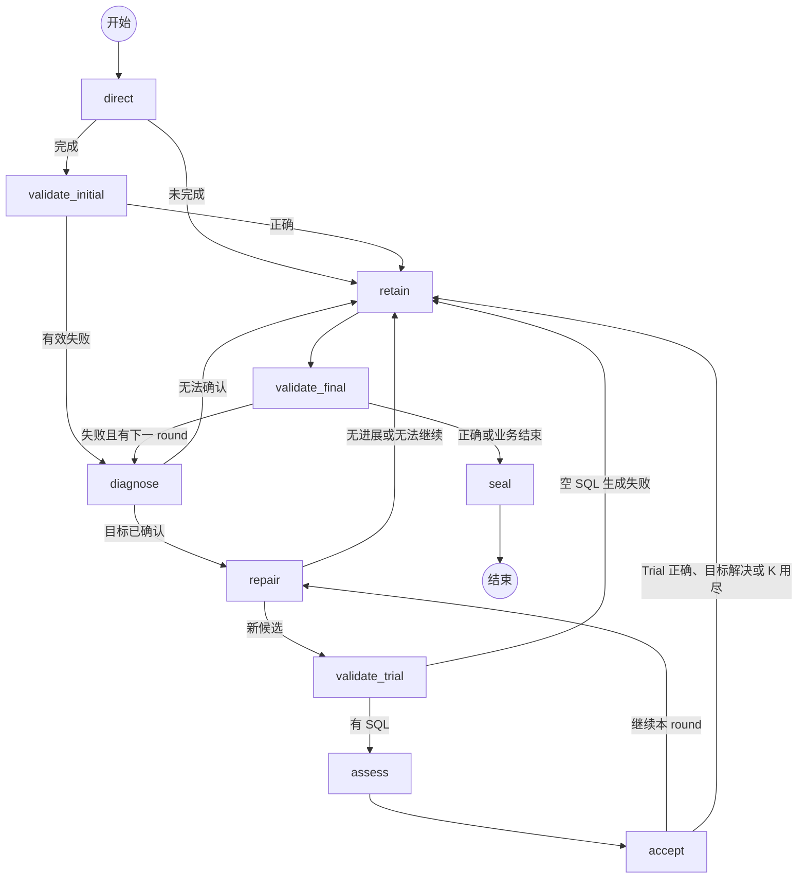

# 单 case LangGraph 抽取设计

本文件是当前唯一的 case 执行设计。流程由 LangGraph 管理，ontology 和证据独立保存；不存在可切换的 Python Controller 备用路径。具体模块和运行方式见 [实施说明](extract-implementation.md)。

## 1. 范围与职责

- 运行层准备数据库物理基础、标准化 QA-SQL、调度独立 case，最后汇总 Incoming 并执行全局 Merge。
- 每个 case 运行同一张同步 LangGraph，拥有独立持久 SQLite checkpointer、thread、ontology 快照和证据目录。
- Direct 与 Repair 复用同一个自主 Learning Agent runtime。Agent 联合处理 Concept、Metric、GenerationRule。
- Diagnosis 与 Assessment 是独立反馈模块，由外层 graph 调用，不是 Learning 可自主跳过的工具。
- ontology、SQL 正确性、接受规则由领域代码保证，框架负责执行位置、路由与阶段恢复。

## 2. 数据所有权

| 数据 | 唯一权威来源 |
| --- | --- |
| 执行位置、W/L/B 引用、目标、notes、当前结果引用 | LangGraph State/checkpoint |
| 某个 revision 的完整内容、schema、内容指纹、JOIN | 不可变 GraphSnapshot |
| 对话、工具、验证、诊断、评审、接受原因 | 不可变 EvidenceStore |
| 已完成节点的可重放结果 | operations 下按输入指纹保存的更新收据 |
| 可供系统集成的最终产物 | 原子封存 bundle |

操作收据只保存已完成节点的输出字段变化，不保存执行位置，也不能被扫描为最新状态。它不是第二套 checkpoint。恢复必须从 LangGraph checkpoint 开始，再按相同节点和输入查找结果；未引用快照和证据不得自动成为 Working 或 accepted。

## 3. 物理准备与输入

配置范围内所有 Table 和 Column 初始化入图。Value 按配置、Gold 分类谓词和 Concept 条件查证后加入，保留真实值、别名和来源，不追求删成最小图。JOIN 拓扑在 case 初始化时冻结。并行 case 从同一运行基础创建各自完整图，不读取其他 case 随后变化的物理 workspace 进行历史验证。

每个 case 输入固定 question/Gold SQL/source_id、配置和数据库快照。Gold 可用于学习和诊断，但验证 SQL generator 不读取 Gold 或 Learning 私有对话。

## 4. 唯一业务图

| 节点 | 输入与动作 | 输出及退出 |
| --- | --- | --- |
| direct | 当前 W、source、notes；自主调查与联合抽取 | 完成覆盖记录后初始 L=W；未完成不保留半成品语义 |
| validate_initial | 确定完整图 | 正确进入收尾，语义失败进入 Diagnosis |
| diagnose | 最近 L 与匹配的失败证据 | round+1，iteration=0，B=L，固定目标和反馈 |
| repair | W/L/B、固定目标、最新反馈、notes | 新合法候选和分组；无法继续结束学习 |
| validate_trial | 确定 W | iteration+1，固定 Trial revision 和验证证据 |
| assess | B、旧 L、Trial、分组、目标、逐 attempt 证据 | 独立评审证据；最多一次格式修复，不写图 |
| accept | 已保存评审及精确版本 | 合格整组构造新 L，保存接受证据 |
| retain | 最近 L 与 checkpoint W/L 的已查证物理事实 | 丢弃暂定语义，保存完整最终图，W=L |
| validate_final | 最终完整图 | 复用精确 gate 或重新验证；正确结束，否则进入下一 round 或 partial |
| seal | 完整最终图与匹配证据 | case 资源先关闭，汇总物理值，再原子封存 |

实验的 skip_direct 只改变 START 的入口，同一张 graph 从 validate_initial 开始；没有另一套抽取/优化 runtime。

## 5. State 与依赖

State 仅保存：case_id/context_id/workflow_version，W/L/B，round/iteration，固定 targets 和 groups，短 notes，最新反馈、Trial/验证/评审/episode/接受引用，计数、紧凑事件和 bundle_ref。没有驱动执行的 phase/done 字段，后续执行位置由 LangGraph 管理。

模型、数据库连接、Runner、文件锁、GraphStore 对象和 EvidenceStore 对象属于本次执行的 CaseRuntime，不进入序列化 State。每个节点开始时，以及命中结果收据后，都依据 State 恢复 W/L，禁止依赖上一节点遗留的内存指针。

当前仅有 working memory：计划、观察和证据引用、假设、未解决问题、失败路径摘要。notes 是辅助信息，不能改变可信执行事实。不存在跨 case 的长期经验发布、向量 memory 或复杂记忆层级。

## 6. Learning episode

Agent 默认看到 source、模式、W/L/B 标识、全部 case semantic 概览、固定目标、最新反馈、notes 和预算。完整物理详情、节点定义、类型契约和历史证据按需读取。

| 工具 | 权限 |
| --- | --- |
| inspect_graph | 节点、依赖、差异、准确 schema/契约；只读分页 |
| inspect_database | 配置范围的 metadata/sample/exact/statistics/只读 SQL；限行、超时、配额 |
| read_evidence | 本 case 不可变证据；分页 |
| edit_graph | 完整语义 create/update/revert；版本检查、单次多节点原子操作 |
| update_notes | 有长度上限的短笔记 |
| handoff | ready 或 unable；不能宣布 stable correct 或跳过外层反馈 |

纯读工具至多四个并行；任何包含写工具的多调用批次在执行前整批拒绝。图的多处修改应放进一次 edit_graph。物理节点不可任意写，已保留节点不可直接删除，类型和身份不可迁移。

Direct 必须明确覆盖三类语义节点，允许某类无产物。自然语言结束不等于 Direct 完成。Repair 可以调查、编辑、更新笔记多次，最后交付；代码控制步骤、时间、调查配额和无进展退出。

每次 episode 使用新的内部 create_agent graph 实例。首版内部不接独立 checkpointer，不恢复到任意工具调用；外层保存 episode 完成边界。完整对话外置，下一次 episode 使用新对话和保留 notes。

## 7. Ontology Mutation Protocol

编辑事实源为完整 NodeAsset，而非派生 GraphSpace。每个 revision 保存完整 authoring assets、JOIN、父版本、schema 和内容指纹。所有版本不可变。

create/update 提交完整节点，revert 恢复 L 版本或撤销相对 L 的暂定新增。一次编辑先构造临时完整图，查证条件 Value，验证类型、引用、Metric 依赖和环、物理落点及整体 schema，再原子保存快照与编辑收据，最后推进 episode 内 W。失败不改变 W。

模型提供的 edit_id 在工具层与随机 episode attempt_id 一起哈希。相同 attempt 的重复操作可识别；未完成 episode 重跑时新 attempt 不会被旧的已丢弃编辑收据阻塞。

## 8. 接受、回退与物理事实

- B 在 round 开始固定，只用于比较。
- L 是最近接受快照，只能由 Direct 完成或 accept 节点推进。
- W 在 episode 内动态变化；Trial 是其确定版本的验证角色，不是另一套可变图。
- accept 仅从 Diff(L_before, Trial) 选择被评审整组的完整定义；不能应用最后一次局部编辑补丁。
- 同目标、重叠成员或对其他暂定内容存在依赖时合组；无法合法投影的子集不提升，不做复杂子集搜索。
- m2 接受、m3 拒绝时回退点仍为 m2，不能恢复到 B=m1。
- retain 保留 L 语义和已查证物理事实；未完成且未进入 checkpoint 的 episode 变化可丢弃，其日志仍可调查。

接受顺序：读取已保存评审 → 检查 B/L/Trial/验证和分组匹配 → 完整新快照 → 接受证据 → 节点结果收据 → 返回新的 L → LangGraph checkpoint。

结果收据之前遗留的证据或快照不是已经完成的接受。收据写完后，即使 checkpoint 失败，重放相同节点输入也会恢复同一个 L_after，不再次评审或 promote。

## 9. 验证与终止

同 case、同 source/data/config/schema/prompt context、相同完整图内容和策略下，correct/incorrect gate 都精确复用；语义失败不得通过反复抽样挑成功。每个新 gate 最多 N 次独立 SQL 再生成，首次失败即止。

Assessment 不因 Trial 正确而省略。筛选后最终图内容不同于 Trial，就需要对应最终图的验证；接受不等于正确。

stable correct 路径：retain → 匹配最终验证 → 资源关闭成功 → 原子 ready/empty bundle。
修复上限路径：retain 最近 L → 最终验证 → 正确则正常完成，否则 partial/empty 并保留原因。达到 K/R 不提升当前 W，不跳过最后验证。

只有 ready semantic fragments 正常集成。全部物理节点不重复塞入 draft_nodes；已查证 Value 增量独立汇总。

## 10. 故障与恢复

持久化 SQLite checkpointer 使用 sync durability；每个 case 有独立 thread 和本地非阻塞 writer 文件锁。同一 case 不允许两个执行者同时推进。检查 source/context/workflow/schema 后才恢复和开启本次有限 infrastructure 重试窗口。

| 故障位置 | 恢复 |
| --- | --- |
| episode 中途 | 恢复节点输入 W/L/notes，允许模型调用重复成本 |
| 节点已完成并写收据、checkpoint 未完成 | 按节点输入指纹复用输出字段变化 |
| 验证服务暂时不可用 | 单次执行有限重试；失败保留 graph 位置，手动 resume 开新有限窗口 |
| 完成的错误 SQL gate | 缓存保留，不因 resume 重新抽样 |
| accept 已写结果收据 | 恢复同一个 accepted revision，不再 promote |
| seal 已完成但 checkpoint 失败 | 核对完整完成签名，复用原 bundle |
| source/schema/data/prompt/config 不匹配 | 作为恢复拒绝返回，不修改证据、进度和 checkpoint |
| 数据或存储损坏、case 资源关闭失败 | 报运行故障；保留 checkpoint，不发布新的 ready bundle |

空 SQL 属于已完成的生成失败，收尾且不进入 Assessment，不误作需恢复的基础设施故障。基础设施异常不伪装为业务终止，不封存不可重试的失败 bundle。外层失败报告从最近 checkpoint 的 L 构造 partial，可供 review；它不是正式完成事实。允许未引用中间产物，不承诺外部调用 exactly-once。

seal 的幂等签名包括 case/context/workflow、最终 revision/完整图指纹、验证/接受引用、状态、终止原因和 Direct 完成依据，不能仅比较图内容。

## 11. 追踪、评测与扩展

LangSmith 保留显式 stage/model/tool 摘要及 case/revision/evidence 关联；框架自动 State/prompt tracing 在业务范围禁用。完整 SQL、对话和图在本地证据。checkpointer 是恢复设施，不是 remote trace。

评测分别覆盖语义质量（SQL 稳定正确、未知 case 泛化、误接受）和执行可靠性（故障重放、预算、资源、并发隔离）。测试不代替真实模型质量实验。

本轮没有增加人工审批、内部工具级持久化、分布式锁、任意旧版本恢复迁移、长期记忆或第二种 runtime。后续确有需求时再独立扩展。
