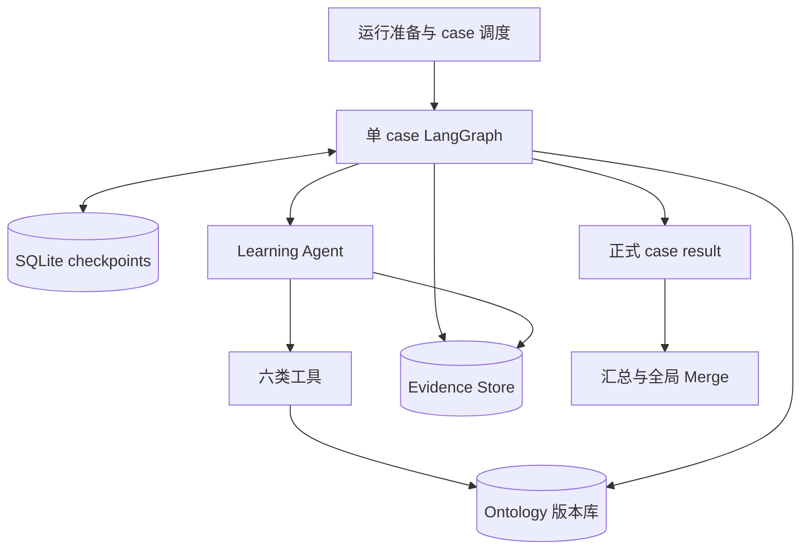
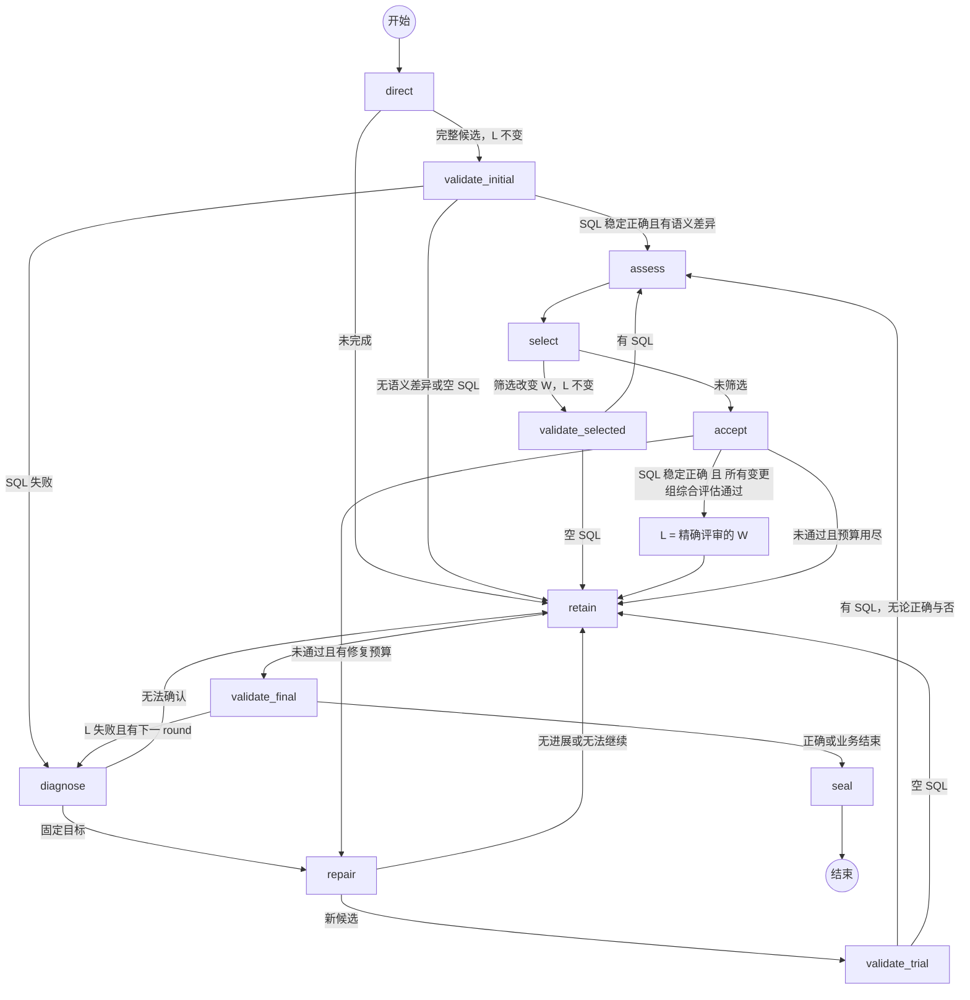

# 单 case LangGraph 抽取设计

本文件是当前唯一的 case 执行设计。流程由 LangGraph 管理，ontology 和证据独立保存；不存在可切换的 Python Controller 备用路径。具体模块和运行方式见 [实施说明](extract-implementation.md)。

## 1. 范围与职责

- 运行层准备数据库物理基础、标准化 QA-SQL、调度独立 case，最后汇总 Incoming 并执行全局 Merge。
- 每个 case 运行同一张同步 LangGraph，拥有独立持久 SQLite checkpointer、thread、ontology 快照和证据目录。
- Direct 与 Repair 复用同一个自主 Learning Agent runtime。Agent 联合处理 Concept、Metric、GenerationRule。
- Diagnosis 与 Assessment 是独立反馈模块，由外层 graph 调用，不是 Learning 可自主跳过的工具。
- ontology、SQL 正确性、接受规则由领域代码保证，框架负责执行位置、路由与阶段恢复。

## 2. 数据所有权

| 数据 | 唯一权威来源 |
| --- | --- |
| 执行位置、W/L/B 引用、目标、notes、当前结果引用 | LangGraph State/checkpoint |
| 某个 revision 的完整内容、schema、内容指纹、JOIN | 不可变 GraphSnapshot |
| 对话、工具、验证、诊断、评审、接受原因 | 不可变 EvidenceStore |
| 已完成节点的可重放结果 | EvidenceStore 内按输入指纹保存的完成节点回执 |
| 可供系统集成的最终产物 | 原子封存 result 目录 |

操作收据只保存已完成节点的输出字段变化，不保存执行位置，也不能被扫描为最新状态。它不是第二套 checkpoint。恢复必须从 LangGraph checkpoint 开始，再按相同节点和输入查找结果；未引用快照和证据不得自动成为 Working 或 accepted。

## 3. 物理准备与输入

配置范围内所有 Table 和 Column 初始化入图。Value 按配置、Gold 分类谓词和 Concept 条件查证后加入，保留真实值、别名和来源，不追求删成最小图。JOIN 拓扑在 case 初始化时冻结。并行 case 从同一运行基础创建各自完整图，不读取其他 case 随后变化的物理 workspace 进行历史验证。

每个 case 输入固定 question/Gold SQL/source_id、配置和数据库快照。Gold 可用于学习和诊断，但验证 SQL generator 不读取 Gold 或 Learning 私有对话。

## 4. 唯一业务图

L 框是 accept 内部的唯一指针更新，不是额外 LangGraph 节点。

| 节点 | 进入时持有的数据与允许动作 | 退出时的数据变化 |
| --- | --- | --- |
| direct | W/L、source、notes；自主调查与联合抽取 | 只更新 W 与相对 L 的分组；完成 handoff 也不推进 L |
| validate_initial | Direct W 或物理初始图 | 固定 Trial=W，取得完整图 SQL 稳定验证证据；正确且有语义差异进入 Assessment |
| diagnose | 与失败证据匹配的完整图（可为暂定 W） | round+1、iteration=0、B=L，固定目标；可更新的旧知识身份从 L 获取 |
| repair | W/L/B、固定目标、最新 Assessment/Diagnosis、notes | 新合法候选和分组；Direct 质量修复可无 Diagnosis target |
| validate_trial | 新 W | iteration+1，固定 Trial 与验证证据 |
| assess | B、L、Trial、分组、目标、匹配 SQL 证据 | 独立逐组评审，不写图 |
| select | 精确匹配的评审与 Trial | 非空合格真子集合法投影到新 W；L 不变，旧证据不授予新图接受资格 |
| validate_selected | 筛选后的 W | 重新取得匹配 SQL 证据，再进入 Assessment；不消耗新的 Learning 修复次数 |
| accept | 当前 W=Trial，SQL 与 Assessment 对应同一完整图 | 仅 SQL stable_correct 且所有变更组综合评估通过 时 L=W；否则 L 不变，保存拒绝记录 |
| retain | 最近 L 和 checkpoint 内已查证物理事实 | W 恢复 L 的语义并保留物理事实；绝不推进 L |
| validate_final | 最近 L | 精确复用或验证 L；未接受语义不能参与最终成功判定 |
| seal | L 与最终证据、接受凭据 | 检查语义有双重通过的匹配接受凭据；关闭资源后汇总物理事实、封存语义导出 |

实验的 skip_direct 只改变 START 的入口，同一张 graph 从 validate_initial 开始；没有另一套抽取/优化 runtime。

## 5. State 与依赖

State 仅保存：case_id/context_id/workflow_version，W/L/B，round/iteration，固定 targets 和 groups，短 notes，最新反馈、Trial/验证/评审/episode/接受引用，计数、紧凑事件和 result_ref。没有驱动执行的 phase/done 字段，后续执行位置由 LangGraph 管理。

模型、数据库连接、Runner、文件锁、GraphStore 对象和 EvidenceStore 对象属于本次执行的 CaseRuntime，不进入序列化 State。每个节点开始时，以及命中结果收据后，都依据 State 恢复 W/L，禁止依赖上一节点遗留的内存指针。

当前仅有 working memory：计划、观察和证据引用、假设、未解决问题、失败路径摘要。notes 是辅助信息，不能改变可信执行事实。不存在跨 case 的长期经验发布、向量 memory 或复杂记忆层级。

## 6. Learning episode

Agent 启动时必定获得 ontology 类型/关系结构、三类职责、完整输出 schema 和精简 Rule registry；这些内容从现有模型与 schema 生成。独立动态 context 提供 source、模式、W/L/B、当前图范围/schema version/节点数量、Gold 相关物理 Table/Column 精确绑定和 joins、全部 case semantic 概览、目标、反馈、notes 和预算。完整节点定义、复杂业务契约、registry 示例及历史证据按具体缺口读取；不要求先枚举图、读 guide 或查询数据库。只有会改变有据节点定义的具体物理事实不确定性才触发数据库调查；Value 入图仍由代码查证。

| 工具 | 权限 |
| --- | --- |
| inspect_graph | 相关节点、依赖、edges、差异及详细契约；准确 schema 启动时已有，工具只读分页 |
| inspect_database | 配置范围的 metadata/sample/exact/statistics/只读 SQL；限行、超时、配额 |
| read_evidence | 本 case 不可变证据；分页 |
| edit_graph | 顶层 edit_id/expected_revision/upserts/revert_ids/proposed_groups；代码生成 create/update/revert，版本检查与多节点原子操作 |
| update_notes | 有长度上限的短笔记 |
| handoff | ready 或 unable；不能宣布 stable correct 或跳过外层反馈 |

纯读工具至多四个并行；任何包含写工具的多调用批次在执行前整批拒绝。相依节点可放进一次 edit_graph 原子修改；独立修改可串行调用。物理节点不可任意写，已保留节点不可直接删除，类型和身份不可迁移。

Direct 必须明确覆盖三类语义节点，允许某类无产物。自然语言结束不等于 Direct 完成。Repair 可以调查、编辑、更新笔记多次，最后交付；代码控制步骤、时间、调查配额和无进展退出。

每次 episode 使用新的内部 create_agent graph 实例。首版内部不接独立 checkpointer，不恢复到任意工具调用；外层保存 episode 完成边界。完整对话外置，下一次 episode 使用新对话和保留 notes。

## 7. Ontology Mutation Protocol

编辑事实源为完整 NodeAsset，而非派生 GraphSpace。每个 revision 保存完整 authoring assets、JOIN、父版本、schema 和内容指纹。所有版本不可变。

create/update 提交完整节点，revert 恢复 L 版本或撤销相对 L 的暂定新增。一次编辑先构造临时完整图，查证条件 Value，验证类型、引用、Metric 依赖和环、物理落点及整体 schema，再原子保存快照，最后推进 episode 内 W，并在 session 内记下编辑收据。失败不改变 W。

模型提供的 edit_id 仅在当前 LearningSession 内去重，收据记录请求指纹和生成版本。相同 ID 不允许对应不同请求；重复请求只确认仍在当前版本祖先链上的结果，不能恢复已丢弃的修改。收据不写磁盘，未完成 episode 重跑时使用新的空 session；完整版本仍保存在 ontology 目录。

## 8. 接受、回退与物理事实

- B 在 round 开始固定，只用于比较。
- L 是最近接受快照，Direct 与 Repair 仅由 accept 节点按同一条件推进。
- W 在 episode 内动态变化；Trial 是其确定版本的验证角色，不是另一套可变图。
- select 从 Diff(L_before, Trial) 构造候选真子集；accept 只能接受经过 SQL 稳定验证和 Assessment 的整个当前候选，不能拼接旧证据或应用局部补丁。
- 同目标、重叠成员或对其他暂定内容存在依赖时合组；无法合法投影的子集不提升，不做复杂子集搜索。
- m2 接受、m3 拒绝时回退点仍为 m2，不能恢复到 B=m1。
- retain 保留 L 语义和已查证物理事实；未完成且未进入 checkpoint 的 episode 变化可丢弃，其日志仍可调查。

接受条件：完整图 schema/引用合法 ∧ 同 case/context/完整图内容的 SQL stable_correct ∧ 所有差异分组依据独立评估结果计算通过。targets resolved 不替代这两个 gate。

接受顺序：读取已保存评审 → 检查 B/L/Trial/验证/目标和分组匹配 → 两个 gate 同时通过 → 接受证据 → 节点结果收据 → 返回新的 L → LangGraph checkpoint。筛选只产生新 W，重验、重评后才允许进入此顺序。

结果收据之前遗留的证据或快照不是已经完成的接受。收据写完后，即使 checkpoint 失败，重放相同节点输入也会恢复同一个 L_after，不再次评审或推进 L。

## 9. 验证与终止

同 case、同 source/data/config/schema/prompt context、相同完整图内容和策略下，correct/incorrect gate 都精确复用；语义失败不得通过反复抽样挑成功。每个新 gate 最多 N 次独立 SQL 再生成，首次失败即止。

Direct 和 Repair 的任何新语义接受均不可省略 Assessment。SQL 失败但组 acceptable、SQL 正确但组 revise/reject/inconclusive 都不能推进 L。有预算则把匹配的原始反馈交给 Learning 继续修复；SQL 正确但 Direct 质量不足也走同一个 repair 节点，不必先制造 Diagnosis 目标。

筛选仅保留有效合组后的合格真子集，不做组合搜索；依赖不闭合则不筛选，保持 W 并交给 Learning。筛选改变完整图后必须重取 SQL 和 Assessment；相同 case/context/内容的已有 SQL gate 可以精确复用，旧大图证据不可套用。连续筛选严格减少相对 L 的暂定差异，不能无限循环。最新反馈包含当前紧凑 SQL 证据；发生筛选时只保留一条原评审引用，供 Learning 按需查回被删候选的修改原因，不复制 round 历史。

stable correct 路径：候选通过双 gate → L=W → retain → 匹配 L 的最终 SQL 验证 → 原子 ready/empty result。
修复上限路径：允许完成当前筛选候选的双 gate 验证，但不额外启动 Learning episode；未通过则保留原 L、丢弃暂定语义 → 验证 L → 正确则完成，否则 partial/empty。K/R 上限绝不降低接受门槛。

所有 Table/Column 和已查证 Value 是确定性物理事实，不按语义评审接受。retain 可以使 W 比 L 多出未被使用的物理事实，L 与其完整图证据保持原样；后续候选若携带这些事实则按新完整图验证。正式语义导出及最终 SQL 只读取 L，物理增量单独汇总，不以物理保留偷偷推进 L。

只有 ready semantic fragments 正常集成。全部物理节点不重复塞入正式语义导出；已查证 Value 增量独立汇总。

## 10. 故障与恢复

持久化 SQLite checkpointer 使用 sync durability；每个 case 有独立 thread 和本地非阻塞 writer 文件锁。同一 case 不允许两个执行者同时推进。检查 source/context/workflow/schema 后才恢复和开启本次有限 infrastructure 重试窗口。

| 故障位置 | 恢复 |
| --- | --- |
| episode 中途 | 恢复节点输入 W/L/notes，允许模型调用重复成本 |
| 节点已完成并写收据、checkpoint 未完成 | 按节点输入指纹复用输出字段变化 |
| 验证服务暂时不可用 | 单次执行有限重试；失败保留 graph 位置，手动 resume 开新有限窗口 |
| 完成的错误 SQL gate | 缓存保留，不因 resume 重新抽样 |
| accept 已写结果收据 | 恢复同一个 accepted revision，不再推进 L |
| seal 已完成但 checkpoint 失败 | 核对完整完成签名，复用原 result |
| source/schema/data/prompt/config 不匹配 | 作为恢复拒绝返回，不修改证据和 checkpoint |
| 数据或存储损坏、case 资源关闭失败 | 报运行故障；保留 checkpoint，不发布新的 ready result |

空 SQL 属于已完成的生成失败，收尾且不进入 Assessment，不误作需恢复的基础设施故障。基础设施异常不伪装为业务终止，不封存不可重试的失败 result。外层失败报告从最近 checkpoint 的 L 构造 partial，可供 review；它不是正式完成事实。允许未引用中间产物，不承诺外部调用 exactly-once。

seal 的幂等签名包括 case/context/workflow、最终 revision/完整图指纹、验证/接受引用、状态、终止原因和 Direct 完成依据，不能仅比较图内容。

## 11. 追踪、评测与扩展

LangSmith 使用原生 StateGraph、Agent、model/tool tracing，展示 State、实际 prompt/response 和工具输入输出；业务 stage 另外展开版本与验证、Diagnosis、Assessment、接受证据，并记录 case/revision/evidence 关联和调用统计。SDK client 在上传边界过滤凭据，保留业务内容；本地快照与证据仍是恢复事实源，checkpoint 只维护执行位置。详见 extract-implementation.md 第 10 节。

评测分别覆盖语义质量（SQL 稳定正确、未知 case 泛化、误接受）和执行可靠性（故障重放、预算、资源、并发隔离）。测试不代替真实模型质量实验。

本轮没有增加人工审批、内部工具级持久化、分布式锁、任意旧版本恢复迁移、长期记忆或第二种 runtime。后续确有需求时再独立扩展。

## 12. 最小存储约定

每个 case 只保留 case.json、checkpoints.sqlite、ontology/、evidence/、result/ 和 writer 锁。result/result.json 保存紧凑元数据，result/ontology.json 是唯一正式语义资产导出；完整图版本用于接受、回退与验证，不能用语义导出替代。

完成节点回执与验证索引归入 evidence，不建立第二套状态目录。episode 编辑收据只驻留内存。故障报告的 result_path/ontology_path 为空，恢复仍使用 checkpoint 和完整图版本。此轮不引入自动清理策略，以免把恢复所需版本或证据误删。

### Assessment 的独立维度（2026-10-24）

此处的“评估通过”由控制器计算，不是模型直接返回 acceptable verdict。模型按 unit 返回标量 quality、application 和 feedback，按 target 返回汇总 status 和 feedback，并分别记录 regressions 和 coupled_unit_ids。检索、选择和依赖引入是代码从每次验证记录和已保存依赖关系计算的输入事实，不允许模型覆盖。相关错误的解决不能替代质量判断，SQL 整体失败也不能直接否定局部应用或目标解决。

控制器校验单位/目标覆盖、逐次上下文事实与归因，要求候选质量有效、各次完整应用（删除则评估移除安全性）、无待处理修复或相关回归，并遵守变更组和耦合约束。目标未解决仍会阻止最终接受。所有变化还必须通过同图版本的 SQL 稳定验证；筛选改变图后重取两类匹配证据。旧 accepted 快照保持回退依据。

Assessment 对同一候选的内容质量只评一次，应用和目标解决检查所有验证后各给一个汇总结论；任一次存在问题就不能汇总通过。所有具体缺口统一写入 feedback（kind/location/gap/required_change/preserve），相同问题合并，不同问题分别列出；不输出逐次分析、evidence、defects 或 exceptions。完整 SQL 与执行证据继续保存，回归保留 prior_evidence_ref 用于核验。

### Metric 原子性与 Direct/Repair Rule 边界（当前约束）

Metric 表达 NLQ 中需要计算才能实现、不能再拆成“查询操作＋已有完整 Concept/Metric”的最小语义单元。它不是所有 SQL 计算结果的统称，也不按运算符数量拆分。共同定义同一业务量的多步公式保留；对完整量执行当前请求的 AVG/COUNT/排序/筛选不因此产生组合 Metric。差值可以是 Metric，差值的当前群体平均值由查询操作承担。定义共用 asset_contract.METRIC_ATOMICITY，由类型指南、详细 contract 和 Assessment 同步引用。

Direct 的 operation registry 和 taxonomy 不包含 joinability；普通单跳或仅沿现有边展开的多跳连接，复用抽取前的 joins_with 事实。写入端拒绝 Direct 的 joinability Rule。Repair 保留连接决策能力，用于真实错误支持的键/路径选择、桥表语义或粒度约束；不硬编码禁止所有连接知识。Registry 增加 population_average_comparison，表达对完整量计算同群体均值后比较，不建立 average helper Metric，并允许等价 CTE/window 实现。

实际错误驱动的纠错 Rule 与正确绑定 Concept 可以共存：Concept 保存语义绑定；Rule 保存实际错误所证明的错误替代、正确选择和适用条件。DOCType 被误用为 DOC 的错误可产生纠错 Rule，不因两个节点引用相同 Concept/Column 就删除；条件不应绑定“同时输出学校名称”等无关细节，也不将所有 DOC type 措辞都推广为编码请求。Direct 不预先制造这种纠错 Rule。

References 仅保存定义直接且共同需要的依赖。Rule 优先引用完整语义操作对象，只有自己承担独立物理选择时才另引 Column/Table；不展开所有可达依赖，也不为扩大检索添加引用。Concept 的 Column+Value 完整谓词和 Metric 的公式物理依赖不做机械传递裁边。GraphManager 的 refs 默认边、显式覆盖、版本与冲突检查不变。

Assessment quality 增加原子性、重复事实、case 特例和依赖必要性检查，同时明确保留实际错误支持的纠错 Rule。SQL 正确或 applied 不证明内容设计合理。语义边界由指南与独立评估判断，不按 AVG/SUM 关键字硬编码拒绝；控制器继续要求同版本 SQL 稳定验证和 Assessment 通过。领域合同升至 v28；既有 prompt/guide/registry 指纹拒绝混用旧 checkpoint，不增加新状态或另一套实现。

真实验证补充：历史验证曾使用 bracket quoting；当前 SQL 表达式统一采用方言序列化，仅保留必要标识符引号。含空格列名需要引用，避免模型在 JSON 参数中重复转义双引号；不做宽松 JSON 修复，也不增加重试。Repair 对已确认的投影绑定目标优先使用 Gold bindings 与精确 Column 查询，不重新扫描整表或重跑 Diagnosis；context.budget 显示 repeated_read_decisions_left，沿用三次停滞上限。通用 same-population Rule 不把本 case 的类别 Concept 作为永久依赖，除非自身条件确实限定该类别。

本轮验证：466 项全量测试通过。旧真实图重评明确拒绝 metric.average_enrollment_difference 与普通 join Rule，保留实际错误驱动的 DOC Rule。新 california-28 经 Direct → 三个实际绑定错误的 Diagnosis → 一次 Repair → SQL 连续三次正确 → Assessment 五个单元 valid/applied、三个目标 resolved → 接受和封存。历史语义产物为 1 Concept、1 Metric、3 Rule；后来核查确认其中缺少明确命名的输入和输出 Concept，不能用纠错 Rule 代替绑定知识。该产物不作为完整抽取的验收基准。新图无 average helper Metric 或普通 join Rule，同群体比较 Rule 仅引用差值 Metric；最终 SQL 使用等价 CTE。新过程有一次非法 JSON 批次被既有校验拒绝并由模型改正，没有发布非法图版本。接受快照、验证指纹与评审修订匹配。产物见 workspace/atomic_extraction_live_20261024/verified/，仅完成 case 封存，未执行全局 Graph Merge。

### Rule、原始 metadata 与 Concept 表达式（当前规范）

Generation Rule 表达一个原子的 SQL 生成决策。可独立成立的操作意图分开；共同完成不可分割决策的多个操作保留。当前请求值、无关输出与固定行为分离，只有决策自身需要的固定事实才持久化。Registry 匹配只说明允许抽取，不要求逐 SQL 操作生成 Rule。Direct 不能假设发生过错误；Repair 根据真实错误学习纠错行为。Concept、Metric 定义与纠错行为各司其职。规则原子性与 metadata 支持同时进入现有 Assessment quality，不增加状态或新的评估协议。

`database.description_path` 是可选外部 CSV metadata 目录，对 SQLite/MySQL 配置均可使用，并按配置文件路径规则解析。复用现有 DatabaseDescriptionLoader，在构建物理 catalog 时按真实表/列名匹配规范节点。数据库 comment 保留在 Column description，外部 business_name/description/data_format/value_description 保存在 Column source_metadata，按来源区分，不覆盖 comment。不存在 metadata 时正常运行；已配置但目录不可读时失败，不静默忽略。冻结的 prepared catalog 使用自身已有 metadata。

启动输入只包含 Gold 实际涉及的字段及其来源释义，简短描述最多 400 字符，截断时明确提示通过现有 inspect_graph 节点读取完整内容。长值编码说明只在节点读取时披露。Assessment 的相关 physical_context 复用同一物理节点 metadata，不把整个数据库目录注入。业务描述必须受证据支持；缺少释义或来源冲突时按需读取，不猜测缩写。Aliases 不属于本次改造范围。

Concept target 的 sql_expression 是完整的源内物理绑定 SQL 表达式，不是完整查询、图 ID 或模板 token。字段使用真实 table.column；类别使用完整谓词；允许有证据支持的局部表示转换。references 精确列出所用物理节点 ID。复用现有语义绑定解析与验证路径，均以 SELECT 投影表达式解析；规范化按连接器的数据库方言序列化，序列化保留字段拼写、必要引用和字面量内容，删除多余标识符引号；不引入新的表达式语言或第二套实现。Metric plan 的 <table.column> 仍只是计划文本标记。

本版真实验证记录：workspace/rule_metadata_live_20261024/complete/。最终 california-28 Direct 提交 5 Concept、1 Metric、1 Rule，SQL 三次正确，Assessment 全部通过，accepted 与 seal 的版本/指纹匹配。DOC 原始 metadata 已同时进入 Learning 和 Assessment，描述及 SQL 绑定正确；未执行全局合并。本次最终运行没有触发 Repair；此前实际 DOC 错误验证过 Concept 与纠错 Rule 共存。仍存在模型质量局限：比较 Rule 固定了当前类别，Assessment 未报告；另有两次非法工具 JSON 被拒绝并由模型修正。此记录不作为抽取语义全面正确或工具首调全成功的证明。全量 479 项测试通过。

### Assessment 输入压缩（v4）

完整图快照与执行证据仍保存在既有 evidence 存储，压缩只发生在 assessment_inputs / assessment_views 的模型输入投影。refs 和全部相关自动边仍同时提供，不做关系去重；当前边、历史边及变更边统一为 id/type/from/to/可选 properties，保留稳定 ID 与有语义的属性。关系定义仅保留 type 与 description，不注入写入权限、字段 schema 或管理规则。

每个 unit 的 context_facts 将内容相同的检索/选择/上下文包含事实合并，通过 attempt_ids 标注适用验证。输入必须恰好覆盖所有 attempt，重复、缺失、未知或空分组被拒绝。任一验证缺少实际包含证据都不能声明全部 applied。显式 absence 仍覆盖 selected 或依赖引入；不改变输出协议、group/coupling、SQL 稳定门槛或接受逻辑。Repair 使用同一分组事实，不保留旧协议分支。policy v4 与 prompt 指纹拒绝旧 checkpoint 混用。

保留每次完整 SQL；执行成功且结果相等时只提供 execution_ok/result_equal，不重复 Gold/预测结果样例。失败保留现有 reason 与可用结果差异；执行状态无法确定时用 null，不推断成失败或成功。字段采用明确白名单，避免新增内部字段自动泄漏。完整结果仍可从证据文件核验。

物理输入仅提供相关节点的名称、类型、必要约束与原始业务释义。只有相关 Value/类别谓词的 owner Column 才携带完整值编码说明；无可靠结构的原文不做猜测性截句。语义节点定义不截断，仅去掉空展示字段与 sources；新增单元不重复传 accepted_before:null，删除单元保留 candidate:null。Aliases 只在输入中省略空数组，不改变图内内容或策略。System 中 response schema 本轮不变。

v4 验证记录（2026-10-25）：全量 487 项测试通过。对同一历史图与三次验证证据重新投影，紧凑 JSON 从 19,741 字符降至 13,442（减少 31.9%），14 条边全部保留。新 california-28 实际 User Message 为 16,007 字符，含 9 个评估单元（7 节点、2 显式边）、17 条紧凑边；每个单元以一个 context_facts 分组覆盖三次验证。SQL 三次正确、Assessment 九个单元全部通过，v4 接受记录与封存版本一致；未执行全局合并。本轮 Direct 已通过，没有触发 Repair。完整输入和输出见 workspace/assessment_compact_live_20261025/actual-assessment-user.json 与 actual-assessment-feedback.json；完整执行证据仍在 case evidence 目录。
