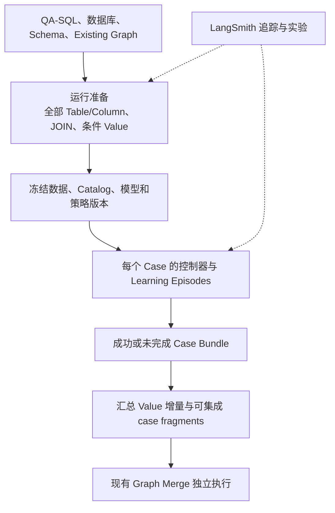
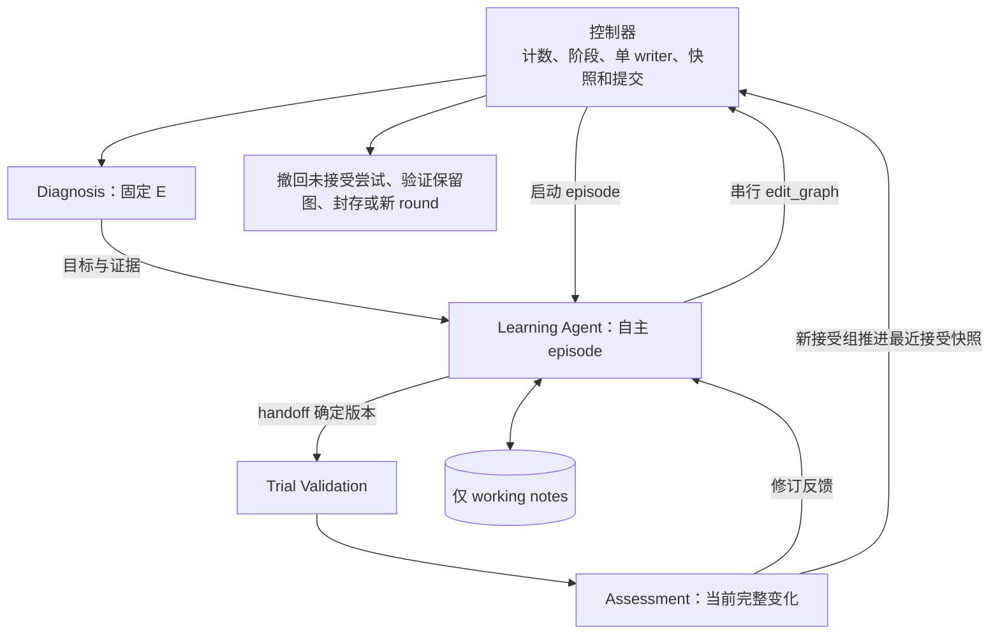
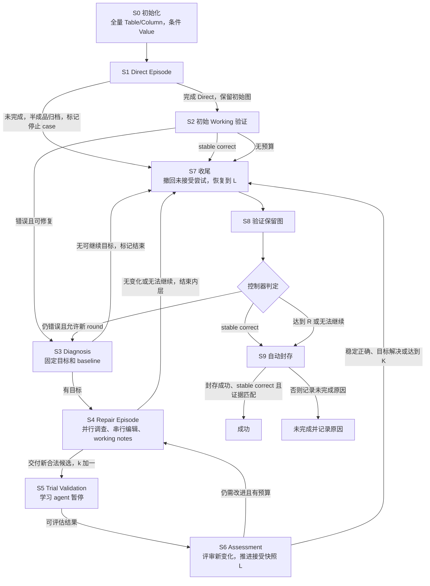
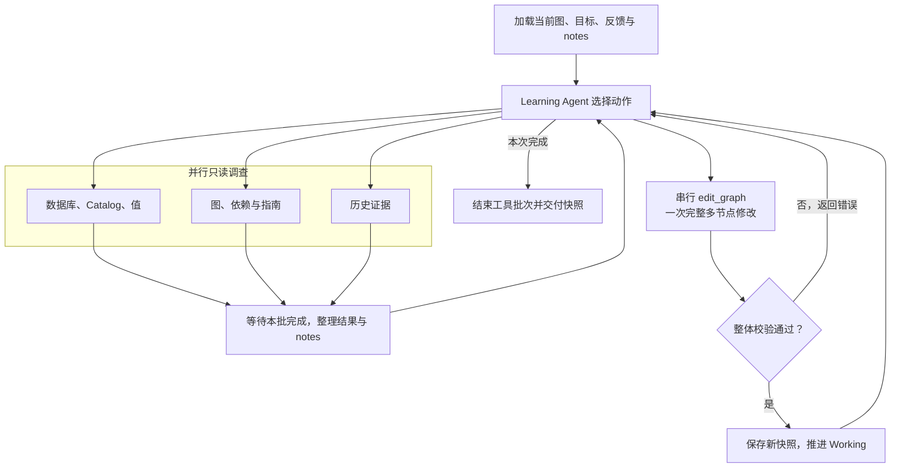
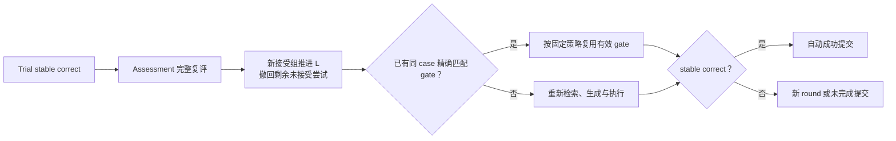
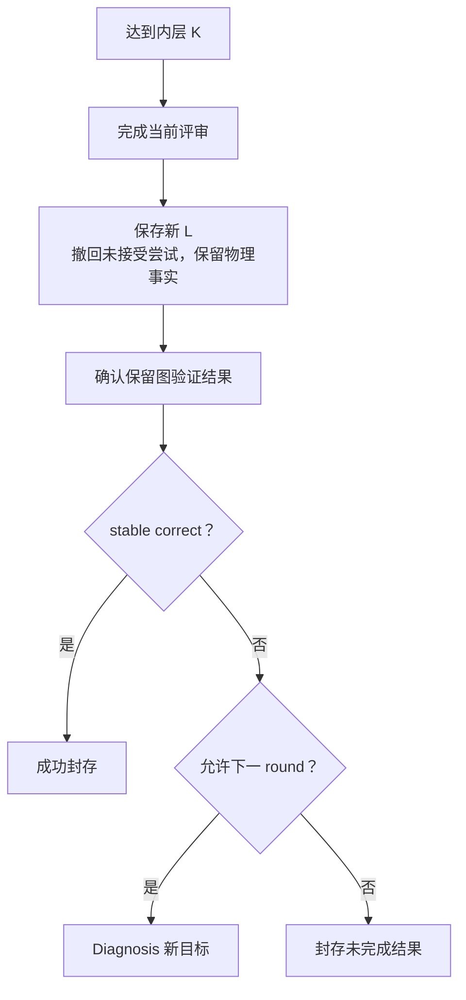

# Extract Pipeline 与单 Case Agent Loop 设计

状态：首版已接入默认训练路径。本文保留职责与状态机设计；模块、接口、持久化格式和验证范围见 [实施设计](extract-implementation.md)。

更新日期：2026 年 10 月 22 日。

单个 case 使用统一 Ontology Learning Agent 进行直接抽取与错误驱动修复；Diagnosis 确定本轮目标，Assessment 提供独立反馈，控制器负责验证、筛选和提交。Learning Agent 在一次修复 episode 内使用 working memory、自主调查，并串行应用跨节点修改。

首版采用单 writer、并行只读调查和简单完整快照。目标数据库的全部 Table 和 Column 初始化入图且不由 agent 删除；Value 按现有条件纳入，并预留后续按需查证纳入能力。只保留 case 内 working memory，不建设长期经验系统。

## 1 设计范围与简化边界

### 1.1 已明确的设计基线

1. 同一个 Learning Agent 联合理解 Metric、Concept、Generation Rule 及其关系，不再按节点类型划分独立学习决策者。
2. 主状态机保持简洁。agent 的自主性位于 episode 内：观察、计划、查询、跨节点修改以及根据反馈调整方案。
3. Diagnosis 是独立模块，Assessment 是独立评审者。二者不能直接写 Working，也不能互相替代。
4. Working 是动态工作图，round 内可以多次变化。Trial 是不可变验证快照。
5. 所有写图动作经过一个入口串行应用。可以并行调查，但不允许后台工具无序写图。
6. 每次成功编辑保存合法完整快照；失败不改变当前 Working。首版不需要节点版本树或增量存储引擎。
7. 接受反馈绑定明确快照。每次 Assessment 审查本轮变化与当前暂定变化，合格组推进最近接受快照；不建设细粒度依赖失效系统。
8. baseline 只用于比较，最近接受快照用于回退。不同独立组可以部分接受；关联组整体处理，未接受的新尝试不撤销已有接受结果。
9. 所有 Table 和 Column 在初始化时进入 graph。Value 不全量枚举，沿用条件纳入，并可后续扩展按需查证。
10. graph 全量包含表列，不意味着 prompt 全量展开物理节点。默认提供本 case 的全部 semantic nodes 总览，详情按需读取。
11. 只保留 working memory。历史日志和验证证据可保存供读取，但不提炼、发布或检索跨 case 长期经验。
12. 控制器在 stable correct 或修复上限等条件下自动收尾提交。成功证据必须对应最终保留图。

### 1.2 首版主动省去的机制

| 不进入首版的机制 | 简单替代 |
| --- | --- |
| 并行写事务、read/write set 合并、自动 rebase、lease | 并行调查，单入口串行写；过期版本拒绝 |
| 独立 draft 事务、临时 ID、复杂编辑分支 | 一次 edit_graph 提交完整关联修改，使用规范 ID |
| 节点依赖指纹与增量接受失效传播 | 接受结果绑定快照，完整评审新变化，保留已有接受快照 |
| 最大可接受子集求解、字段级筛选 | 小型变更组整组处理；有依赖则合组 |
| 物理图最小化和路由裁剪 | Table/Column 固定保留，已查证 Value 在 case 内先保留 |
| 任意工具执行点恢复、外部调用精确一次 | 从最近完整安全点重启未完成 episode |
| 独立预算服务、精确 token 预留账本 | 本地计数、有限并发批次、固定收尾余量 |
| 多层 memory 与长期经验发布 | runtime 消息记录加一份 working notes |

这些约束保留学习自主权，收缩执行系统的通用性。首版不开放已保留节点删除、合并拆分和身份迁移；能力不足时明确报告，不暗中扩大 update 的语义。

### 1.3 与论文的对应关系

参考本地论文 [Extraction 章节](/Users/yichendezaizai/SIGMOD_AutoOnto/secs/04-Extraction.tex)。保留直接抽取、Diagnosis 外层、固定目标的内层修复、Assessment 和轮末保留知识的结构。

论文中的 W 是 retained graph，C 是内层 candidate graph。本文用动态 Working 表示当前正在学习和测试的图，用最近接受快照 L 表示已保留知识，用 round baseline 作比较依据，不再维护另一套可独立编辑的 Candidate Graph。

论文中的执行匹配扩展为 stable correct gate。episode 工具循环和 working memory 属于工程设计；它们不改变本轮 Diagnosis 目标固定的原则。

## 2 职责与控制边界

| 角色 | 输入 | 任务与输出 | 边界 |
| --- | --- | --- | --- |
| Learning Agent | source、当前图、固定目标、最新反馈、working notes | 调查并提出完整的多节点修改，交付一个待验证版本 | 不修改接受结论、预算或成功状态 |
| Error Diagnosis | 保留图对应的失败 SQL、执行结果、Gold | 通过修复、执行与消融形成目标和修正要求 | 不直接写图，不固定节点类型 owner |
| Assessment Agent | baseline、最近接受快照、当前变化、固定目标、Trial 证据 | 逐项反馈并判断哪些新变化可接受 | 首版做结构化评审，不另建自主工具循环 |
| Validation | 确定快照、问题、数据库与固定配置 | 检索、生成 SQL、执行比较和稳定性结果 | 不能将 agent 自述作为证据 |
| Case Controller | 工具结果、反馈、计数与图快照 | 调度、串行写入、筛选、checkpoint 和封存 | 不自行生成业务语义 |

图编辑工具执行代码契约，不代表控制器再进行一次语义审批。模型语义判断仍可能出错；首版用独立评审、必要分组和最终验证降低风险，不追求自动证明任意图组合绝对正确。

## 3 运行准备与物理图

### 3.1 Pipeline 边界



### 3.2 初始化 Table 和 Column

运行级代码校验输入与唯一 source_id，保存原始及规范化 QA-SQL；扫描目标数据库，创建全部 Table、Column 及其规范关系。数据库访问范围在运行前确定，不由 agent 临时扩大。

每个 case 的逻辑图都能访问完整 Table/Column。实现可共享只读基础快照，无须为每个 case 复制数据库目录。agent 不能删除表列节点、修改其物理身份，或改写数据库声明事实。

Catalog 保存元数据和查证入口；Working 已包含全部表列；prompt 只展开当前需要的信息。表列引用找不到时，应区分真实不存在、引用解析错误和初始化不完整；后两者是系统问题，不能让 agent 创建虚构表列。

### 3.3 Value 的条件纳入

首版沿用当前设计的条件和校验：

| 来源 | 处理 |
| --- | --- |
| 配置指定的维度列 | 按配置读取 distinct values、过滤和去重，不扩展到所有数据库值 |
| Gold SQL 分类谓词 | 提取字面量并查证实际值；保留数据库和 case 来源 |
| 抽取出的 Concept 表达式 | 沿用已有语义值物化与数据库查证规则 |
| 后续按需扩展 | agent 调查后请求查证和纳入具体值，复用同一验证服务 |

普通数值阈值不自动成为 Value，通配符 LIKE 表示模式而非具体存储值。匹配失败或不唯一必须返回明确结果，不能由模型补造事实。

按需纳入作为后续扩展，首版先完整复用现有条件物化。扩展启用时，由 inspect_database 查证具体列和值，返回规范值及证据引用，再经 edit_graph 请求纳入；不新增主状态或独立物理 agent，不接受未经查证的自由 Value 定义。

已查证并纳入的 Value 在本 case 内先保留，不随语义候选拒绝而裁剪。它只表示物理值存在，不表示相关 Concept 或 Rule 被接受。这样不需要物理最小图或路由清理协议。

### 3.4 JOIN 与运行上下文

保留数据库外键、启发式 JOIN 和 Gold JOIN 的来源区别。建议继续在运行前准备 JOIN，再冻结 case 的基础拓扑；首版不开放自由物理拓扑重构。

RunContext 固定输入、数据、Catalog、ontology schema、模型、prompt/类型指南与策略版本，不再包含长期 memory 版本。schema hash 不能证明数据库数据未变，实验优先使用固定数据副本。

## 4 Case Round 与 Episode

| 层次 | 单位 | 控制方式 |
| --- | --- | --- |
| Case | 一个训练 case | 控制器初始化、调度和封存 |
| Round | 一组固定 Diagnosis 目标 E_r | 最多 K 次候选版本验证 |
| Repair Episode | 一次完整调查和修改方案 | agent 内部自主工具循环 |
| 工具批次 | 多个独立只读调用，或一次写入 | 批次完成后再推进图版本 |

R 是最大 Diagnosis rounds，K 是每轮候选验证次数，N 是一次 gate 的连续正确次数。episode 可以有多次内部编辑，但交付合法版本进入 Trial 才增加 k。内部无进展或结构错误由总调用和耗时预算约束。



图中的验证和 Assessment 由控制器调用；agent 不需要主动调用它们，也不能替换活动目标。

## 5 Working 快照与接受依据

| 对象 | 内容 |
| --- | --- |
| Working revision | 当前完整合法图的快照及唯一当前指针 |
| Round baseline B_r | 本轮开始时保留图的历史快照；只用于累计变化比较和审计，不是日常回退点 |
| 最近接受快照 L | 基础保留图，加上完成的初始直接抽取和之后已接受的改进；控制器维护一个快照引用作为恢复点 |
| 本轮 Diff | 当前 Working 相对 B_r 的累计变化，供目标和整体影响分析 |
| 暂定 Diff | 当前 Working 相对 L 的尚未接受变化，供本次接受或撤回 |
| Trial | 指向确定图内容、数据和配置的不可变验证快照 |
| Assessment | 对该 Trial 下变化的评审，以及相对评审前 L 的新接受组 |
| Working notes | agent 当前计划、观察、假设与问题；不是可信图状态 |

每次成功编辑保存完整图快照；相同只读表列基础可共享。首版不建设节点版本树、依赖指纹和分支系统。

接受结论绑定 graph_revision/Trial：m2 被接受后保存进 L，不意味着后来修改出的 m3 自动被接受；但 m3 被拒绝也不会擦除 L 中的 m2。每次 Assessment 检查当前图及变化，只有新接受的完整组才能替换 L 中的对应内容。

首版只增加一个 accepted_revision 引用。L 与 Working 共用不可变快照存储，不维护第二套可独立编辑的图、逐节点历史栈或版本拼接系统。baseline 在 round 内固定，L 可以随接受推进，Working 继续承载暂定探索。

最低不变量：

1. Working 可以动态变化，但只有一个写入入口。
2. 应用后的图结构合法；失败不推进当前指针。
3. Table/Column 固定保留，Value 来自查证，semantic 内容由 agent 提议。
4. Trial 不可变，成功证据属于明确图快照。
5. 本轮目标固定，agent 不修改评审和运行事实。
6. 关联变更组共同接受或撤回；拒绝新版本只回到 L，不回到更早的 baseline 丢掉已接受改进。
7. 最终提交图与成功证据一致。

## 6 单 Case 主状态机



### 6.1 状态与数据变化

| 状态 | 进入条件和数据 | 动作与数据变化 | 退出 |
| --- | --- | --- | --- |
| S0 初始化 | source、基础图、配置就绪 | 控制器建立 case、初始 W 和基础保留点 L、计数 | 合法进入 S1 |
| S1 Direct | 初始抽取尚未完成，E 和反馈为空 | agent 调查并串行编辑；正常完成且覆盖记录齐备才直接保留到 L | 完成进入 S2；中断则归档尝试并 S7 |
| S2 初始验证 | 初始图完整 | 冻结并验证，保存结果与安全点 | stable 收尾；错误且有预算进入 S3 |
| S3 Diagnosis | L 对应的保留图及失败证据、新 round 预算 | 从当前保留图建立 baseline，固定 E、重置 k；不丢弃 L 的内容 | 有目标进入 S4，否则收尾并停止 case |
| S4 Episode | 当前 W、L、E、最新反馈和 notes | 并行调查、串行编辑；W 变化，L 不因暂定修改变化 | 有新合法候选且有额度进入 S5；无变化或无法继续则 S7 |
| S5 Trial | 当前工具批次结束，交付版本固定 | 暂停学习工具；检索、生成和执行 | 可评估进入 S6；故障恢复或受控收尾 |
| S6 Assessment | 当前图、baseline、评审前 L、变化、E 和 Trial | 记录结论；把新接受组应用到旧 L，校验并保存新 L；没有接受组则 L 保持 | 保存接受安全点后，继续 S4 或进入 S7 |
| S7 筛选 | round 结束或 case 需要停止，L 已明确 | 撤回 W 中未接受尝试，以 L 为语义结果，保留已查证物理事实 | 保存保留图，进入 S8 |
| S8 保留图验证 | 保留图已合法，可能不同于 Trial | 匹配该图证据或重新验证；不因验证失败擦除 L 的接受改进 | stable 或不能继续则 S9，否则新 S3 |
| S9 封存 | 终止原因和当前保留图明确 | 原子保存 bundle 与完成记录 | 成功或未完成终态 |

### 6.2 初始直接保留

同一个 agent 联合抽取 Metric、Concept、Rule 及关系。类型检查覆盖允许为空，但不能跳过记录。Rule taxonomy 通过 inspect_graph 的指南查询读取。

S0 的 L 只是基础保留点，不标成 direct_extraction。Direct 正常完成、Metric/Concept/Rule 三类覆盖记录齐备（可明确无产物）且图合法，才记录 direct_extraction 依据并推进 L，不要求初始 Assessment。初始通道只开放一次；后续新增和修订进入修复流程。初始收尾不因缺少 Assessment 删除已完成的直接抽取内容，首个 round 的 baseline 来自该保留图。

Direct 中断、无法继续或资源耗尽时记录 direct_completed=false，半成品 Working 仅作为尝试证据保存，语义不自动进入 L；标记停止 case 并走已有收尾路径，保留基础 L 与已查证物理事实，不重新开启 Direct 或新 round。最终仍按保留图验证判定：没有匹配 stable 证据则未完成；若基础图本身通过，则可成功封存，但不把半成品语义输出为 ready，也不把 Direct 标成已完成。

### 6.3 Round 切换

下一轮 Diagnosis 读取上一轮保留图及其失败证据，新的 baseline 也取自该图。L 的已接受改进继续存在，不重置到上一轮开始版本。未接受尝试与旧目标作为历史保留，不自动重入新 Working。

## 7 Diagnosis 与 Assessment

### 7.1 Diagnosis 输出

```text
DiagnosisReport
  round_id
  graph_revision
  source_validation_id
  status
  confirmed_errors_and_groups
  correction_requirements
  evidence_refs
  inconclusive_findings
```

Diagnosis 给出需要纠正的行为，不强制节点 owner。修复和消融证据说明当前数据库实例上的必要性，不代表普遍因果证明。其修复 SQL 不作为知识驱动生成成功的证据。

本轮 E 固定。新发现的问题记入 notes 和 deferred_observations，下一轮再诊断。

### 7.2 Assessment 输出

```text
AssessmentFeedback
  round_id / iteration
  baseline_revision
  accepted_revision_before
  graph_revision / trial_id / validation_id
  target_results
  group_results
    group_id / member_ids
    source_support_and_quality
    retrieval_selection_and_application
    regression_findings
    acceptable | revise | reject | inconclusive
  revision_suggestions
  deferred_observations
```

每次 Assessment 同时看到本轮累计 diff 和相对 L 的暂定 diff，评价当前图及相关依赖。它可以合并必须共同接受的变化；不将旧结论套给新的内容版本，也不因新版本失败自动撤销旧 L。

新的可接受组必须相对旧 L 完整可应用。若它依赖仍未接受的暂定变化，应合组评审，不能一边拒绝必要依赖一边提升该组。控制器只做整体应用和已有图契约校验，不引入子集求解；不能安全应用的组暂不提升，旧 L 保持不变并返回反馈。

整体 SQL 正确、目标解决、变化值得保留是独立判断。Trial stable 后仍需评审；目标全解决但仍有别的错误时可以结束内层，收尾后再由新 round 处理。

反馈可以细到节点和字段，但执行接受以小型变更组为单位。存在依赖或无法确认独立性时保守合组；不为了保留更多内容求解任意组合。

首版按修复目标分组，不按节点类型或工具调用分组。一个节点只属于一个组；多个目标修改同一节点时合组。若组引用另一组的暂定内容，则共同接受；Assessor 还可因语义依赖要求合组。一个 episode 可以交付多个独立组，不被强制变成一个大组。

## 8 Episode 输入输出

### 8.1 输入

| 类别 | 默认提供 | 按需读取 |
| --- | --- | --- |
| Source | 问题、Gold、必要 evidence | 原始材料和规范化详情 |
| Graph | 全部 semantic nodes 总览、当前重点节点、W 与 L 的版本 | 完整定义、物理节点、依赖、本轮及暂定 diff |
| Task | direct/refine、固定 E、剩余预算 | Diagnosis 详情 |
| Feedback | 最新 Assessment 和执行概要 | 逐次检索、SQL、结果与消融 |
| Memory | 当前计划、观察、假设、待查问题 | 本 case 的历史记录 |
| Contract | 核心约束 | schema、类型指南和 taxonomy |

表列全部在图中，但不全量展开进 prompt。semantic nodes 较少时可提供完整结构，较多时提供全部概览并按 ID 读取。

### 8.2 输出

```text
EpisodeResult
  episode_id
  outcome: ready_for_validation | unable_to_continue | resource_limit
  direct_completed / direct_type_coverage  # 仅 Direct
  starting_revision
  delivered_revision
  edit_refs
  change_group_refs
  source_evidence_refs
  concise_summary
  unresolved_questions
```

输出引用真实已应用快照。handoff 表示本次修改准备好或无法继续，不等于 case 成功。控制器负责验证、评审与终止。

模型未调用 handoff 而直接结束，或达到 episode 步数上限时，控制器同样关闭 episode，不要求再调用模型补交接。Repair 中有尚未验证的合法候选、K 未耗尽且验证与评审余量足够，则固定当前 revision 进入一次 Trial；否则收尾到 L。明确报告 unable_to_continue 则结束内层；Direct 按第 6.2 节处理，不以合法半成品替代完成依据。outcome 记录退出原因，不自行决定接受或成功。

## 9 Episode 内部与 Working Memory

### 9.1 简化内部循环



不是每步都要调用所有工具。纯只读批次才允许多个调用并行；edit_graph、update_notes 和 handoff 每次单独调用。只读批次完成后再决定修改，数据依赖动作顺序执行。agent 一次 edit_graph 可以修改多处，但不会产生多个后台 writer。

### 9.2 Working notes

```text
WorkingNotes
  current_plan
  observations_and_evidence_refs
  hypotheses
  open_questions
  attempted_paths_summary
```

只维护这一份 case 工作笔记，主要服务当前 episode。runtime 保存消息与工具返回；图版本、阶段、工具执行事实和预算由系统管理，不复制成可被 agent 改写的记忆字段。

update_notes 更新整份短笔记或其中明确条目，和其他写操作一样按序执行，无需并发 memory revision 系统。观察附带原 Trial 或数据来源；解释仍是 hypothesis，不能因为附了证据 ID 就自动升级为事实。

新 episode 读取最新反馈与必要摘要。新 round 可压缩旧计划，保留相关失败路径，不自动继承所有消息。完整证据日志继续可查，但不构建长期经验库、向量记忆检索或经验发布流程。

### 9.3 Episode 交接

handoff 前结束当前只读批次，确认唯一写入口无进行中的编辑，再固定交付 revision。进入验证、Assessment、筛选和提交时，Learning Agent 暂停。

超时迟到的读取结果可以丢弃，不能通过回调写图或 notes。首版没有后台写任务，因而不引入 lease 或 fencing token。

## 10 Tools 与阶段权限

### 10.1 六类工具

| 工具 | 能力 | 写入性质 |
| --- | --- | --- |
| inspect_graph | 节点、关系、依赖、diff、schema 和类型指南 | 只读，可并行 |
| inspect_database | metadata、sample、exact value、statistics、受控只读 query | 只读，可并行；返回查证引用 |
| read_evidence | 本 case 的历史验证、Diagnosis、Assessment 与编辑结果 | 只读，可并行 |
| edit_graph | 多节点 create/update、暂定撤回；按已启用规则处理 Value 纳入 | 唯一 writer 串行应用 |
| update_notes | 计划、观察、假设、待查问题和失败路径摘要 | 串行更新短笔记 |
| handoff | 交付当前 revision，或报告无法继续 | 交回控制权，不宣布成功 |

不再向 agent 拆出 stage、merge、restore、materialize、recall_experience 等多个协议。必要物理查证和契约检查内置于现有领域服务，Value 扩展复用这些能力。

工具结果统一提供 status、summary、图版本或证据引用，以及必要的错误、抽样和截断标记。区分真实不存在、值未纳入、版本过期、schema 错误、查询失败与预算耗尽即可，不先建设通用错误分类平台。

### 10.2 图写入与操作范围

首版图编辑默认开放语义 create/update，以及撤回相对 L 的未接受内容。撤回到 L，而非 round baseline；在本轮已接受的新节点不能再被当作“暂定新增”直接删除。节点 ID 和类型固定，关系由规范字段编译；Table/Column 身份和已纳入 Value 保持。

首版禁止删除 baseline 或 L 中已保留的语义节点，禁止类型转换、合并拆分与身份迁移；可修订已有定义和引用，或撤回相对 L 的暂定变化。不能暗中用 update 改变身份；若修复必须使用未开放操作，handoff 报告限制。

edit_graph 接收完整关联操作或目标语义内容，使用正式规范 ID；跨节点引用在同次调用中联合检查。多个工具提供的调查结果由 agent 综合后提交，不需要独立 draft 区和临时 ID。

### 10.3 只有两套阶段工具集

| 阶段 | Learning Agent 权限 | 控制器职责 |
| --- | --- | --- |
| S1 Direct、S4 Repair | 六类工具；只读可并行，图和 notes 按序写 | 资源计数、执行工具、应用合法快照 |
| 验证、Diagnosis、Assessment、筛选、封存 | 学习工具暂停，不修改图或 notes | 调用相应模块，保存反馈和快照，推进状态 |

Diagnosis 和 Assessment 获得所需的独立输入；首版不为 Assessor 配另一套探索循环。Learning Agent 可以读取历史反馈，但不能修改 E、评审、预算、成功标志或全局 graph。

## 11 简单 Graph Mutation Protocol

### 11.1 操作与快照

```text
GraphEdit
  edit_id
  expected_revision
  operations
  proposed_groups
  evidence_refs

GraphSnapshot
  revision
  parent_revision
  schema_version
  content_ref
  content_fingerprint
```

完整内容快照与唯一当前指针即可；不保存独立节点版本树、read/write set 或复杂编辑分支。

同一 edit_id 的相同请求可返回已保存结果；同 ID 不同参数直接报错。这只是局部写入去重，不承诺模型/SQL 外部调用精确一次。

### 11.2 写入顺序

```text
检查当前阶段、预算、expected_revision
→ 在内存构建完整结果图
→ 验证节点类型、身份与表达式契约
→ 检查 Value grounding、引用和规范关系编译
→ 检查整体图合法、必要依赖闭合、无禁止环
→ 保存完整快照并推进当前指针
```

失败则 Working 不变。图快照包含足够来源供 Assessment 使用；业务内容正确性由评审判断，不由 schema 检查替代。

单 writer 下版本过期直接拒绝并返回当前 revision，不自动 rebase。每个 edit 可以同时修改多个节点；若临时中间状态不合法，应合成一次完整编辑，而非提前写入不完整图。

## 12 接受记录与简单筛选

### 12.1 快照级记录

```text
AcceptanceRecord
  assessment_id
  baseline_revision
  accepted_revision_before
  assessed_revision / trial_id
  group_results
    group_id
    member_ids
    verdict
  accepted_revision_after
```

评审同时保留本轮比较依据和接受推进关系：从 accepted_revision_before 应用新接受组，生成 accepted_revision_after。快照及记录保存完成后才算接受完成；重试不能重复推进或丢失已经完成的接受。

Working 后续变化不会修改已经保存的 L。旧评审不能给新内容背书，但它支持的旧内容仍保留在 L 中。无需维护节点历史栈或依赖指纹，只保存前后完整快照引用。

### 12.2 按组保留

不同独立组可以部分接受；关联修改整组提升。每次 Assessment 后，控制器以旧 L 为起点，仅叠加新接受的组，构造一个合法完整的新 L；不是在 baseline 上仅应用最后一次评审结果。

接受内容严格从 Diff(accepted_revision_before, assessed_revision) 的完整暂定差异中按组提取，不重放本轮累计 diff，也不只重放最新 episode 的 edit 日志。同一节点取被评审快照中的完整语义内容：例如旧 L 是 m2、Working 已连续修成 m3 后又改别名，接受时保留完整 m3，而不是 m2 加上最后一次别名修改。

接受推进不要求立即重置 Working。agent 可以保留当前暂定方案继续改进；L 单独作为只读恢复点。只有显式撤回或 S7 收尾时，才把 Working 的未接受部分恢复到 L。

| 情况 | 接受快照及 Working 的变化 |
| --- | --- |
| 新增内容被接受 | 写入新 L，即使尚未 stable correct 也保留 |
| 已接受内容的新修订被接受 | 在新 L 中替换为接受的新版本 |
| 暂定新增未接受 | 不进入 L；可以继续探索，收尾时移除 |
| 暂定修订未接受 | L 保持原有接受版本；收尾恢复该版本 |
| 暂定方案仍需改进 | Working 可继续携带它；L 继续充当保留点 |
| 新接受组无法完整应用到 L | 暂不推进该组并返回反馈，不删除既有接受内容 |

S7 的筛选因此很简单：语义结果取最近 L，去掉 Working 中剩余未接受尝试。不会逐节点搜索旧版本，也不会因最后一次失败而撤销此前接受组。

Table/Column 和已查证 Value 在本 case 内保留；构造新 L 或收尾图时沿用已纳入物理事实，不因语义拒绝回滚它们。若物理增量导致图内容不同，应保存明确快照并使用匹配证据。L 的推进只表示知识被接受，不自动产生验证成功。

### 12.3 baseline 比较与最近接受快照回退

baseline 只用于计算本轮累计变化、分析目标和审计；回退始终使用最近接受快照 L。

```text
本轮开始：baseline = m1，L = m1
Working 改为 m2 → Assessment 接受 → L = m2
Working 再改为 m3 → Assessment 未接受 → L 仍为 m2
继续改进或达到上限 → 撤回未接受 m3 → 保留 m2
```

L 是完整图，不是仅保存该 Metric。若另一个独立组随后被接受，新 L 同时保存 m2 与这个组的改进。存在共同依赖时整组处理，不能用旧版本与新节点任意拼接。

普通拒绝、内层上限和最终验证失败都不能自动将 L 退回 baseline。若未来要撤销已经接受的知识，应作为明确的新修复与评审能力另行设计，不隐含在失败收尾中。

## 13 验证与证据

```text
ValidationEvidence
  validation_id
  case_id / source_ref
  graph_snapshot / content_fingerprint
  database_revision
  retrieval_generator_and_policy_version
  attempts
    raw_retrieved_ids
    selected_ids
    generated_sql
    execution_result_ref
    comparison_result
  stable_status
```

一次 gate 要求连续 N 次正确，首次失败停止。内部每次重新生成 SQL，不复用模型输出。SQL generator 不读取 Learning Agent 对话、Gold SQL 或 Gold 结果。

首版 gate 仅在同一 case 内复用，case_id/source_ref 标明问题与比较依据，不能因图相同而复用另一问题的结果。在此范围内，相同图内容、数据版本、检索/generator 配置和验证策略的已完成 gate 统一复用，成功和失败一视同仁。恢复同一验证读取原结果，不靠重复调用选择成功样本。未完成或基础设施失败的 gate 可按有限重试策略重跑并记录，不能推断成功；首版不开放 agent 自主追加相同图的随机采样。

验证证据复用不等于重放接受操作。Assessment 绑定 Trial/证据、评审前 L、固定目标和策略；同一次已保存的接受推进只恢复其结果，不再次应用。评审前 L 已变化时，旧反馈可供参考，但不能原样作为相对新 L 的接受指令。

一次 Assessment 读取整个 gate 的简明逐 attempt 记录，不建立 N 个 Assessor 再合并判断。gate 失败时，以失败 SQL 为主要对象，前面成功结果只作辅助；gate 成功时，检查各次 SQL 中的目标解决与应用是否一致，不使用不同 attempt 的 selected IDs 并集。依赖展开中的使用也可构成应用，不要求每个依赖节点都直接 selected。无法确认的情况返回 inconclusive，而非强行判定已应用。

## 14 收尾与两条主要提交路径

### 14.1 Stable correct 路径



不能跳过 Assessment，也不能只重新执行旧 SQL。最终保留图来自 L 加上应保留的物理事实，可能与当前 Trial 不同。必须按该图的内容和配置匹配或重做验证，不能因为“已接受”或历史某版曾 stable 就直接成功。

首版固定为：完全匹配则复用完整 gate，不额外追加独立最终 gate；图内容或配置改变则重新验证，且同一图的失败也复用。验证失败不撤销 L 中的接受改进：可以从该图进入下一 round，也可以在上限时将其作为未完成结果封存。若稳定性要求不足，统一调整 N，而非针对个别 case 临时增加采样。

### 14.2 K 和 R 上限路径



K 只关闭内层，R 关闭错误迭代。最后一次先完成接受并保存 L，再撤回未接受尝试和验证保留图；成功优先于上限失败判断。若最后尝试 m3 被拒绝，之前已接受 m2 必须留在结果中，而不是恢复 m1。

### 14.3 结束原因与输出

结束原因区分 stable_correct、round_limit_reached、no_confirmed_targets、diagnosis_inconclusive、resource_limit、operational_failure。无确认目标不等于成功；不能因为仍有 R 就无限重启相同诊断。

Case Bundle 保存最近接受图及应保留物理事实、接受快照引用、内容指纹、验证状态、按组保留/恢复清单、未解决目标与证据引用。未完成结果同样保留此前接受的改进，不从汇总中消失。

| case_status | validation_status | asset_outcome | 默认含义 |
| --- | --- | --- | --- |
| passed | stable_correct | ready | 成功且有可输出 semantic assets |
| passed | stable_correct | empty | 基础图已支持正确生成，但无语义产物 |
| needs_review | incorrect 或 unavailable | partial / empty | 业务上限、无确认目标等未完成；按实际是否保留语义资产区分 |
| failed | stable_correct / incorrect / unavailable | partial / empty | 不可恢复运行或导出故障；验证状态如实保留，已有接受资产不进入正常合并 |

passed 要求当前保留图的匹配成功证据且封存成功，ready 还要求语义资产及导出契约合法。基础设施故障不能只标为普通语义错误，具体原因另记 completion_reason；已有 stable 证据不能掩盖导出或封存失败。

这里的提交是 case 封存，不是全局发布。首版仅 ready semantic fragments 进入正常 Graph Merge；partial 保留供 review，empty 不生成语义 fragment。运行级物理资产仍按既有增量集成契约处理。

### 14.4 示例

本轮 baseline 有 Concept c1 和 Metric m1。

1. 第一次 episode 提出 m2，Assessment 接受，控制器保存 L1，其中包含 c1 和 m2。
2. 第二次 episode 暂定修改为 m3，并独立修正 Concept 为 c2；Trial stable。
3. Assessment 接受 c2，但拒绝 m3。控制器在 L1 上只应用 c2，保存 L2，其中包含 c2 和 m2；不是在 baseline 上只应用 c2。
4. 收尾撤回 m3，语义结果取 L2，已查证 Value 仍保留。由于保留图不同于第二次 Trial，必须匹配或重新获取该图的验证。
5. 若仍错误且 R 有余额，从 L2 开始下一轮；若 R 耗尽，未完成结果也包含 c2 和 m2。不能借用 m3 所在 Trial 的成功，也不能丢弃已接受 m2 回到 m1。

## 15 简单 Session Hooks 与恢复

### 15.1 可信执行状态与笔记

控制器只需保存 case/round/episode、phase、working_revision、accepted_revision、baseline、E、最新反馈和计数。accepted_revision 指向完整接受快照；它与 Working 共享快照存储。working notes 不可改写这些执行事实。

工具调用与返回由 runtime 保存；完整日志用于追溯，不另建 memory 生命周期系统。首版 runtime 和本地存储选择见第 15.5 节。

### 15.2 少量 Hooks

| 时机 | 职责 |
| --- | --- |
| 模型调用前 | 注入当前 source、图总览、目标、最新反馈和短 notes |
| 工具批次前后 | 检查资源与阶段，收集结果，记录日志 |
| edit_graph 内部 | 验证完整图、保存快照、推进唯一指针 |
| handoff | 结束当前批次，固定版本，暂停学习工具 |
| Assessment 完成 | 在旧 L 上应用合格组，保存新 L 及接受安全点 |
| 收尾 | 撤回未接受尝试到 L、匹配证据、保存 checkpoint 与 bundle |

不通过 hook 实现第二套业务正确性逻辑。核心图检查在写入服务中执行。

### 15.3 本地预算

控制器记录 Learning 模型、工具和调查调用，并限制单批并发数、episode 步数和边界耗时。数据库额度在调用前扣除，内部 Value grounding 使用同一配额；Diagnosis、Assessment 和 Validation 各自有有限调用策略，详情保存在证据中。计数用于控制与观测，不作为崩溃情况下的精确费用账单。

Assessment 与最终验证使用独立阶段配额，普通探索不能消耗它们。先不预测精确费用、不建设独立预算服务。episode 在模型/工具边界检查 deadline；已经发出的同步请求受其自身 timeout/retry 控制，不承诺瞬间取消。

首版实验起点：R=3、K=3、N=3；每批只读工具最多 4 个；一个 Direct/Repair episode 最多 10 次模型决策。working notes 保持短笔记，长结果默认摘要/分页，完整内容可按引用读取。这些是可配置实验值，不是质量保证。

连续 3 次契约错误或无新事实且无图变化的空转动作，结束当前 episode；正常读取新的必要证据不算空转。Repair 相对 episode 启动图没有内容变化的 handoff 不启动重复 Trial，直接结束内层并收尾到 L，不因 K 还有余额重开空 episode；“无变化”按内容指纹判断，不按 revision ID。agent 主动报告无法继续也结束内层并正常筛选；是否新 round 由剩余 R 和 Diagnosis 决定。其他 episode 退出按第 8.2 节处理。

上下文优先级固定为 source 与目标、当前图总览、最新反馈、notes、当前工具详情、旧历史。超预算先外置长结果和旧消息，再缩为节点概览；不静默截断必要 source 或目标。实际模型的上下文上限和输出余量是硬边界，无法容纳的输入明确失败，不无限压缩。

### 15.4 安全点恢复

安全点是没有运行中学习任务的完整边界，例如初始图保留完成、一次 Trial 与 Assessment 完成、轮末保留图验证完成。checkpoint 一次保存 working_revision、accepted_revision、baseline、目标、接受记录、进度计数和 notes 引用。S6 必须完成该保存后才对外宣布接受完成，避免已接受改进仅存在于内存。

进程中断后恢复最近完整安全点及其 L，不恢复到 round baseline。未封存 episode 可以从该安全点重做；若放弃安全点中的暂定方案，Working 取 L 加上已保存物理事实，不丢失已完成接受的改进。遗留只读任务不能写图，迟到结果可丢弃。

已完成并保存的验证和评审继续引用原结果；未完成 gate 必须重新完成并记录重试，不能推断成功。恢复不保证外部模型/SQL exactly-once，也不保证保留所有未完成笔记；允许重复调查和成本，但不能伪造接受或成功。重启重试有上限，不能借恢复绕过修复策略。

图和 bundle 用原子保存或单一本地事务维护明确指针；首版不做跨多存储精确恢复，也不承诺任意工具点继续。

### 15.5 Runtime 与本地存储默认

选择 LangChain create_agent 承担 episode 的模型与工具循环，使用 middleware 注入上下文并限制工具执行；普通 Python Case Controller 调度 Diagnosis、验证、Assessment、接受推进和收尾。不手写完整业务 LangGraph，也不自研通用 agent runtime。依据：[Agents](https://docs.langchain.com/oss/python/langchain/agents)、[Middleware](https://docs.langchain.com/oss/python/langchain/middleware/overview)。

底层使用 LangGraph 不改变业务边界。框架不自动保证单 writer：纯只读批次才可并行，最多 4 个调用；任何含 edit_graph、update_notes 或 handoff 的多调用批次，在执行前整批拒绝并要求单独调用，不先执行部分工具。无需自动排序、后台 writer 或 lease；runtime 适配必须验证批次分发前检查及合法的 tool-call/result 对应关系。

episode 消息由 runtime 管理；正常边界后的下一 episode 重新组装当前图、目标、最新反馈与 notes。业务恢复以本地安全 checkpoint 为准，不盲目续跑图版本已回退的旧消息线程。支持工作笔记不要求建设长期 Store。

沿用 workspace：完整图快照使用 JSON，证据与编辑日志用 JSON/JSONL，notes 用短 JSON/文本，checkpoint 用原子替换的小 manifest。保留 working_revision、accepted_revision 和必要证据引用即可；不先加数据库服务、消息总线或跨存储事务。

已接入并锁定 LangChain 1.4.6 / LangGraph 1.2.16 的实际 runtime 依赖；真实 create_agent、工具批次和调用限制已有测试。Threaded/Pooled 模型包装保留自身调度并支持 bind_tools；模型不支持必要能力时明确失败，不静默降级成文本执行。

## 16 LangSmith 与必要验证

LangSmith 追踪准备、Learning Episode、工具调查、图编辑、Diagnosis、Trial、Assessment、筛选和封存。它不是图、接受记录、working notes 或恢复状态的事实来源。

记录 case/round/episode、图和 Trial 引用、模型与策略版本、Value 来源、耗时与调用量、评审和终止原因。长期 memory 发布与检索不在 trace 或实验设计中出现。

远端默认记录调用层级、摘要、指标和证据 ID；完整快照、大结果集和原始证据留本地。需配置 tracing 的输入输出过滤，不能仅在自定义摘要中省略详情却让框架自动上传完整 payload。本地证据 ID 是关联键，不承诺远端 UI 可直接打开本地文件。控制器函数可用 LangSmith 自定义 instrumentation 记录：[官方文档](https://docs.langchain.com/langsmith/annotate-code)。

实现后的必要检查包括：

- 初始化图包含全部 Table/Column，而 prompt 不必全量展开物理内容。
- Value 沿用条件查证；后续按需能力启用时仍拒绝未确认值。
- 读工具可并行，但任何图编辑均串行且失败不推进快照。
- 一次编辑支持多个相互引用节点，派生关系和 schema 检查完整。
- 含写工具的多调用批次在执行前整批拒绝，不能部分执行。
- Direct 中断不自动保留半成品语义；Repair 无变化交接结束内层，未显式 handoff 也有有界退出路径。
- 每次 Assessment 区分本轮累计变化与相对 L 的暂定变化，不套用旧结论接受新内容。
- 接受组取自评审快照相对旧 L 的完整暂定差异，不重放单次 edit 的局部字段。
- m2 已接受、m3 未接受时，回退和上限输出保留 m2，不回到 baseline m1。
- 独立组的新接受叠加在旧 L 上，关联组不拆散；无接受组则旧 L 保持。
- 接受安全点能恢复已接受改进，物理事实不被收尾删除。
- Trial 成功但筛选改变图时，需要新图证据。
- gate 只在同一 case 内复用；复用 gate 不重复应用已完成的接受推进。
- K/R 上限使用相同收尾路径，失败与无目标不会变成成功。
- 安全点重启不会将未完成验证标记成功。

评估重点是统一 agent 是否提高抽取和修复质量，以及调用成本、无效循环与泛化。不要以实现了多少恢复或事务能力作为首版成功标准。

## 17 当前实现映射

默认训练路径已整体切换，不再以旧类型 extractor 预生成候选，也不进入 owner optimizer。

| 能力 | 当前实现 |
| --- | --- |
| 入口、全量物理准备和 Incoming 投影 | [engine.py](../../src/cortex/capabilities/sql_training/engine.py) |
| 准备、隔离 case 调度、物理 Value 汇总与恢复 API | [pipeline/train.py](../../src/cortex/capabilities/sql_training/pipeline/train.py) |
| Gold 元数据、JOIN、条件 Value 准备 | [pipeline/physical.py](../../src/cortex/capabilities/sql_training/pipeline/physical.py) |
| Case S0–S9、接受/回退与终止 | [training/controller.py](../../src/cortex/capabilities/sql_training/training/controller.py) |
| 可信状态与安全 checkpoint | [training/state.py](../../src/cortex/capabilities/sql_training/training/state.py) |
| 统一 create_agent 与 middleware | [learning/runtime.py](../../src/cortex/capabilities/sql_training/learning/runtime.py) |
| 六类工具和 working notes | [learning/tools.py](../../src/cortex/capabilities/sql_training/learning/tools.py)、[session.py](../../src/cortex/capabilities/sql_training/learning/session.py) |
| 完整 authoring 快照、W/L 和内容匹配 | [graph/snapshots.py](../../src/cortex/capabilities/sql_training/graph/snapshots.py) |
| 串行多节点修改、变更组与 Value 合并 | [graph/mutations.py](../../src/cortex/capabilities/sql_training/graph/mutations.py)、[values.py](../../src/cortex/capabilities/sql_training/graph/values.py) |
| 验证与 Diagnosis 适配 | [training/services.py](../../src/cortex/capabilities/sql_training/training/services.py) |
| 独立结构化 Assessment | [training/feedback.py](../../src/cortex/capabilities/sql_training/training/feedback.py) |
| 正式 bundle 与 ready/partial/empty 桥接 | [artifacts/cases.py](../../src/cortex/capabilities/sql_training/artifacts/cases.py) |
| 本地证据及远端摘要 spans | [training/evidence.py](../../src/cortex/capabilities/sql_training/training/evidence.py)、[observability.py](../../src/cortex/capabilities/sql_training/training/observability.py) |
| Prompt 注册、共享契约、分角色指令与 hash | [llm/prompts](../../src/cortex/capabilities/sql_training/llm/prompts/README.md) |

类型、关系编译、Concept Value 物化、SQL Diagnosis 和稳定性 gate 复用现有领域服务。旧单次 Compile/extractor 和旧 repair 模块保留兼容现有独立调用，不参与新的默认 case 流程；repair-only 实验也复用新控制器。

## 18 首版默认决策与后续验证

原开放项已按讨论收敛为以下默认。实现按这些默认进行，不先补齐通用机制；更改策略必须显式记录，不能由 agent 临时决定。

| 编号 | 选择 | 首版默认 | 取舍与后续验证 |
| --- | --- | --- | --- |
| O1 | 语义删除和身份重构 | create/update、撤回未接受尝试；禁止删除已保留内容、类型转换和合并拆分 | 不能解决少量身份重构，遇到限制明确报告 |
| O2 | 变更组 | 按目标分组；同节点或依赖暂定内容则合组；Assessor 可要求语义合组 | 保守大组减少局部保留机会，不做最优分组 |
| O3 | 回退点 | baseline 比较；最近接受快照 L 回退；新接受组叠加旧 L | 不拼接任意节点历史，不丢失 m2 已接受改进 |
| O4 | 最终验证复用 | 仅同一 case 内，相同图内容、数据和配置复用完整 gate，成功失败一致；图变化重新验证 | 不跨问题复用；不额外追加相同图随机采样，稳定性不足统一调 N |
| O5 | Value | 首版复用现有条件物化；按需查证作为后续小扩展 | 具体值查证后再纳入，无需新 agent 或状态 |
| O6 | 多 attempt 反馈 | 一次 Assessor 读取 gate 全部简明证据；失败 SQL 为主要对象，依赖展开也可算应用 | 不用跨 attempt 并集，不建设应用评分或多个评审合并 |
| O7 | 无进展 | 连续 3 次契约错误/空转结束 episode；无变化 handoff 结束内层；未显式交接也由控制器关闭 | 不以重开 episode 绕过上限，可能提前停掉长路径，可通过 trace 校准 |
| O8 | 参数 | R/K/N=3/3/3；并行只读最多 4；episode 模型决策最多 10；固定收尾余量 | 是实验起点；上下文按固定优先级组装 |
| O9 | Runtime 与存储 | create_agent+middleware 管 episode，Python 管外层；JSON 快照、日志与原子 manifest | 接受框架适配与重复调查成本，不承诺工具点精确恢复 |
| O10 | 输出 | passed/needs_review/failed、验证状态和 ready/partial/empty 分开；仅 ready 正常合并 | 未完成产物可 review，不能自动正式发布 |
| O11 | LangSmith | 远端摘要、指标和引用；本地完整图与大证据 | 配置输入输出过滤，远端不保证直接读取本地详情 |

### 18.1 不再作为开放问题

仅 working memory、全量 Table/Column、已查证物理事实保留、单 writer、并行调查、简单快照，以及 baseline/L 分工均已固定。最终验证复用和 runtime 也已选定，不在正文同时保留相互冲突的候选方案。

### 18.2 实验校准与验证边界

后续需要实测预算、图和 prompt 大小、模型工具支持、分组质量、Assessor 一致性、数据库耗时，以及 LangSmith 实际记录范围。这些是默认方案的验证项，不意味着先建设新协议。

六类工具、JSON manifest 和兼容依赖已有首版实现。离线测试与真实模型小规模 episode 的验证范围记录在实施设计；它们不替代真实数据集上的质量、成本和泛化实验。只有实测限制抽取效果或恢复可靠性时，才重新讨论删除重构、额外验证或更精细的存储。

### 18.3 多方面评审结论与保留风险

本轮分别审查了图与接受协议、session/memory/runtime，以及整体状态机与结果接入，未发现需要重做主状态机或新增基础设施的阻塞问题。评审发现的局部缺口已补齐：接受差异来源、验证与评审复用边界、case 内证据复用、无变化与非显式交接退出、Direct 中断，以及成功出口条件。

仍需验证的核心风险是 Assessor 能否识别隐含语义依赖；schema 合法和当前 case stable 都不证明任意组合的知识正确。首版保守合组、验证最终图并人工抽查，不新增组合求解或第二套语义评审。实际 runtime 测试已覆盖批次拦截、协议对应、上下文外置、恢复和 tracing payload 边界；真实模型已完成小规模 Direct 交付和结构化 Assessment 反馈。它们不替代真实 case 数据集上的预算、分组质量和泛化校准，范围见实施设计。

## 19 决策与修订记录

| 日期 | 内容 | 状态 |
| --- | --- | --- |
| 2026-10-21 | 统一 Learning Agent，保留独立 Diagnosis/Assessment，由控制器自动提交 | 保留 |
| 2026-10-21 | 动态 Working、验证快照、筛选后确认成功；episode 具备 working memory | 保留 |
| 2026-10-22 | 根据 subagent 评估收缩为单 writer、并行调查、简单完整快照和安全点恢复 | 本版基线 |
| 2026-10-22 | 只保留 working memory，移除长期经验管理、发布和检索 | 已确认 |
| 2026-10-22 | 全部 Table/Column 初始化入图；Value 按现有条件纳入并预留按需查证 | 已确认，替代旧的表列按需补全假设 |
| 2026-10-22 | 同步简化状态机、六类工具、两套阶段权限、快照级评审和物理保留 | 历史阶段；当时开放项现已收敛为第 18 节默认 |
| 2026-10-22 | baseline 只作比较，已接受组推进最近接受快照；拒绝后续尝试时回到该快照，不丢失已有改进 | 已确认；替代旧 baseline 回退默认 |
| 2026-10-22 | 原第 18 节其余选项按讨论落为首版默认，包括分组、gate 复用、runtime、预算、Value 扩展和状态映射 | 正文同步，后续以实验校准为主 |
| 2026-10-22 | 三个 subagent 分别评审图协议、session/runtime 和整体流程；补齐接受 payload、case 内复用、episode 退出、Direct 中断与成功条件 | 未增加主状态或基础设施；保留风险见 18.3 |

| 2026-10-22 | 实现统一 Agent、单 writer 快照、控制器、反馈、恢复和 LangSmith；按实现更新模块映射 | 默认路径已切换，验证见实施设计 |

后续讨论直接修改相关正文，替代旧规则，并在本表记录变化。协议与工具已映射到首版实现；本文未涉及的通用能力不隐含承诺已实现。
