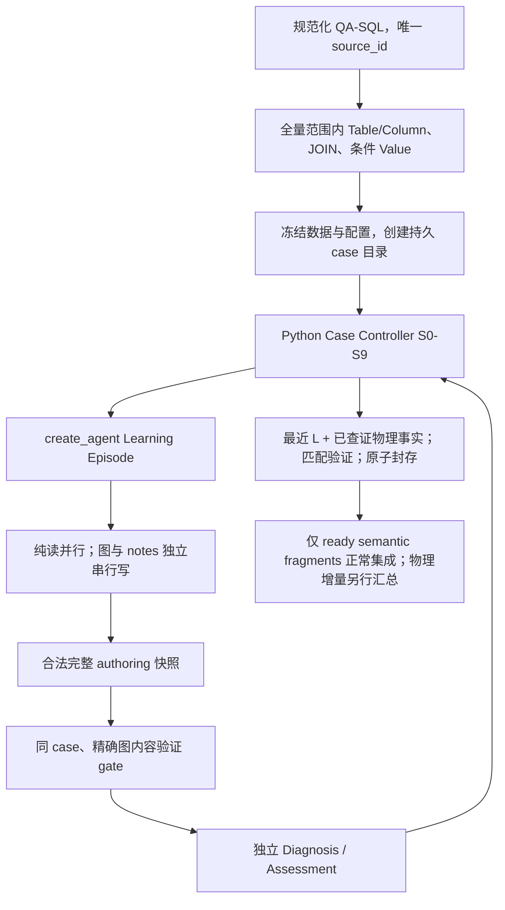

# Extract Agent Loop 实施设计

本文件细化 [case 设计](extract-case-agent-loop.md)，随实现和验证更新。首版已接入默认训练路径；它不增加新的业务状态。

## 1 实施顺序与完成依据

| 步骤 | 内容 | 完成依据 | 状态 |
| --- | --- | --- | --- |
| 1 | 不可变完整图快照、编辑、接受与回退 | 真实领域模型契约与 SQLite 测试，m2/m3 回退及旧快照不变 | 完成 |
| 2 | 统一 Learning Agent、六类工具、working notes、prompt 管理 | 实际 create_agent 配合可控模型，验证并行读、混合批次拒绝、有限退出 | 完成 |
| 3 | Case Controller、独立反馈、验证证据与安全点 | 覆盖 stable、部分接受、K/R 上限、故障和恢复 | 完成 |
| 4 | 默认训练入口与物理准备、导出、LangSmith | 默认路径端到端测试、已有集成契约检查 | 完成 |
| 5 | 分方面 review、修正与文档对齐 | 解决实质缺陷，记录真实验证范围与剩余限制 | 完成首轮；后续继续实验校准 |

## 2 代码边界

默认主调用链统一为同步接口：`CLI → SqlTrainingService.run → SqlTrainingCapability.train → TrainPipeline.run`，训练完成后同步调用 `GraphMergeOperator.merge` 并保存系统图。Controller、Learning episode、Merge 身份匹配/协调/挖掘、LLM 结构化调用和 embedding 均直接返回结果，不在这些层嵌套 `asyncio.run` 或线程包装。并行 case 与 episode 纯读工具继续使用原有并发机制。

共享结构化调用提供 `run_llm_extraction_sync` 给 Merge，原异步 `run_llm_extraction` 继续供在线能力使用；两者共享 prompt 构造、输出解析和修复消息规则。训练专用 SQL generator 直接同步调用模型与数据库。RetrieveDB 在线能力仍保留原异步接口，训练复用它时只在 `CortexRetrieveDbGenerationClient.retrieve` 这一适配边界运行每个 case 独立、惰性创建的 `asyncio.Runner`，并由 factory 资源的 ExitStack 在封存前关闭。每次运行传入新的 `copy_context()`；缓存命中不创建循环。共享注入模型使用同步客户端适配，避免跨 case 循环复用异步连接。这次不改在线检索及其异步 embedding 缓存。同步训练入口不能直接在运行中的事件循环线程调用；异步宿主需要在自己的任务边界调度工作线程。

```text
sql_training/
  pipeline/             运行准备与 case 调度；保留 SQL 生成/执行服务
  graph/                authoring 资产、完整投影、快照与图变更
  learning/             episode runtime、working session、六类工具
  training/             case 状态机、独立反馈、验证与证据
  artifacts/            JSON 持久化与正式 case bundle
  llm/prompts/          集中注册、共享契约、分角色 Markdown prompts
  contracts/ models/    复用现有类型、引用、表达式契约
  error_analysis/       复用 Diagnosis 修复/消融能力
```

外层 engine 仍负责数据库物理准备及 Incoming/Graph Merge 边界。训练只有一条默认 case 路径，不由旧 extractor 先生成候选再调用新 agent。实验入口通过显式策略跳过 Direct，不能隐式回到旧 owner optimizer。

## 3 全流程



数据库范围在运行前由 include_tables 决定。全部表列进入每个逻辑图，prompt 只给本 case semantic 总览与必要 schema 入口。SQL generator 不读取 Learning 对话或 Gold。

## 4 图事实源与唯一写入口

编辑事实源为 NodeAsset，不是投影后的 GraphSpace。投影会将 references 编译为关系，不能无损反向编辑。每个 revision 保存完整 authoring assets、catalog JOIN edges、schema 版本和内容指纹。验证只使用该 revision 捕获的内容，不读取变化中的物理 workspace。

指针只有动态 W、最近接受 L，以及 round 固定比较点 B。L 与 W 共享不可变快照，读取返回独立对象；笔记不能改这些指针。

edit_graph 接收 expected_revision、edit_id、完整 create/update/revert 操作与建议分组。规范 ID 与类型固定；所有关联节点可在同次编辑中创建。revert 仅撤回相对 L 的暂定变化；已保留节点不能直接删除。物理资产不允许自由编辑。

写入顺序：构建完整临时图 → Concept 条件 Value 查证物化 → 全批类型/引用/表达式及 Metric 依赖检查 → 精确 Value 存在检查 → 规范关系与整体 schema 投影 → 原子写完整快照 → 推进 W。任何失败不推进指针。

配置维度、Gold 分类谓词和 Concept 条件物化继续复用现有服务。已查证 Value 在 case 内保留，不随语义拒绝删除。按需 Value 导入不作为首版自由创建工具开放。

接受内容只取 Diff(L_before, assessed_revision)，按整组选择被评审节点的完整内容。一个节点只在一组；同目标或引用其他暂定组时合组，Assessor 可要求语义合组。不能应用的组不提升；旧 L 不变。m2 已接受后，即使 W 改成 m3 被拒绝，回退仍是 m2。

## 5 Agent、工具和 working memory

一个 Learning Agent 联合处理 Concept、Metric、Rule。Direct 和 Repair 使用同一 runtime，分别注入任务指令；不创建按类型分工的学习 agent。

默认输入：source、阶段、W/L revision、全部 semantic 节点概览、固定目标、最新反馈、短 notes、剩余额度。物理详情、指南、历史证据按需读取，不把每轮所有消息不断追加。

| 工具 | 具体输入 | 输出与约束 |
| --- | --- | --- |
| inspect_graph | revision、节点/依赖/diff/指南、分页 | 明确版本及有界结果；全部物理信息可查 |
| inspect_database | metadata/sample/exact/statistics/read-only SQL | 配置范围、真实列、只读执行、行数与耗时限制；保存完整证据 |
| read_evidence | 本 case 证据 ID、分页 | 原始验证/反馈/编辑证据，有界返回 |
| edit_graph | 完整操作、expected_revision、edit_id、分组 | 原子合法修改，失败图不变；返回 revision 和差异 |
| update_notes | 短计划/观察引用/假设/问题/失败摘要 | 一份 case working notes，长度上限，不允许改执行事实 |
| handoff | ready/unable、Direct 类型覆盖、简短说明 | 暂停学习；控制器决定 Trial、评审、收尾 |

只有纯读多调用批次允许并行（最多 4）。含写工具的多调用批次在分发前整批拒绝，为每个 tool_call_id 返回错误，不执行部分调用。每次写工具单独调用；一个 edit 可改多个节点。

notes 是唯一 memory。每次新 episode 从可信图状态、最新反馈与 notes 重新组装消息；旧历史外置为可查日志。默认 episode 最多 10 次模型决策；连续 3 次契约错误/无进展结束。无变化 handoff 结束内层，不通过重开 episode 绕过 K。自然语言结束由控制器接管，不视为成功。

Direct 完成需三类覆盖记录齐备（允许无产物）且图合法。未完成只归档半成品，不自动接受。Repair 退出时有新合法候选且额度足够可验证一次；无法继续或无变化直接收尾。

## 6 状态与独立反馈

| 状态 | 输入与持有数据 | 退出及持久化 |
| --- | --- | --- |
| S0 | source、全量物理基础、配置 | 建立 W=L=基础图 |
| S1 | Direct session，目标为空 | 完成则 L=W 并安全保存；中断则归档尝试，标停止 |
| S2 | 初始 L | 完整稳定 gate；正确收尾，错误进入 Diagnosis |
| S3 | L 的失败证据、剩余 R | B=L，固定目标 E，k=0；无目标停止 |
| S4 | W、L、B、E、最新反馈与 notes | 调查/编辑；有新候选交付；无变化或无法继续收尾 |
| S5 | 确定 W revision | 冻结 Trial，k+1，验证；运行故障受控收尾 |
| S6 | B、L_before、Trial、暂定差异、目标与全部 attempt | 一次结构化 Assessment；按合格组推进 L，保存安全点 |
| S7 | 明确最近 L | 语义恢复 L，合入已查证物理事实 |
| S8 | 最终保留完整图 | 同 case 精确匹配 gate 则复用，否则新 gate；失败不撤销 L |
| S9 | 图、匹配证据、终止原因 | 原子封存；只有封存成功且 stable 才 passed |

Diagnosis 复用 SQL 修复/消融，输出固定纠正目标，不指定类型 owner。无法确认目标时停止，不能当作成功。Assessment 独立于 Learning 对话，读取 baseline、旧 L、当前完整变化与简明逐 attempt 证据；返回整组 acceptable/revise/reject/inconclusive 及目标状态，可要求合组，不写图。

Trial stable 不跳过 Assessment。接受不等于 stable；筛选后不同于 Trial 必须验证最终图。K 关闭内层，R 关闭外层；两者都先保存已接受内容再收尾。最终 stable 优先于旧目标 bookkeeping，验证失败不得退回 B。

## 7 证据、恢复与输出

gate 只在同 case、同 source、同数据/策略和完整图内容下复用，成功失败一致；每个新 gate 最多 N 次独立 SQL 再生成，首次失败即止。Assessment 的旧 L 不匹配时不能重复重放旧接受推进。

本地安全 manifest 指向已完整写出的不可变快照和证据；包含 phase、W/L/B、目标、round/iteration、反馈引用、notes 和计数。恢复只从完整边界继续；未完成 episode 可重做，允许重复成本，不承诺外部调用 exactly-once，不丢已完成接受。

正式 bundle 的 draft_nodes 只含最终 semantic NodeAsset envelopes，不包含全部表列。另存完整快照引用、semantic 与完整图指纹、接受记录、全部验证证据、未完成原因。仅 ready fragment 进入正常 Merge；partial 可 review，已查证 Value 增量汇总到物理资产。验证状态与 case_status 分离，导出失败不能掩盖已有 stable 验证事实。

## 8 Prompt 与追踪管理

沿用集中 load_prompt 注册和共享 ontology 契约；新增 Learning system/direct/repair 与独立 Assessment prompt。静态职责/工具/限制使用 Markdown 分节，动态 source/graph/feedback 使用结构化数据边界；领域 schema 和 taxonomy 由同一 renderer 提供，避免复制契约。记录 prompt 内容 hash，变更可追溯，不引入远端 prompt 发布依赖。

参考 [OpenAI prompt engineering](https://developers.openai.com/api/docs/guides/prompt-engineering)、[LangChain agents](https://docs.langchain.com/oss/python/langchain/agents) 与 [middleware](https://docs.langchain.com/oss/python/langchain/middleware/custom)。这些建议用于指令与上下文分隔、工具语义和明确输出，不要求输出隐式思维链。

LangSmith 记录阶段、工具名、case/revision/evidence IDs、摘要与调用指标；完整图、SQL 结果和对话本地保存。框架自动 tracing 在业务调用范围关闭，由显式摘要 spans 记录，防止自定义摘要之外仍上传完整输入输出。未配置 tracing 时可本地正常运行。

## 9 验证范围与后续校准

实际测试覆盖完整图初始化、原子失败、多节点修改、Value 查证、接受/回退、gate 复用、上下文/无进展边界、恢复、导出和默认入口。三个 subagent 分别评审图协议、session/runtime 和外层集成，已修正复现出的收据恢复、Value 来源覆盖、SQL 作用域/错误反馈、过大工具 batch、infra 重试、Diagnosis 状态和资源关闭异常等问题。

Assessor 的隐含语义依赖判断、N 与预算、真实模型工具兼容和上下文容量仍需真实 case 校准；不通过增加复杂协议假装证明知识普遍正确。

## 10 实际接口与持久化格式

```text
pipeline/train.py
  TrainPipeline.run(...)                       准备、独立 case 资源、汇总
  TrainPipeline.resume_case(case_root)          恢复单个持久 case，不重启整个 run
pipeline/physical.py
  PhysicalPreparation                          Gold 元数据、JOIN 和 bootstrap
graph/
  snapshots.py: GraphSnapshot / GraphStore      authoring 快照、W/L、完整投影
  mutations.py: GraphEdit / ChangeGroup         create/update/revert 与分组
  values.py: merge_verified_values              统一保留别名、来源与物理身份
learning/
  session.py: LearningSession / WorkingNotes / EpisodeResult
  runtime.py: LearningAgent / EpisodeHooks      实际 create_agent 工具循环
  tools.py: build_tools                        六类工具
  database.py: investigate_database            scope 校验、只读/超时/行数/预算
training/
  controller.py: CaseController                简单阶段分发，不含类型 owner 路由
  state.py: CaseState                          可信 manifest 数据
  services.py: CaseServices                    稳定验证、缓存、Diagnosis 适配
  feedback.py: AssessmentFeedback / assess      一次结构化独立评审，最多一次格式重试
  evidence.py: EvidenceStore                   case 内不可变证据 ID
  observability.py: SummaryTracer              显式父子摘要 spans
artifacts/cases.py
  case_result / seal_case                      当前应用契约与原子正式 bundle
```

### 10.1 图和编辑格式

```text
GraphSnapshot
  revision, parent_revision, schema_version, content_fingerprint
  assets: 完整 NodeAsset[]（含全部 Table/Column、已查证 Value、case semantic）
  catalog_edges: 冻结的 GraphEdge[]

GraphEdit
  edit_id: case 内唯一，重复不同请求拒绝
  expected_revision
  operations[]: operation(create|update|revert), node_id, asset?
  proposed_groups[]: group_id, member_ids[], target_ids[]
```

create/update 是完整节点替换而非任意字段 patch。identity/type 和物理节点不能修改；revert 恢复 L 中版本或删除相对 L 的暂定新增。改动先完整校验，快照和收据写完后才推进 W。旧收据若不在当前图分支中，明确要求重新观察并使用新 edit_id，不自动复活已回退的编辑。

Concept 只重新查证本次编辑涉及的内容；不对每次编辑无差别重新扫描全部历史 Concept。内部 grounding 与 inspect_database 使用同一有界调查配额。Value 重复物化合并 aliases/sources，不能覆盖旧来源；同 ID 指向不同实际值明确报冲突。

### 10.2 Session 与反馈格式

```text
EpisodeResult
  outcome: ready_for_validation | unable_to_continue | resource_limit
  starting_revision, delivered_revision
  direct_completed, direct_type_coverage
  proposed_groups, summary
  model_calls, tool_calls, database_calls, transcript_ref

AssessmentFeedback
  group_results[]: group_id, verdict, evidence, revision_suggestion
  target_results[]: target_id, resolved|unresolved|inconclusive, evidence
  merge_groups[][], deferred_observations[]
```

评审必须恰好覆盖全部输入组和固定目标。合组声明只减少可独立接受范围：其中任一组不合格，整个关联集合不提升。控制器从旧 L 和被评审快照构造拟接受完整图，先保存 acceptance 证据，再更新 L 和安全 manifest；不重放旧接受命令，也不按最后一次局部编辑拼图。

默认 Learning 输入不重复展开物理节点。类型指南默认返回准确 properties schema 和完整契约引用；contract/taxonomy 可按需取。read_evidence 的 offset/limit 指 payload 序列化字符，预览和分页使用同一文本。过大的当前工具返回外置为证据，保留原 tool_call_id；必要 source/目标自身超出配置容量时明确失败。

Assessment 保留当前 semantic 内容，baseline 与旧 L 只提供已变化节点的旧定义，不重复发送三份完整图；附带明确的省略策略、累计/暂定差异 ID 和全部简明验证 attempt。只拼接涉及节点类型的共享契约。

### 10.3 Case 目录与安全点

```text
train_runs/<run_id>/cases/<index>_<source>/
  source.json                    冻结的规范化 case 输入
  run_context.json               run_id / case_index
  checkpoint.json                完整安全点；原子替换
  snapshots/<revision>.json      不可变完整图
  edits/<edit_id>.json           编辑收据
  evidence/<evidence_id>.json    模型、工具、验证、诊断、评审和故障
  validation_index.json          case 内完整 gate 与有界 infra 重试记录
  progress.json                 外层进度
  bundle/
    manifest.json / case_result.json
    assets/ / draft_nodes.json / draft_edges.jsonl
```

checkpoint 保存 phase、W/L/B、source/data/config/prompt context_id、round/iteration、E、groups、最新反馈、notes、验证/接受引用、Direct 完成依据和计数。安全边界没有运行中的学习写入；可在 Direct、Diagnosis、交付 Trial、Assessment 和收尾完成后保存。恢复最多三次，未完成工作可重做；已 done 的 bundle 直接读取，不消耗新的恢复次数。

`resume_case` 要求相同配置、source、prompt 和固定数据库。SQLite 记录文件及 WAL 的 size/mtime，变化则拒绝缓存/恢复；其他数据库要求运行方使用固定数据快照，这一实现不声称能检测任意在线数据库的数据变化。恢复是 Python API，不新增一个分布式恢复服务或 CLI 子状态机。

### 10.4 验证、预算与故障处理

- 相同 case、source/context_id、完整图指纹下，完成的 correct/incorrect gate 统一复用。失败不能通过反复抽样筛出成功。
- infrastructure unavailable 有独立的有限重试（默认 validation.max_retry_count+1 次总尝试），每次保存证据并持久化次数。耗尽后继续引用故障事实，不将其当作成功 gate。
- Learning episode 使用独立步骤/调查配额，Diagnosis 使用现有有限修复/消融参数，Assessment 最多两次格式调用，Validation 每个新 gate 最多 N 次并首次失败即止。阶段配额分开，探索不能占用评审或收尾配额；不维护费用/token 预留账本。
- episode 耗时在模型/工具边界检查；已发出的同步 HTTP/SQL 请求受自身 timeout/retry 控制，不承诺瞬间取消。晚到读取不能写图或 notes。
- 普通工具契约、SQL parse/scope 错误返回 tool error，允许 agent 修正；运行/存储故障进入受控收尾，不能撤销已接受内容。
- Case 资源正常关闭后才正式 seal，避免先发布 passed bundle 再发现关闭失败。失败结果保留已接受 semantic 输出为 partial；完整 bundle 原子保存成功才可正常合并。

### 10.5 运行与维护

默认命令保持 `cortex sql-train` 不变。使用 `pip install -r requirements.txt -e . -e ./baseline` 安装已验证 runtime；开发检查另安装 `pip install -e '.[dev]'`。

```bash
python -m pytest -q
python -m pip check
```

Prompt 文件按角色管理，实际字段由 Pydantic、领域规则由共享 renderer 提供；说明见 [Prompt 维护指南](../../src/cortex/capabilities/sql_training/llm/prompts/README.md)。LangSmith 自动 payload tracing 在业务操作内关闭，仅显式 whitelist 摘要 spans 启用，保持父子关联；完整内容只在本地证据中。

当前自动检查：79 项测试通过，另有 4 项 unittest subtests；pip check 通过。测试包含真实 SQLite、实际 create_agent 和 SDK 记录客户端；学习决策/SQL 生成在大部分控制器测试中使用可控替身，不能将测试通过解释为真实模型的语义质量保证。

真实模型小规模验证：一次 synthetic Direct episode 在默认 10 次模型决策内正常 handoff，产生两个结构合法 semantic 节点；独立 Assessment 也返回了合法结构化反馈，结论为 revise。初期过长指南导致资源耗尽，据此收缩默认指南并补充测试。第一次 Assessment 在 25 秒请求超时后，以 60 秒上限完成接口冒烟；未将该结果用于正式接受。这些不替代真实数据集上的 SQL 正确率、抽取质量或泛化实验。

同步接口迁移回归：新增 11 项检查，覆盖应用层同步训练与真实 Merge、精确节点去重、同步挖掘入口、LLM 身份判定、embedding、输出修复与异常、独立协调反馈及未决内容保留、证据缓存，以及 SQLite 上的训练 SQL 生成和执行。全量 73 项测试与 4 项 subtests 通过；训练 CLI、pre-merge/merge 脚本和 Merge evaluation 的 help 入口、源代码编译检查通过。本次未重跑真实模型数据集实验。

同步改造专项复核：三个 subagent 分别检查调用方、异步边界和并发/资源管理。未发现遗漏的 train/merge 调用方或主链协程包装；补齐同步结构化助手的模块导出。复现并修复保留检索边界原有的跨循环异步连接问题：同一个 case 的 cache miss 复用 Runner，case 退出时关闭；共享注入模型不直接复用原生异步客户端。新增 6 项回归覆盖两个 case 实际并发、线程归属、关闭异常隔离、循环复用、逐调用 context、后台任务/线程清理和共享模型。当前全量 79 项测试和 4 项 subtests 通过。
