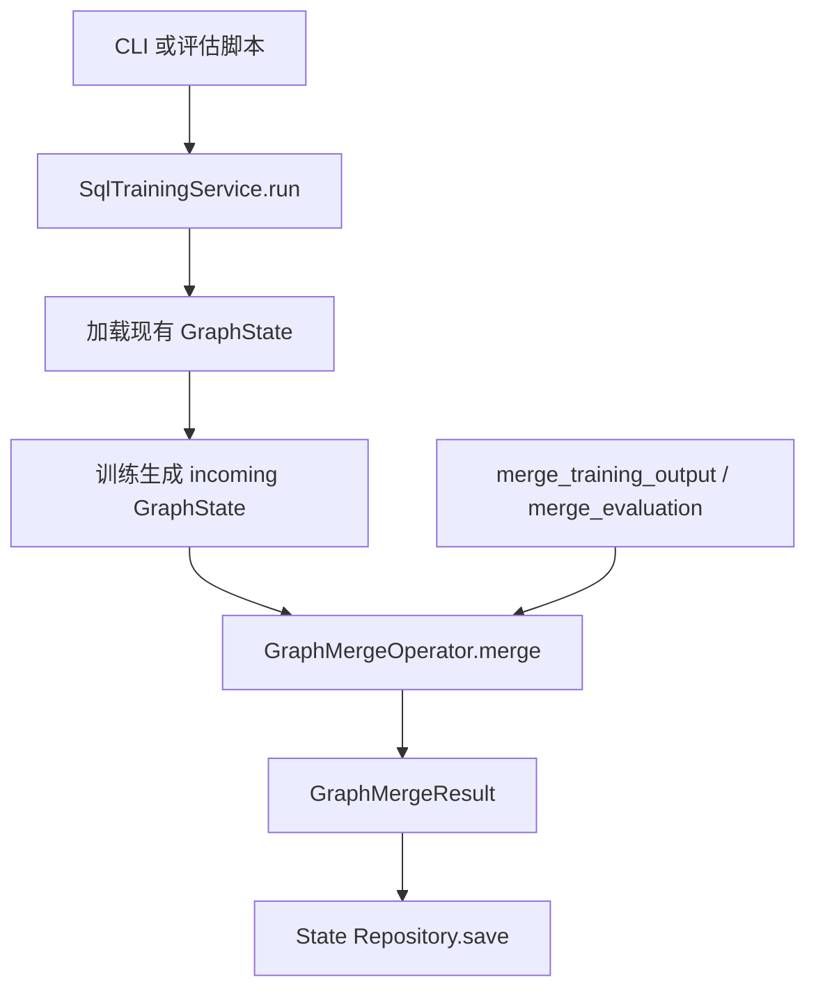
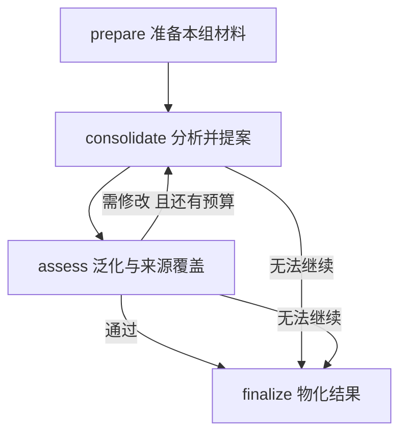

> 2026-10-25 更新：运行时现已统一为官方文件型 SQLite / SqliteSaver，移除 PostgreSQL 依赖。下文涉及旧 PostgreSQL 决策的内容仅保留为设计历史。

# Merge Operator 的 LangGraph 和 LangSmith 迁移方案

状态：已按最新方案实现，保留本文的取舍说明。范围：Graph Merge 的简洁首版设计、working memory 和观测。已完成三个 subagent 的设计 Review，以下为收敛后的方案。依据：2026 年 10 月 22 日工作区中的代码，包含当前尚未提交的改动；算法设计以论文 [Cross-Case Ontology Integration](/path/to/user/SIGMOD_AutoOnto/secs/05-Integration.tex) 为准，重点对应 Matched Node Consolidation。

保留同步 operator 和现有身份匹配，只将真正需要语义协调的双角色循环迁移到 LangGraph。LangSmith 记录角色、工具调用与运行摘要。保持同步 `merge(existing, incoming, schema) -> GraphMergeResult` 接口。存在内容差异的语义组统一采用整组提案、独立检查和有界修订；只保留本次运行的 working memory，不接入 Store 或跨任务经验。Miner 及其专用 rewrite 链路从目标实现中删除。

最值得替换的是隐藏在 Python 循环和 `ContextVar` 里的执行状态。身份规则、完整来源覆盖、冲突 alternatives、canonical ID 和完整图约束仍然属于本项目，框架无法替代这些判断。

## 1 改造前架构与替换范围

### 1.1 调用和提交边界



`SqlTrainingService.run` 训练完成后执行一次 merge，再保存 `merged.state`。operator 本身不提交正式知识图，而是在本地构造完整结果，最终校验成功才返回。现有文件 repository 通过 generation 目录和 `CURRENT` 指针发布图版本；它是正式知识状态的事实源。

代码入口：[application/sql_training.py](../../src/cortex/application/sql_training.py)、[application/merge_graph.py](../../src/cortex/application/merge_graph.py)、[bootstrap/graph_merge.py](../../src/cortex/bootstrap/graph_merge.py)、[artifacts/graph_state.py](../../src/cortex/infrastructure/artifacts/graph_state.py)。

### 1.2 Operator 主流程

| 阶段 | 当前行为 | 主要代码 |
| --- | --- | --- |
| 输入验证 | 校验 existing、existing/incoming 元素 ID 不相交、incoming 引用合法；空增量直接返回 | `operator.py:merge` |
| 身份归组 | 先处理 Concept/Metric 跨类型纠正，再按 seed 顺序处理 EXACT 或 SEMANTIC 身份匹配 | `identity.py:IdentityGrouper` |
| canonical 碰撞合组 | 将最终会生成同一 canonical ID 的 provisional group 与已有锚点重新合并 | `operator.py:_coalesce_canonical_id_collisions` |
| 单组准备 | Concept target 规范化；读取历史冲突；从原始输入节点与历史 alternatives 展开传递依赖 | `normalization.py`、`operator.py:_dependency_nodes_for_group` |
| 内容协调 | 逐组调用 `NodeGroupReconciler`，生成完整 canonical node 或保留完整冲突 alternatives | `reconciliation/service.py` |
| 全局映射 | 汇总 incoming ID、跨类型 existing replacement；重写节点属性和冲突 alternative 内容引用 | `operator.py`、`edges.py` |
| 边规范化 | 端点重映射、身份去重、来源合并、保留内容变体、删除纠正类型后不合法的边 | `edges.py:normalize_edges` |
| 引用同步 | 根据 canonical 节点及冲突定义的引用闭包清除过期编译依赖边 | `edges.py:prune_stale_reference_edges` |
| 可选挖掘 | miner 提案，rewrite applier 验证与应用；不合法的组合可回滚整个 mining 阶段 | `mining/`、`rewrite/` |
| 最终验证 | 完整图验证；失败抛 `FinalGraphStateInvalid`；成功返回图、映射和 diagnostics | `operator.py` |

注意两个现有行为：identity 会为全部 existing 节点创建 group；协调依赖来自固定的原始输入快照，并非前面某个 group 刚生成的 canonical 输出。依赖读取仍基于本次固定输入；首版新增无新增信息组的直接保留，避免每次增量重新评估全图。

### 1.3 身份分组

`IdentityGrouper.group` 是一个会修改候选集合的顺序算法：选 seed → 找 collection/query 候选 → 决定归属 → 消耗 incoming queries → 更新 groups → 处理下一个 seed。

- EXACT 按 Schema 的 `identity_policy.fields` 序列化匹配，不调用模型。
- 普通 SEMANTIC 使用名称、别名和实现等候选通道，做多通道 top-k 选择，再由模型选择一个已有组并判定其他 incoming 是否同身份。
- Generation Rule 单独使用 condition/action 与 operation intent 筛选，结合词法分数和可选 embedding 排序。
- Concept/Metric 跨类型判定在同类型归组之前执行；映射冲突或不确定时保留输入并记录 diagnostic。
- 模型不能返回任意候选；`validate_candidates` 要求选择在给定集合中，且逐项覆盖 query candidates。

不能直接把 seed 全量并行：后一个 seed 看到的组和剩余 queries 会受前一个 seed 影响。候选检索继续使用项目现有的领域算法。

### 1.4 当前协调路径与收敛方向

当前代码同时包含两条路径：默认 live 配置创建 `LLMGroupConsolidator` 和 `LLMConsolidationChecker`；注入旧接口时仍可进入 semantic outcome、fact fusion/generalization、coverage verification 的旧路径。

目标只保留第一条：`ConsolidationProposal → 契约校验 → ConsolidationReview → acceptance gate → 修订或物化`。删除旧接口注入导致的策略切换，不保留 legacy adapter、旧 backend 开关或失败后切回旧算法的行为。失败只进入原定义保留流程。

改造前整组循环位于 `reconciliation/proposal.py`；现在由 [workflow/group.py](../../src/cortex/capabilities/graph_merge/workflow/group.py) 接管。Checker 调用或格式失败时复用原 proposal；合法的负面语义 review 才要求重新提案。当前默认最多 3 个循环轮次、18 次协调内部模型调用；轮次也会被格式失败消耗。新方案明确区分最多 3 轮语义修订与每组模型调用上限，工具循环的模型调用也占额度，不叠加隐藏的 repair 调用。

Consolidator 同时负责表达融合、泛化和冲突组织，Checker 同时检查泛化合理性、来源行为覆盖和组织一致性；这些职责不再分别交给 fuser、generalizer、branch selector 或另一个 verifier agent。校验函数和来源清单继续由代码维护。

历史冲突仍重新展开完整 alternatives，不能把历史选择当作证据。Bootstrap 中的 `branch_selector` 当前只被保存，未被 service 调用，随旧路径一起删除。`graph_miner` 当前需要显式注入，目标直接移除整个阶段。

### 1.5 当前 memory 和观测

| 机制 | 生命周期与用途 | 当前边界 |
| --- | --- | --- |
| `ConsolidationMemory` | 每次 `reconcile_group` 新建；记录 round/calls、proposal/review、feedback、history、失败指纹和 stop reason | 运行于内存，依赖 `active_memory: ContextVar` 隐式传递；没有 checkpoint 恢复 |
| prompt memory projection | 提案者读取上一提案和修订反馈；checker 只读取有限格式反馈及必要历史冲突点 | 已经有角色隔离，迁移必须保留；同一模型的两个角色并不保证判断独立 |
| `CachedEvidenceResolver` | 根据 SourceReference 缓存 evidence | 实例在 bootstrap 构建并被 operator 持有，实际生命周期可能跨多次 merge；缺失项不缓存 |
| 冲突持久化 | 将不含完整 context 的 consolidation audit 写入 `NodeMergeConflict` | 已有领域审计；不能因为接入 LangSmith 就删除 |
| Merge JSONL trace | 候选检索、prompt hash、模型请求／响应、parsed result、错误、协调状态等 | 自定义 sink，没有统一图节点执行视图；序号通过每次扫描文件计数，不宜直接用于并发写入 |
| Training LangSmith | `SummaryTracer` 已有显式摘要 span 和原始 payload 隔离 | Merge 尚未统一接入这套观测边界；自动子 trace 需要单独验证 |

相关代码：`旧 consolidation.py（已删除）`、[llm/agents.py](../../src/cortex/capabilities/graph_merge/llm/agents.py)、[graph_merge_trace.py](../../src/cortex/infrastructure/artifacts/graph_merge_trace.py)、[training/observability.py](../../src/cortex/capabilities/sql_training/training/observability.py)。

`GraphMergeConfig` 已声明证据条数／字符限制，但当前 bootstrap 没有将这两个参数接入 merge 的证据加载；这部分应在迁移中补上明确的执行位置。`WorkspaceEvidenceRepository` 构造时就读取来源数据，新方案应在训练结束后冻结本次 evidence snapshot，避免复用构造时的旧快照。

## 2 Review 后的取舍

三个独立 subagent 分别从简洁性、论文一致性、实现成本审查，结论一致：双角色循环合理，但逐字段语义映射、重复覆盖账本、阅读审计和分布式执行保障超出了首版需求。

| 问题 | 首版决定 | 原因 |
| --- | --- | --- |
| 对全部 existing 组及单成员反复泛化 | 增加直接保留和相同内容去重 | 增量集成不应成为全库重优化 |
| candidate_locations、relation_bindings、重复冲突引用 | 删除这些新增字段 | JSON 位置可解析不代表条件语义正确，维护成本高 |
| member/source/plan/relation 多套 verdict | 合并为一份来源覆盖结果 | 计算、条件、plans、依赖在同一来源下检查，避免重复结论 |
| 两个角色强制通过工具重读全部输入 | 小组材料直接输入；工具补充大材料和依赖 | 不为使用工具而制造搬运工作 |
| loaded/pending/episode/hash 等阅读状态 | 不建立逐角色阅读账本 | 工具返回过原文不能证明理解或覆盖正确 |
| 身份分组循环全部拆图 | 直接复用现有 grouper | 图化收益主要在有反馈修订的协调循环 |
| 原生 checkpoint 与成本统计 | 首版直接使用 PostgresSaver 和 LangSmith usage/cost tracking | 复用框架能力，接入成本低 |
| 持久 attempt ledger、恢复版本迁移、并行 reducer、CAS | 不纳入首版 | 严格执行/计费保证与多 writer 不是基础持久化的前提 |

保留的约束集中在实际损失上：输入成员不丢、竞争定义完整、来源覆盖、引用有效、失败保留原文。语义合理性仍由 Assessment 判断和回归样例验证，不将其包装成程序可形式化证明的保证。

## 3 与论文的对应

论文 [Matched Node Consolidation](/path/to/user/SIGMOD_AutoOnto/secs/05-Integration.tex:17) 要求联合生成分析 A_B 与完整定义，经泛化和覆盖评估后有界修订。

| 论文要求 | 简洁实现 |
| --- | --- |
| S_B 共同内容 | analysis.shared 中的简短语义说明 |
| Delta_B 差异与上下文解释 | analysis.differences，说明差异、依据和条件 |
| K_B 未解决竞争 | 既有 difference_points 与完整 candidates/alternatives，不再重复存冲突引用 |
| 分析与定义共同修订 | Consolidator 每轮同时修改 analysis 和 candidates |
| 泛化评估 | 一项 generalization 判断，检查解释、参数、条件和泛化范围 |
| 覆盖评估 | 按来源核对计算、条件、plans 和必要依赖 |
| 有界失败 | 保留原定义及关系，标记 unresolved |

共享、互补、条件差异和竞争可以共存于一个组，不给整组预先分配互斥标签，也不固定 shared/residual 后只修残差。参数与条件必须进入完整定义，不能只写在分析里。条件应合理解释行为差异；没有反例不是唯一接受依据，但不要求形式化因果证明或每个新参数值都有训练例。

语义冲突与证据不足继续区分：有依据的竞争保留完整 alternatives；不知道如何解释或证据不足则保留原文并标记 unresolved，不编造冲突。

## 4 最小执行流程

```text
GraphMergeOperator.merge
  → 现有输入验证与身份匹配
  → canonical 碰撞合组与规范化
  → 无需语义协调的组直接处理
  → 对其余组运行 LangGraph 协调子图
  → 现有 ID 重映射、边规范化与引用清理
  → 完整图验证
  → 返回，由应用服务保存
```

主流程保持 Python 同步实现，先不为每个确定性函数建立 graph node。唯一的语义协调子图为：



只有 consolidate 和 assess 调用模型。格式校验、预算、反馈记录放在节点代码中，不单独建节点或新增 agent。格式失败仅在有预算时重试相应角色；Assessment 格式失败复用原候选。最终失败保留本组原始完整定义。

### 4.1 哪些组不需要调用 Agent

- 物理节点：按身份和可信数据库元数据直接合并，保留来源。
- 未受本次输入影响的 existing-only 组：原样保留已有节点及 conflict overlay。
- 无历史 alternatives 的单个 incoming 定义：默认保留训练输出，不把 integration 变成额外的单案例泛化优化。
- 规范化内容和有效出向语义关系都相同的组：确定性合并来源，不改写计算和条件。正文相同但关系目标或有效关系属性有实质差异时，进入协调；只比较直接关系签名，不建立传递证明体系。
- 内容不同，或本次输入重新触发历史 conflict 的语义组：进入唯一双角色协调流程。

判断相同/单成员前必须展开已有 alternatives；不能只比较 conflict envelope。若已有节点的相关依赖或来源在本次输入中变化，也不能按 untouched-existing 跳过。首版沿用已有关系与依赖读取逻辑做保守判断，不引入通用增量依赖失效框架。

这些直接终态不引入另一套语义融合算法。输入成员映射、来源汇总和最终校验对所有组一致执行。

## 5 两个角色的输入输出

### 5.1 公共输入

prepare 固定本次输入视图，提供本组成员的完整定义、来源列表、出向关系及目标节点概览、类型契约和必要历史 alternatives。小组的 question/gold SQL 默认直接加入输入，避免两个 Agent 为必读材料反复调用工具。

依赖正文或较大的来源材料按需读取。不预先展开所有传递依赖；先查看直接出向关系，遇到确实影响含义的引用再进一步读取。所有读取基于同一份原始输入，不能混入其他组尚未接受的输出。

材料不足或超出上下文及调用预算时，允许保留原定义。首版不建设自动分页调度、上下文卸载和分布式 artifact 管理；工具过大结果明确报告限制，不能伪装成完整内容。

### 5.2 Consolidator

输入：公共 context、上一版完整 proposal 和本轮反馈。首轮没有上一版及反馈。

```text
ConsolidationProposal
  analysis
    shared[]                    简短共同内容说明
    differences[]               差异、上下文解释和必要的来源引用
  candidates[]
    content                     完整 NodeContent，包括条件和依赖
    supporting_refs[]           由本候选承接的原始成员
  difference_points[]           沿用现有竞争点结构
  unresolved_refs[]             明确交回程序原值保留的成员
```

analysis 用于表达和修订论文中的分析，不承担逐字段证明。K_B 由 difference_points 表达，不再新增 conflict_point_refs。去掉重复的总 reason、candidate_locations、relation_bindings 和模型生成的局部 candidate ID；程序需要展示标识时自行编号。

Consolidator 同时构造共享内容、条件化差异和完整竞争定义。它不输出 accepted，不生成 canonical ID，不编辑正式图。每个原始成员必须恰好属于一个候选或 unresolved；共同内容可以在完整竞争定义中重复，不为去重造成残缺定义。

### 5.3 Assessment

输入：相同原始 context、当前 proposal，以及程序从原始来源生成的待覆盖列表。不输入前轮语义 verdict 或 Consolidator 的历史修订讨论。共享原文缓存即可，不强制它重新调用工具。

```text
ConsolidationReview
  generalization
    verdict                     acceptable / revise / unknown
    reason                      泛化、条件解释和方案组织上的判断
  coverage_by_source[]
    supporting_ref
    evidence_id
    verdict                     covered / not_covered / unknown
    reason                      计算、条件、plans、依赖中的具体缺陷或依据
```

每个 `(supporting_ref, evidence_id)` 一项；同一来源支持多个不同成员时不能合并掉成员维度。原始成员及 plans 在 context 中完整可见，Assessment 在该来源下判断必要内容是否被保留。不另加 representation、plan、relation 三套重复 ledger；必要的 plan 格式和引用合法性检查继续由程序执行。

具体反馈直接使用 generalization.reason 和失败/unknown 来源行，不再复制一份结构复杂的 issues/target/kind 账本。反馈可修改分析或候选，由 Consolidator 决定如何修订。

所有候选相关来源及可能构成反例的其他组内来源都可读取，不能只提供支持候选的子集。unresolved 原文由程序照原值保留，无需模型为原文重新提供覆盖证明；但这些来源仍可作为其他候选的反例。

接受条件只有：proposal 结构有效、generalization acceptable、所需 coverage 行齐全且 covered。组织冲突的结构检查归入程序，组织解释的语义检查归入 generalization，不新增第三个模型总判定。改写成员没有必要来源或可用 question/gold SQL 时，不能从空清单推出覆盖通过，应保留该成员原文。原文保留是独立结果状态，不伪称泛化成功。

这一精简会减少现有 Review 中的重复字段。实现时需要同步改造 review_checklists/validate_review/review_passes，将有价值的来源、条件与 plan 检查保留到统一入口；不通过填默认值的兼容层伪造旧 ledger 已通过。

## 6 Tools 和 working memory

### 6.1 两个只读工具

| 工具 | 内容 |
| --- | --- |
| read_evidence(ids) | 批量返回给定 source/evidence 的原始 question/gold SQL 等材料 |
| read_nodes(ids, include_relations=True) | 批量返回完整节点、必要 alternatives、出向关系及目标概览，可沿引用继续读取 |

已知 ID 足以支持本组和依赖探索，get_neighbors 合入 read_nodes。暂不建设全库 search_ontology；真实案例确实需要按名称查找未知节点时，再增加一个简单有界查找工具，不把检索系统当作迁移前提。

工具只能读本次固定输入；不能执行自由 SQL、改图、修改 evidence 或读取长期记忆。工具读取记录由框架 trace 保存；只读内容缓存位于 runtime context，不维护每个角色的 loaded hash/reading manifest。原始内容通过工具获取还是已在输入中提供，不影响覆盖判定。

Consolidator 和 Assessment 采用 create_agent 复用内部模型/工具循环，使用结构化输出；内部每次模型调用都计入本组调用上限。外层只协调两个角色，不再嵌套新的 proposer/assessor 逻辑。[官方 Workflows and agents](https://docs.langchain.com/oss/python/langgraph/workflows-agents)

### 6.2 一份简短组状态

```text
GroupState
  context                      本次固定组输入或运行内引用
  proposal                     当前分析和完整候选
  review                       当前评估；反馈直接从这里读取
  validation_feedback          最近一次格式/契约错误，没有则为空
  round
  model_calls
  stop_reason
```

Consolidator 看到原始输入、上一方案和待修订反馈；Assessment 看到原始输入与当前方案。两者内部 messages 和工具结果由框架管理，不在组状态中再复制 role_episode_states 或自己设计 memory manager。

完整聊天历史不反复注入两个角色。进入新一轮时按上述状态重新构建角色输入；只读缓存复用原文，不携带另一个角色的语义结论。原始 context、当前方案和反馈足以支撑首版工作，不增加自定义摘要 agent 或复杂 token 调度。

首版使用 LangGraph state 和官方 PostgresSaver 保存当前运行；测试可用 InMemorySaver。通过相同 thread_id 继续当前协调，不需要 Store 或跨任务记忆。工具的运行上下文需重新连接同一份输入；本次输入、证据和分组结果直接保存到原生 run checkpoint，避免从进程内引用恢复。框架区分当前模型上下文与短期 state；不要求每次模型调用都看到全部历史。[官方 Context engineering](https://docs.langchain.com/oss/python/langchain/context-engineering)

### 6.3 预算和失败

默认最多 3 轮语义修订，并保留每组模型调用上限。工具循环、格式重试中的模型调用都计数，避免 create_agent 内层无界运行。工具使用同一个有限循环预算并设置单次输出大小，不再增加多层独立预算体系。

普通 provider 重试使用现有配置；模型调用的 usage 和成本交给 LangSmith 记录。首版不承诺严格跨重启计费上限，不实现持久 attempt reservation。预算耗尽、重复失败或关键证据缺失时保留原定义。最终图非法则失败，不覆盖正式图。

### 6.4 原生持久化和成本观测

Checkpoint 从首版统一使用 PostgreSQL，不维护 SQLite/Postgres 双后端切换框架。开发和部署连接同类后端，测试仍可使用内存 saver。Bootstrap 负责连接生命周期、初始化官方 checkpoint 表和注入 saver，凭据使用环境配置；业务 Agent 不感知数据库类型。

基础持久恢复纳入首版：使用官方 PostgresSaver，协调图及 agent 子图使用框架的 checkpointer 继承机制；每次 merge/group 有稳定 thread_id，继续任务时复用该 ID。当前组的模型消息、proposal 和 feedback 等图状态由框架保存，不另建 checkpoint 协议。工具所需输入从同一份 checkpointed context 恢复，客户端与连接重新创建。[官方 Checkpointers](https://docs.langchain.com/oss/python/langgraph/checkpointers)

这一能力恢复的是图执行状态；尚未保存的外部模型调用可能重复，正式图 repository 的保存仍属于应用边界。不承诺外部副作用 exactly-once、不支持运行到一半任意替换输入或流程版本，不为此建设状态迁移平台。

成本观测也纳入首版：启用模型层 LangSmith trace，保留 usage/model 元数据，用原生功能汇总角色、group 和 run 的 tokens/cost。自定义模型名或价格无法自动匹配时配置 pricing/usage，不重建账单系统。现有 SummaryTracer 会关闭自动子 payload，接入时须确保实际模型 spans 与 usage 被记录，同时继续隐藏原始 SQL 和消息。[官方 Cost tracking](https://docs.langchain.com/langsmith/cost-tracking)

这里的成本是观测/估算，不是供应商最终账单、客户结算或严格美元额度拦截；后几项没有当前需求，不纳入首版。

## 7 必须保留的程序检查

| 检查 | 范围 |
| --- | --- |
| 成员归属 | 每个输入成员恰好分配给候选或 unresolved，不能丢失或重复 |
| 内容与身份 | Schema 字段、必要字段、EXACT 身份和原始来源合法 |
| 引用与竞争 | 引用可解析；竞争点对应完整候选；历史 alternatives 不被 envelope 替代 |
| 来源覆盖 | coverage 行与候选相关的原始来源对齐，不能缺项或虚构证据 |
| 失败保留 | 原始内容、来源和必要关系继续保留，区分 unresolved 与真实竞争 |
| 全局图 | 复用现有重映射、边规范化、过期引用清理和完整图校验 |

条件和依赖必须保留在完整内容/alternatives 中；canonical 边并集不意味着所有依赖无条件同时适用。Assessment 直接检查这一语义，不引入通用 content_location 或 scoped-relation 协议。若实际遇到现有领域模型无法表达的条件关系，保留该定义，再针对真实案例讨论小范围 Schema 扩展。

这些检查保证基本数据完整性；不保证语义 100% 正确。主要语义风险通过独立 Assessment、有限修订和代表性回归案例控制。

## 8 删除范围和实施顺序

### 8.1 删除与保留

| 对象 | 处理 |
| --- | --- |
| 旧语义协调 | 删除 semantic outcome/fusion/generalization 的旧编排及注入 registries，不保留 legacy backend |
| 旧角色与 prompts | 删除旧 reconcile/pair/input analysis/composer/fuse/generalize/branch/verifier；保留并改造 Consolidator/Assessment |
| 共享校验 | 保留 plan ID 唯一性、RANK 语义、竞争点与 selector 等检查；plan 行为覆盖归入统一来源评估，不用旧 ledger 模型假装兼容 |
| Miner | 删除 mining/、专用 rewrite/、LLMConceptResolver、concept_mine.md、装配参数、diagnostics、报告和测试依赖 |
| 领域图处理 | 保留物理节点合并、canonical ID、来源汇总、引用重映射、边规范化、完整 alternatives 和最终验证 |
| 身份匹配 | 保留现有 grouper，不在首版拆成 seed 子图 |
| 关系类型 | 不因取消 miner 删除已有合法关系类型，如 broader_than |

代码组织只需增加薄的 workflow/state 和 tools 适配，将现有 proposal 规则、物化函数与角色调用复用起来。不先建设通用基础设施目录、artifact manifest 平台或自定义 memory 子系统。

### 8.2 三步交付

1. 删除旧协调路径与 miner，提取必要领域规则，补直接保留入口并精简 proposal/review 契约。
2. 将唯一双角色循环迁到 LangGraph，接入两种只读工具、简短 state、PostgresSaver 和 LangSmith 原生 token/cost trace。
3. 用论文和现有 merge 样例做回归，确认映射/来源无丢失、失败能保留、调用量没有无意义增长，再调整 prompts 和预算。

LangSmith 首版记录角色、工具、轮次、结果、耗时、usage 及可用成本估算，复用仓库已有摘要与原始证据过滤策略。Datasets/experiments 可复用现有评估入口，不阻塞迁移。不增加 Prompt Management、人审 interrupt 或复杂线上评估平台。

官方 Postgres checkpoint 的基础恢复和 LangSmith 成本统计属于首版。多 worker、Send 并行、多 writer CAS、严格幂等提交及计费额度保证按真实需求延后，不改变现有应用服务保存边界。

## 9 首版验收样例

- 论文 N1/N2：保留单位数比例，产品条件表达 kit filter；错误删除过滤应被指出。
- 论文 N1/N3：相同产品和过滤条件下计算口径仍竞争，保留两套完整定义及依赖。
- 混合组：允许部分成员融合，另一些保留为完整竞争项或 unresolved。
- 增量运行：未受影响的 existing 组不调用模型；单成员正确保留；内容及有效关系相同的组正确合并来源，关系有差异时不被误跳过。
- 工具：Assessment 能获取原始证据和依赖，不能被 proposer 的已选支持案例限制。
- 失败：格式错误、有负面评估、预算耗尽和证据不足均有有限退出，原始成员不丢。
- 结构：映射完整、引用合法，删除 miner 后导入、评估报告和现有同步边界仍可用。
- 原生能力：相同 thread_id 和输入能恢复中断的协调图；LangSmith 实际模型 spans 能看到 usage 和匹配价格后的 cost。

用这些案例验证简化的收益和主要风险，而不是要求逐字段可证明正确。正式提交仍需全局图验证通过。

## 10 实现边界

代码保留同步 operator、现有 identity grouper 和确定性图处理。LangGraph run 图只增加 match_nodes 与 assemble_graph 两个粗粒度 checkpoint 边界，固定身份判断和来源证据；assemble_graph 调用可复用的四节点组协调图。这样恢复不会重新运行身份匹配，也没有把身份 seed 循环和每项校验拆成节点。

默认由 bootstrap 注入官方 PostgresSaver，单元测试显式使用内存 saver；live_semantics=False 只保留确定性处理和原文保留，不是第二套语义算法，也不连接 Postgres。两种模型角色通过 create_agent、ToolStrategy 和 ModelCallLimitMiddleware 复用工具循环、结构化输出和有界执行。

内部 context 保存同一运行所需原始图与证据，模型实际输入只投影本组材料。需要解释变化依赖时，read_nodes 同时返回该依赖在本次输入中的其他原始定义。没有新增跨任务 Store、自由图编辑或自定义阅读账本。

实现 Review 后补齐了三处确定性边界：run checkpoint 保留完整来源快照，但每个 GroupContext 只接收本组全部来源；统一提取顶层及 expression.refs、targets.references，检查引用、公式绑定与 SQL plan 格式；接受后的变更定义及完整 alternatives 通过 synchronize_reference_edges 删除过期编译关系并补齐新依赖，保留匹配边 ID、来源和其他语义关系，不重编未变化组。子 Agent 在工具读取后中断的 working memory 恢复也已纳入回归测试。

命令行 merge 和 bundle evaluation 均支持 --run-id；单独 merge 会在输出目录先写 merge_run_id.txt。Python 接口保持原有三个位置参数，额外接受可选 run_id；输入/配置/prompt 改变时拒绝继续旧运行。业务保存仍由应用服务负责。
