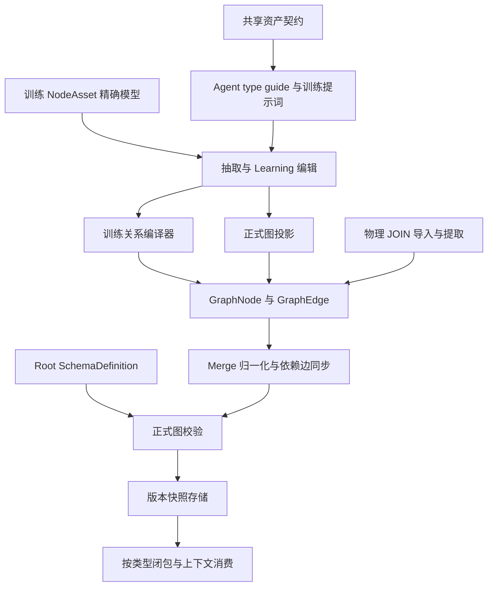

# Ontology 结构盘点与统一定义设计

截至 2026-10-23，基于当前工作区代码。本文区分现有实现与建议设计；新增的 registry、协议和目录尚未接入运行时。已有的 [结构与约束草案](ontology-structure-and-constraints.md) 保留 Constraint 的详细讨论，本文补足类型目录、关系权威来源、维护方式与 Agent 接口。

后续收敛的 [NL2SQL 正式关系与统一管理规范](nl2sql-ontology-relations-v1.md) 是目标关系集合及接入方案的主文档：基础六关系，可选概念结构两关系。本文继续承担代码现状盘点；候选关系及早期建议以正式规范的取舍为准。实现架构最终收敛为 [GraphManager 设计](nl2sql-graph-management.md)：统一 CRUD、校验、原子提交与拒绝反馈；不采用下文早期方案中的 authoring_adapter 注册、行为处理器 registry 或多套投影存储。

## 结论

当前已经有显式图 schema：`SchemaDefinition`、`NodeType`、`EdgeType`。`cortex_root.json` 共声明 12 种节点、17 种边，但这是混合通用定义与兼容定义的 root 目录，不能直接当成 NL2SQL ontology 的类型清单。NL2SQL 的核心节点范围是 table、column、dimension_value、concept、metric、generation_rule。正式图保存 `GraphNode` 与 `GraphEdge`；并不是只保存 refs、消费时再临时猜边。

缺口是没有一个完整的、可供各模块共同加载的 ontology definition。root 定义、训练侧 Pydantic 模型、关系编译器、Merge 同步器、检索策略和 Agent 契约各自承担了一部分定义，维护者无法从单一入口判断某种关系是否可写、如何生成、如何合并、是否会被检索，以及其属性的精确结构。

建议以版本化 `OntologyDefinition` 为统一入口，统一关联精确结构、语义、身份、关系来源、约束和运行能力。业务关系显式选择谓词；公式、绑定和目录事实产生的边按注册规则派生。每项事实只保留一个可编辑的权威表示。

## 现有定义在哪里

下列路径相对于仓库根目录。

| 位置 | 当前职责 | 边界 |
| --- | --- | --- |
| `src/cortex/schema/models.py` | NodeType、EdgeType、SchemaDefinition；端点、继承、identity、方向 | 字段类型只到 object、object[] 等层次，不能描述完整嵌套结构 |
| `src/cortex/schema/roots/cortex_root.json` | 当前全局类型目录、字段、关系语义与端点声明 | 混合当前结构与兼容字段，没有每类能力清单 |
| `src/cortex/schema/roots/loader.py` | 加载 root 或指定 schema 文件 | 加载的是 SchemaDefinition，未聚合编译、检索和 Agent 契约 |
| `src/cortex/schema/graph.py` | 图节点、边、fragment、冲突与状态的数据容器 | 容器本身不执行完整类型校验 |
| `src/cortex/schema/validation.py` | 校验正式图类型、端点、顶层字段、JOIN 列对与冲突 overlay | 不统一执行训练模型的所有嵌套、引用和语义约束 |
| `src/cortex/capabilities/sql_training/models/` | NodeAsset 及各类精确 Pydantic 属性模型 | 训练协议与正式图属性并不完全同构 |
| `src/cortex/capabilities/sql_training/contracts/` | Metric 公式引用、依赖环、Concept grounding 等检查 | 规则在能力包内，未统一注册 |
| `src/cortex/capabilities/sql_training/graph/relationships.py` | 将训练资产引用编译成边，compiler version 为 2 | 谓词选择与端点类型表硬编码 |
| `src/cortex/capabilities/sql_training/graph/nodes.py` | 生成节点和 case 独立 ID，调用 GraphManager 生成、校验关系 | 原 adapter.py 已删除，无兼容入口 |
| `src/cortex/capabilities/graph_merge/edges.py` | 边 identity、归一化、属性变体、定义改变后的依赖边同步 | 再维护一套依赖 → 谓词逻辑 |
| `src/cortex/schema/physical_joins.py` | 物理 JOIN 归一化、完整列对身份、来源及基数合并 | JOIN 是独立关系入口 |
| `src/cortex/capabilities/retrieve_db/closure.py` | 按边类型扩展依赖闭包 | `_POLICIES` 单独硬编码，并非所有已注册边都可被这里消费 |
| `src/cortex/schema/ontology_asset_definitions.py` | Concept、Metric、Generation Rule 的共享语义契约 | 已有契约复用，但不包含完整关系 registry |
| `src/cortex/capabilities/sql_training/learning/tools.py` | `inspect_graph(mode="guide")` 返回精确 schema 和契约引用 | 目前面向三个语义节点类型，没有关系指南接口 |
| `src/cortex/capabilities/graph_merge/llm/prompts/` | Merge 各角色、各类型指导 | 与训练指南分开维护 |
| `src/cortex/infrastructure/artifacts/graph_state.py` | nodes、edges、conflicts JSONL；manifest、schema hash、CURRENT | 存储完整性已存在；hash 不覆盖外部语义契约及编译器行为 |

### 当前维护链路



## NL2SQL 节点范围与 root 声明的区别

NL2SQL ontology 的正式核心只包含下表前六类。example 属于样例与证据层，knowledge_unit、entity、event、process、rule 属于通用 root 声明，不纳入当前 NL2SQL profile。下面保留 root 的全部声明，供审计与迁移使用，不将其等同于产品节点范围。

| 类型 | 含义 | 当前训练侧情况 |
| --- | --- | --- |
| table | 数据库表与目录信息 | 物理初始化；Learning 不可直接编辑 |
| column | 物理字段及所属表 | 物理初始化；Learning 不可直接编辑 |
| dimension_value | 受管理的字段值 | 由值验证和物化链路管理 |
| concept | 原子业务含义及其 source-local 物理表示 | Learning 可创建、更新和回退 |
| metric | 有独立业务名称的完整计算 | Learning 可创建、更新和回退 |
| generation_rule | 使用已有含义和计算的 SQL 生成行为 | Learning 可创建、更新和回退 |
| example | 样例与证据，非 NL2SQL 核心节点 | 有训练模型与 uses 编译分支，应隔离在样例存储与兼容适配层 |
| knowledge_unit | 通用知识，非 NL2SQL 节点 | root 已声明；不在训练 NodeType 枚举中 |
| entity | 通用实体 | 同上 |
| event | 通用事件 | 同上 |
| process | 通用过程 | 同上 |
| rule | 通用业务规则 | 同上；不能与 generation_rule 混用 |

训练枚举还保留 `join_path` 供兼容迁移读取；它不是当前 root 的正式 NodeType。`semantic_mapping` 在枚举中是 concept 的命名别名，持久化类型仍为 concept。

example 的代码支持并非全是死声明：`sql_training/engine.py::_upsert_training_records` 将 QA-SQL 记录包装成 Example NodeAsset 写入训练工作区，adapter 也有投影分支。但在线 `online_context/output/query_examples.py::select_query_examples` 按语义节点的 sources 关联独立 example_index 取样例，不要求 Example 作为正式节点。目标是保留该证据索引与来源引用，将旧 Example 资产留在兼容读取边界；`uses` 不进入 NL2SQL 核心关系集合。

统一定义需要显式的 `nl2sql` profile，限制允许的 node_types、relation_types 与能力。通用 root 中存在一个类型，不代表它可以写入 NL2SQL 图。收紧 profile 前需扫描旧快照并迁移，不能直接删掉样例来源。

这里的 Concept 主要是业务含义与物理绑定，并不是已经建立了客户、订单等实例组成的领域对象图。若未来支持领域实体类型或业务记录实例，需要明确新的模块和实例层语义，不能直接将现有 Concept 解释成数据库中的每一条记录。

## Root 关系完整目录与 NL2SQL 取舍

“非训练编译产物”表示没有在上述 `_declarations` 中生成，不表示所有外部输入都禁止该关系。合法外部图仍可按 root 校验进入。

| 谓词 | 方向与端点 | 准确含义与当前来源 |
| --- | --- | --- |
| belongs_to | column → table | 结构归属；从 Column references 或 ID 回退推导所属表，附带 Table 的时间、键与重要字段标记 |
| value_of | dimension_value → column | 标准值所属字段；从 Value references 编译 |
| joins_with | table ↔ table | 有证据的完整物理等值连接键；独立 JOIN 链路导入、提取，不表达本次 SQL 的 JOIN 类型 |
| aligns_with | table → table | 两侧各自聚合后按共同粒度对齐；非训练编译产物，当前闭包无通用策略 |
| depends_on | metric → metric | 计算依赖；由 Metric references 编译，训练契约要求其与 expression.refs 的引用集合完全一致 |
| computed_from | metric → column | 不可替换的定义依赖；当前训练编译器不生成，检索保留兼容读取 |
| analyzable_by | metric → column | 可分析维度；当前训练编译器不生成，闭包仅在 is_default_time 为真时纳入 |
| filters_on | metric 或 concept → column | 固定业务过滤；当前训练编译器不生成，闭包保留读取 |
| maps_to_column | concept → column | Concept target 的字段端点；从 target.references 编译，保留 target_id 与 binding_operator |
| maps_to_value | concept → dimension_value | Concept target 的值端点；有 Value refs 时选择 Value 端点，支持字段不会全部成为映射边 |
| grounded_on | metric 或 generation_rule → table、column、dimension_value | 物理依赖；由 references 编译，不携带公式角色或查询步骤 |
| applies_to | generation_rule → metric 或 concept | 规则完整定义或适用范围所需的语义资产；由 Rule references 编译 |
| expands_to | concept → metric 或 concept | root 声明的语义展开；当前 Concept 编译器不产生该边，闭包无此通用策略 |
| uses | example → 七类结构化资产或 concept | 示例依赖；从 Example references 编译 |
| broader_than | concept → concept | 直接上位 → 下位；非训练编译产物，`effective_concept_grounding` 提供单父、无环前提下的 grounding 继承读取 |
| related_to | concept 或五类通用知识 → 同类集合 | 有证据但尚不能归类的弱关联；root 要求 reason；不代表任意可执行业务谓词 |
| constrains_metric | rule → metric | 通用 Rule 约束 Metric；非训练编译产物，不能视为完整 Constraint 系统 |

从 refs 编译得到谓词，仅适合已经固定语义的引用槽位。例如公式中的 Metric operand 意味着计算依赖；不能用同样规则解释未来的“指标替代”“指标冲突”。源类型与目标类型相同，并不意味着关系相同。

NL2SQL profile 中：`uses` 属于外部样例证据关系；`constrains_metric` 依赖通用 rule，排除出核心；`related_to` 的通用知识端点不启用。其余关系也需要按当前可生产、兼容读取、候选设计分别登记，不能因两端都是核心节点就默认启用。尤其 broader_than 不应自动意味着绑定继承，expands_to 不应自动意味着节点替换；必须明确语义和已实现能力。

## 现有关系之外还需要什么

17 个 root 谓词不是 NL2SQL 关系的封闭全集，也不是必须全部启用的标准。是否新增关系，要看是否存在独立、稳定、能影响查询解释的事实，而不是看到一个新 SQL 操作就增加一个谓词。

| 潜在知识 | 可能表达 | 建议与边界 |
| --- | --- | --- |
| 业务组成 | Concept → Concept 的 part_of，例如订单行是订单的组成部分 | 与 broader_than 的上下位不同；不自动推导物理 JOIN 或可加性 |
| 不可同时成立的类别 | Concept 之间的 disjoint_with | 有范围、时间、多个参与者时用 Constraint；两个概念不同不足以证明互斥 |
| 带业务角色的关联 | Concept → Concept，例如订单的购买客户、收货客户 | 同类型端点可有不同谓词；通过 binding 关联实际表、键与完整路径，不能只靠边名生成 JOIN |
| 查询粒度 | Metric 的结果按客户、日期等组织 | 优先作为结构化 grain 描述；多维联合粒度不可拆成互不相关的二元边 |
| 计算角色 | 指标的分子、分母、基期、当期、去重键 | 优先保留在 formula/binding 的角色中，由此生成只读关系视图；不要重复手写一套 depends_on |
| 可用维度与时间角色 | 某指标支持哪些分组、采用事件时间还是结算时间 | 审计现有 analyzable_by 是否足够；时间角色与允许聚合方式应有精确属性及范围 |
| 多种物理实现 | 同一含义在多个来源、版本中的落地方案 | 优先扩展 binding 的上下文与选择条件；不把物理实现差异当成新的语义等价边 |
| 特定语境下可替代 | 某指标或概念在给定单位、粒度、时间与口径下可替代 | 若确认是同一身份应合并或维护别名；独立资产仅在明确上下文中声明替代，不建立无条件 equivalent_to |
| 前置条件与禁止组合 | 规则执行要求某项条件、两个行为不能同时应用 | 适用条件与 Constraint 优先；规则优先级须明确同一决策点和冲突语义，不能从共现推导 |

这些是候选设计，尚未在项目中证明为已存在事实。建议首先完善依赖、绑定、物理 JOIN 与适用性的精确结构，再由真实样例驱动 part_of、业务角色关系等扩展。节点合并冲突、版本替换和证据支持分别属于 conflict overlay、生命周期与 provenance，不必全部放进业务关系目录。

### Relation 的维护与扩展协议

1. 类型定义维护 `RelationType`：谓词的准确含义、端点、限定属性、身份、证据、写入所有者、合并规则、消费能力、版本与生命周期。定义通过代码审查发布，Agent 可以提出新类型候选。
2. 图知识维护 `RelationAssertion`：该谓词在具体 source/target 上的断言、适用上下文与来源。显式断言走带 expected_revision 的原子编辑；派生断言仅修改公式、binding 或目录输入。
3. 新增类型时先判断是否已有精确表达：可用属性表达的角色不重复新增谓词，多元联合语义用完整对象表达；独立的新语义才注册新谓词。
4. registry 编译生成校验、Agent guide 与能力目录，并绑定合并、检索等处理器。仅展示的关系可在明确权限下保存，但不能被解释成 SQL 执行依据；可执行扩展须补齐相应处理器。
5. 发布时做快照兼容检查与迁移。改变现有谓词含义属于破坏性变更；旧定义标记 deprecated，保留映射与来源，不以重命名掩盖语义改变。

关系实例可以持续增加，谓词类型通过受控注册扩展；两者分开维护。这样既允许扩展，也避免 Agent 随意创造无法解释或执行的 edge_type。

## 具体问题与影响

### 同一事实跨多个表示时缺少统一所有权

训练 Metric 同时携带 expression.refs 与 references，并通过契约检查两者集合一致；Concept target 也携带 references。正式图投影递归删除 references，但 Merge 的 `content_reference_ids` 和同步逻辑又会读取 expression.refs、references 和 targets 中的 references。

因此不能简单把“正式图以 edges 表示邻接”扩展为“所有结构化引用都可以删除”。公式 operand 与 Concept binding 内的引用还承担解释定义、角色、组合和重建关系的职责。尤其 Concept target 的 supporting Column 不一定出现在 maps_to_* 边中，删掉原引用后无法仅靠端点边恢复完整输入。应将投影与同步的往返一致性列为首个迁移验证点。

### 结构声明与可写协议不同

root 的 Metric 仍声明 filters、default_time、allowed_dimension_refs 等兼容字段；训练 Metric 模型迁移并移除其中部分字段。root 的 expression 和 targets 等为宽泛 object 或 object[]。仅将 root JSON 注入 Agent，会同时暴露过宽结构与旧字段；仅注入训练模型，又无法获知完整图关系和能力。

### 边身份与生成依据不统一

训练编译器以 compiler version、源资产、谓词、目标和全部 properties 生成 ID。Merge 按谓词、端点和 root 的 identity_fields 分组，再区分属性变体。JOIN 另有完整列对身份规则。三者各自有理由，但需要明确“事实身份”“内容版本”“编译产物 ID”的区别，避免把编译器升级误当作新业务事实，或把不同 target 的绑定误当作同一断言。

### 新增关系要跨模块手动维护

修改 root 只让关系在结构上合法，不会自动增加训练可写入口、生成器、Merge 行为或闭包策略。Learning 的编辑协议只有 node asset 操作，没有直接编辑 relation 的操作。当前没有注册新关系后即可贯通各阶段的协议。

### 结构限制、业务约束和推理语义混杂

节点端点限制、Metric 依赖无环、业务数据唯一性属于不同层次。`joins_with.cardinality` 是匹配业务记录的基数信息，不是 table 节点允许多少条边。方向无关也不意味着属性无方向：JOIN 的 1:N 在反转时要变为 N:1。不能因为关系名称或自然语言描述就启用传递推理、删 JOIN 或改变聚合。

## 建议的统一定义

### Definition 与 Graph 分开

`OntologyDefinition` 定义什么可以表达以及如何操作；`OntologyGraph` 保存具体知识与来源。前者随代码与扩展模块发布，后者随知识编辑产生 revision。

```text
OntologyDefinition
  metadata             definition_id / version / content_hash / module dependencies
  node_types           精确属性 schema、identity、语义契约、示例、能力
  relation_types       谓词语义、端点、方向、精确属性、identity、读写规则
  derivations          输入路径、解释器或编译器、输出谓词、版本与重建规则
  structural_checks    结构完整性、引用一致性、依赖环等 checker 绑定
  constraint_kinds     业务约束种类、参数结构与已实现检查能力
  agent_views          按角色生成的指南和工具 schema

OntologyGraph
  definition_ref       id / version / content_hash
  revision
  nodes
  asserted_relations   显式关系事实及来源
  constraints          具体业务约束与作用域
  conflicts            节点或关系的未决差异
  derived_edges        可重建邻接投影，携带 derivation 元信息
```

Constraint kind 是定义；“某业务对象在某范围内恰好关联一个目标”是图中的具体约束。不要将每个数据库的业务限制都塞进公共类型包。绑定可先保留在 Concept target 等强类型内容内；需要独立版本或多方复用时再提升成独立 Binding 对象。

逻辑统一入口可以按文件拆分，建议在 `src/cortex/schema/` 下逐步收拢：

```text
schema/
  definition.py         OntologyDefinition 与 registry 数据模型
  registry.py           加载、链接、校验、冻结与 hash
  types/                共享精确属性模型；训练与正式图的显式投影适配
  definitions/
    core/               节点、关系、语义、示例及模块 manifest
    extensions/         可选领域模块
  derivations/          通用关系编译与版本绑定
  checks/               结构检查器注册
  views/                Agent 指南、工具 schema、维护目录投影
```

复用现有 Pydantic 生成 JSON Schema。模型、语义文本可以分文件，但一项定义由 registry 关联到唯一来源。现有 cortex_root.json 在过渡期保持唯一 root；接入新定义后将它转为兼容导出，不能长期维护两个独立可写的结构目录。

### 每个 NodeType 必须登记

- 稳定 type ID、模块、用途、正反例与生命周期。
- 精确 properties schema；明确 authoring 与 persisted 两种投影，不能混用。
- 身份字段和合并策略；不把业务名称等同于永久实例 ID。
- 结构化引用路径及引用角色，支持 ID remap 与引用检索。
- 可创建、修改、合并、检索、执行的能力与入口；未实现能力明确为空。
- Agent 所需契约与关联 RelationType；区分 Learning 可编辑和仅可读取。

### 每个 RelationType 必须登记

| 部分 | 必填内容 |
| --- | --- |
| 语义 | 稳定 ID、definition、适用与不适用示例 |
| 端点与方向 | source/target 类型集合、directed 或 undirected；反转时属性如何变换 |
| 属性 | 完整 JSON Schema；限定条件与组合标识，例如 target_id、column_pairs |
| 身份 | 哪些限定字段区分事实；哪些属性改变仅产生修订或冲突 |
| 来源 | asserted 或 derived；来源证据；唯一权威输入与编辑所有者 |
| 派生 | compiler ID/version、输入类型和路径、产物更新与删除策略 |
| 合并 | 端点 remap、去重、来源合并、属性冲突、撤销和删除行为 |
| 消费 | 是否为必需依赖、遍历方向、预算、执行语义或仅展示 |
| 能力 | 各角色的读写权限及已实现处理器；不能只有一段说明文本 |

关系的 domain/range 先用作端点合法性限制。inverse、transitive 等推理规则只有绑定了实际实现与检查后才能启用。

### 显式关系与派生关系的边界

| 事实 | 建议权威表示 | GraphEdge 用途 |
| --- | --- | --- |
| Column 所属 Table、Value 所属 Column | 强类型目录字段 | belongs_to、value_of 为投影，检查与字段一致 |
| Metric 计算依赖 | expression.refs；references 逐步改为只读计算结果 | depends_on 与 grounded_on 为依赖索引 |
| Concept 物理表示 | 完整 target，保留表达式、引用角色及组合 | maps_to_* 为端点投影；不能单靠边还原 binding |
| Rule 所需语义与物理资产 | 过渡期明确的 required references；后续需要不同含义时使用有角色的声明 | applies_to、grounded_on 为投影；retrieval triggers 不是必需依赖 |
| 物理 JOIN | 有完整 column_pairs 的显式关系与证据 | 保留组合键整体身份；不是若干独立的单列 JOIN |
| Concept 层次及未来业务关系 | 明确 relation_type 的断言 | 直接存储关系；不从节点类型猜测谓词 |

“显式”不要求 LLM 手写所有边：目录导入、公式解析仍应由确定性代码执行。它要求关系语义与生成规则能从注册定义中查到。

关系断言示意如下，当前 Learning 工具尚不支持此输入：

```json
{
  "id": "relation_instance.revenue_parent",
  "relation_type": "broader_than",
  "source": "concept.revenue",
  "target": "concept.net_revenue",
  "properties": {},
  "sources": [{"source_id": "document.revenue_glossary"}]
}
```

此例使用现有谓词表达概念层次，仍须来源证明。另一个 Concept → Concept 关系可以使用不同的已注册谓词；类型相同只说明端点兼容。所有示例 ID 都是说明用 ID，不是现有图中的资产。

派生边至少关联 `derivation_id`、`derivation_version`、`owner_id`、`input_path` 和 `input_hash`。这类系统元信息应进入统一 envelope 或 sidecar，不能随意塞入现有受限 properties。外部编辑派生边应被拒绝，编辑权威输入后事务内重建；图 revision 与定义版本一致地发布。

## Agent 如何注入和操作

从同一 registry 生成角色视图，保留现有按需读取方式，避免把全库 schema 塞入每轮提示词。

| 角色 | 应收到的定义和能力 |
| --- | --- |
| Extraction / Learning | 当前可写 NodeType 的精确输入 schema、owner contract、可写 RelationType、派生规则说明、最小正反例 |
| Merge | identity 与限定字段、结构化引用路径、remap 规则、重建规则、关系冲突策略 |
| Retrieval / Organizer | 边的准确含义、依赖与关联区别、闭包策略、完整 binding/JOIN 组合、冲突状态 |
| SQL Generation | 相关知识子图、完整业务定义与物理绑定、适用约束；不将弱关联当作计算或 JOIN 指令 |

建议将当前 guide 扩展为 `get_ontology_definition(role, node_types, relation_types, detail)`，返回 definition_ref、精确结构、语义、capabilities 与示例；概览展示全部目录，细节按需读取。这个名称是目标接口，不是现有函数。

图修改协议扩展为带 expected_revision 和 definition_ref 的原子操作：节点编辑、显式关系 upsert/delete、binding 编辑、约束声明。服务端统一校验后计算派生边和闭包差异，再发布新 revision。对 derived 关系只开放其权威输入操作。

Agent 只能使用该角色视图允许的类型和工具。未知谓词可作为 extension proposal 提交，不能静默写入正式图。新关系如果仅支持展示，就应明确阻止其参与自动 SQL 推理；声明一个 schema 并不自动实现相应算法。

## 扩展和日常维护

新增关系应一次提交定义、示例、端点和属性 schema、身份、来源规则、合并/检索处理器或明确的不支持标记。模块使用稳定命名空间和版本依赖。当前 ID 校验不接受点号命名空间；兼容阶段可采用 `sales_has_customer` 等合法 ID，若改成 `sales.has_customer`，须同步升级校验与快照迁移。

启动时加载并冻结完整 registry，拒绝重复 ID、缺失类型、缺失必需处理器、不合法的引用路径与模块版本。schema/definition hash 应覆盖精确模型导出、语义契约和派生规则版本；处理器实现仍随代码发布并记录构建版本。已有 schema hash 的存储检查可以沿用，扩展 manifest 后提供显式迁移入口。

维护视图由定义生成：节点目录、关系矩阵、每类能力、关系来源和约束目录。图画布的每条边可展示谓词、方向、来源、asserted/derived、限定条件及权威输入入口。维护者修改派生边时跳转到相应公式或绑定。

## 迁移顺序和验收

1. **统一目录与能力声明。** 以六类核心节点建立 NL2SQL profile，对 root 的 12 类节点、17 类关系逐项标记核心、外部证据、通用类型或兼容项，关联精确模型与语义契约，登记现有生产者和消费者。此阶段不改变业务含义。验收：目录完整，旧字段与当前可写字段可区分，所有角色读取相同 definition_ref，样例来源仍可追溯。
2. **统一引用与派生。** 合并训练 compiler 和 Merge synchronizer 的规则入口；明确 authoring → persisted 的引用保留策略。验收：Concept supporting refs、组合 target、Metric refs 在投影、合并、重建往返中不丢失；派生集合一致、重复执行幂等；升级编译器不产生重复事实。
3. **显式关系写入。** 先选择已有 broader_than 等范围明确的关系贯通操作、校验、存储与展示；补上层次无环等明确检查。验收：同类型节点之间可表达不同已注册谓词；未知谓词、错误端点和直接篡改派生边会被拒绝。
4. **统一消费。** 从 registry 绑定闭包与 Agent 视图，逐一审计 computed_from、filters_on、analyzable_by、expands_to、aligns_with 的保留、兼容或弃用状态。验收：合法但未支持的边有明确行为；完整 JOIN 键和 binding 组合不会因截断而变义；冲突分支不会被误作同时成立。
5. **业务约束与扩展模块。** 按已有 Constraint 草案补充声明、作用域、来源、检查能力及结果。验收：元数据检查和业务数据检查可区分，unknown 不当成通过；旧快照可以明确迁移并保留来源和未决差异。

优先完成前两步：它们直接解决结构分散和 Agent 注入不一致的问题，也为后续显式业务关系与 Constraint 提供可靠基础。
