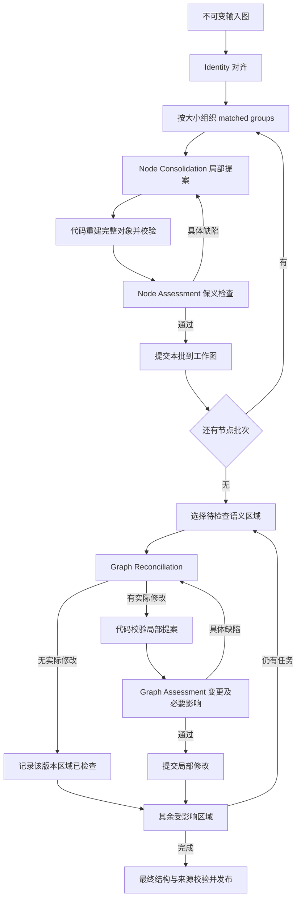

# Ontology 节点整合与关系协调设计 Review 稿

日期：2026-11-16。状态：简化接口和职责指引已接入运行时，当前进行可控回归验证；本轮未启动外部模型实验。

三方向 subagent 审查与修订记录见 [设计审查记录](ontology-merge-content-and-relations-review-notes.md)。案例核对使用已有产物，不等于新版方案已经通过真实模型验证。

## 1 目标与职责边界

Merge 分成两个语义任务：Node Consolidation 完整整合已匹配节点的知识及差异；Graph Reconciliation 在保持这些知识的前提下整理业务关系、层级和关系组。二者都不重新执行 Extraction 的知识真实性评估。

输入节点是合并阶段的知识基准，包括已接受的上游合并结果。不因为原始 SQL 未再次证明某句话，就删除、弱化或改写输入知识。不同输入仍可能冲突；接受输入不意味着把相互冲突的断言作为同时成立的事实。

本文细化 [统一图规范](ontology-graph-design.md) 在 merge 中的执行边界。统一规范继续规定节点和关系的含义、合法表示及新建对象要求；其关于抽取真实性、最小化、错误纠正的要求，不应在 Node Consolidation 中被解释为重新审查所有输入内容。本文获 review 后再同步运行时；历史流程及实验记录不作为本方案已经实现的证据。

| 角色 | 主要问题 | 不承担的任务 |
| --- | --- | --- |
| Identity | 哪些节点表达同一业务身份？ | 仅凭同名、相同字段或邻接结构决定合并 |
| Node Consolidation | 合并表示能否完整表达各输入的知识与差异？ | 重审输入事实，全面优化关系层级 |
| Node Assessment | 合并是否忠实、完整，是否引入错误组合或新断言？ | 重新证明输入 reason、公式或数据库规律 |
| Graph Reconciliation | 已接受知识之间的业务联系与组织是否准确？ | 再做 Extraction、全面补全知识、重写全部节点 |
| Graph Assessment | 本次结构变更是否正确、保义？ | 重查未变节点内容或整张图 |
| 代码 | 检索与作用域、部分更新、引用、事务、来源和格式校验 | 确定性裁决业务 identity、兼容性或属性归属 |

不增加新的 Agent、节点基类、通用约束语言或独立知识审计阶段。不增加 case-specific 代码。示例只解释语义边界，不作为生产规则。

## 2 整体流程与状态



matched-node 任务完成后进入关系阶段。输入图始终不可变；已接受局部修改提交到工作图，不需要等所有图处理完再接受。不直接删除 incoming 原始图，而是记录输入对象到工作图对象或替代结构的对应。

待审提案与已接受工作图分开。工具格式校验通过仅表示 validated，不是语义接受。修复只针对当前候选的具体问题，不能丢失有效待审修改。若已有被拒绝提案仍未解决，空 patch 不表示“无修改通过”；不得把原样重复的拒绝候选反复送评。实际无修改、且没有未解决待审提案时，Reconciliation 不调用 Assessment。

无实际修改指业务节点内容、边、关系组及分支适用范围均未变。已确认同义断言的精确来源并集可由代码维护，不额外增加语义调用；改变分支归属、删除来源或把来源转移到另一断言，不属于机械 no-op。

本稿不改变现有运行轮次约定，不新增模型调用次数上限。失败保留候选、具体原因、日志与来源；未通过不能发布为完成。

## 3 Node Consolidation 的共同判断

### 3.1 内容关系及处理

先接受已确认身份，再比较完整输入及当前候选。关系类型是分析指引，不要求新增逐句标签或额外账本。

| 内容关系 | 处理 |
| --- | --- |
| 同义或重复 | 规范表达、合并来源，保留必要限制 |
| 相容互补 | 按节点类型结合，保留角色、适用范围与内容之间的联系 |
| 明确条件化差异 | 保存真实条件与对应内容；不虚构条件或 else 分支 |
| 适用范围重叠且在重叠部分不相容 | 保存完整 alternatives、原条件、来源及分支关联；不要求两个条件完全相同 |
| 实际业务身份不同 | 返回具体 identity 反例，不强行融合；由既有身份处理机制接管 |

同字段、同 intent、同计算输入、同名称都不是内容等价的证明。某个输入未提及另一输入的限制，不构成冲突。条件不同也不自动消除冲突：case ID、偶然过滤值不能被发明为实现选择条件。

“未规定”以完整节点内容为准，不是某个 description 没有写；已有 expression、action、pattern、匹配表达式可能已经确定了行为。互补结合保留每项原适用范围，不能将局部补充无条件扩大。判断这些内容是否相容，不需要重新验证数据库事实。

### 3.2 保义而非弱化

设输入节点内容集合为 S，合并表示为 M。对每项输入知识 k，M 必须保留其等义表达、适用范围及所属分支；重复内容可共同表达，不要求逐字复制。

\[
\forall k\in S,\quad k\text{ 在 }M\text{ 中具有保留范围、角色和分支的等义表示。}
\]

这是一项语义审查义务，不引入自动定理证明器。不能只用“输入蕴含泛化后的描述”作为通过条件。例如“选择 AdmEmail1”可以蕴含“选择某个邮箱”，但后者丢失具体选择，不是完整整合。

共同内容可以抽取为公共说明，但每个分支的完整含义必须可还原。不能从一个分支取公式、另一个分支取边界行为，再拼成任何输入都没有的实现。不删除不易解释的输入以换取无冲突结果。

保留还包括输入明确声明的配对、依赖和共同条件。分别保留姓名槽位与邮箱槽位，不表示可以任意交叉配对；分别保留选择与布局分支，不表示所有组合都成立。仅检查参与本组整合的必要关联，不引入全图分支组合枚举。

输入中的已有事实不重新认证；合并新增的内容必须能说明是哪些输入的同义改写、互补组合或保义抽象。仅凭“没有反例”不能给合并节点新增独立业务事实。结构阶段的新组织方式另见第 7 节。

### 3.3 名称与内容的共同要求

规范名称代表整合后的业务指代，不按最短、输入顺序或物理列名机械选择。同一对象的名称、identifier 可以是其表示，不必分别建立节点；姓名不自动证明唯一人物，记录键不自动证明业务身份唯一。

允许等义改写 name、aliases、definition、description，但不能改变身份、限制强度或表示角色。来源完整并不等于内容完整；把所有 source IDs 留下来，仍可能丢掉重要条件。

## 4 按节点类型整合

### 4.1 Concept

Concept 整合业务指代、定义及物理匹配方式。

- `targets` 外层每个 item 是一种完整匹配方式；内层多个元素共同参与该匹配。
- 对等义匹配去重，互补匹配保留独立 item。内层组合不能因为并集而改变。
- 保留匹配条件、表示角色及已有 target expression。多个 targets 不表示任选、全部返回、拼接、补空或等价替代政策。
- 名称与 identifier 表示同一业务对象时，可整合到该 Concept；不同业务身份不能因字段重合而融合。
- 真正不相容的匹配要求保留完整分支，不能用 targets 并集隐藏“仅匹配 X”和“仅匹配 Y”的冲突。
- targets 相同也可能存在 definition、时间含义或表示角色的竞争。目标集合无需变化时仍可能需要完整 alternatives；loan-date 示例见第 10.2 节。

示例：管理员的两种联合名称表示。

```json
{
  "name": "school administrator",
  "properties": {
    "targets": [
      ["AdmFName1", "AdmLName1"],
      ["AdmFName2", "AdmLName2"]
    ]
  }
}
```

示例中的字段名是便于阅读的占位符，实际使用物理节点 ID。它不声明两个槽位是同一个具体人物，也不要求同时 SELECT 两组字段。不能将四个字段改成同一个内层 item。

Node Assessment 主要核对指代未变、匹配组边界及条件没有丢失、targets 没有被误解为生成政策。

### 4.2 Metric

Metric 整合的是计算定义。expression、refs、业务量、粒度、范围、单位及输入中已声明的边界行为必须一致保存。这些是语义比较维度，不要求增加一套必填字段。

- 相同计算的等义写法可以规范化，但不能只凭样本近似相等或共享物理输入判为等价。
- 互补说明可结合，例如未规定分母为零行为的定义与同范围下的明确补充；若原定义已经规定不同结果，则须处理差异。
- 不同实现如果有真实条件分界，完整保留条件与实现；没有分界而在同一指标身份下竞争时，保留 alternatives。
- 每个计算分支保留完整 expression、refs、限制及来源；不能像 Concept targets 一样直接合并表达式集合。
- 如差异改变实际衡量的业务量，返回 identity 问题。不能把所有口径差异一律认定为身份不同，也不能一律认定为同指标的实现差异。

示例：A 声明 `eligible / enrollment`，B 对同一计算补充分母为零返回 NULL。先结合 A 的完整公式及已有计算约定确认它没有确定其他行为，才可作为同范围的相容补充；若 A 的表达式已经通过 COALESCE 等指定返回 0，即使 description 未提及，也不能判为“未规定”。比较的是输入计算定义，不重新从 SQL 判断哪个来源更真实。

Node Assessment 检查完整计算定义及差异保存，不重审原公式正确性。代码重映射显式 refs、校验结构；关系阶段仅依据最终公式整理直接依赖。

### 4.3 GenerationRule

GenerationRule 整合的是一个操作决策。condition、action、SQL pattern、reason、triggers 与 operation intent 必须保持对应，不将所有字符串和标签机械拼接。

- 同一选择的等义说明、实现解释可以结合；保留关键实现、条件和限制。
- 两个可同时执行但可独立改变的操作不是同一 Rule 的互补片段。例如字段选择与所选字段的显示布局不能因涉及同一 Concept 就合成一个大 action。
- 适用范围重叠部分竞争的选择保存为完整 alternatives，保留原条件。不能用“选择合适字段”“使用适当 JOIN”掩盖具体实现。
- SQL pattern 中必要的操作和条件必须保留；参数化只能去掉真正可替换的表述，不能把材料性条件当作偶然值删除。
- intent 可以多个；同标签不证明 identity。没有合适标签可表达扩展候选，不为标签改写行为，也不在本任务中扩张 registry 生命周期设计。
- 不重新认证输入 reason 的事实；检查 reason 是否被遗漏或错配到其他 action。合并造成新的内部不一致仍应拒绝。

示例：A 要求选择 AdmEmail1，B 在相同范围要求选择 AdmEmail1/2/3。保存两种完整选择，不能合成“返回所有邮箱”或“按需要选邮箱”。如果只是两种等价 SQL 实现，不因为文本不同就强造冲突。

Node Assessment 关注操作决策与实现差异是否完整保存。只阻止合并新引入的动作混合，不重新执行所有输入 Rule 的最小化审查。

### 4.4 Event 与扩展类型

Event 身份已确认后，可以整合同一事件的互补说明及已有参与、时间、地点信息；保持这些信息关联同一事件的范围和角色。不能将不同事件的时间、对象、地点拼成一个新事件。具体角色关系由 Reconciliation 整理。

不因为日期列、动词或邻居相同就合并 Event。既有 Event 不重做 Extraction 准入；新增或实质重构的 Event 需要满足统一规范的事件结构要求。

扩展类型复用共同保义原则，并依据其类型契约决定如何组合字段。没有契约说明时，不默认数组求并集；本方案不新增 Process、Constraint 等基类。

## 5 Node Assessment 的明确边界

比较完整输入成员与实际候选，必要时查看依赖；不比较 Writer 自述与理想图。只拒绝以下合并缺陷：

1. 原有独立含义、条件、匹配、实现、理由或分支丢失。
2. 互补内容被误判为冲突，或竞争内容被误合为同时成立。
3. 泛化隐藏材料性差异，或组合出输入中没有的业务断言。
4. 身份、表示角色、引用对象或必要依赖被合并改变。
5. 具体分支与来源、作用范围的对应失真。

不因原始 SQL 没有证明节点某句话而拒绝，不要求提供新的数据库探索证明。Input ground truth 是任务边界，不是宣称所有输入相互一致。输入既有冲突完整保留。

当前强制逐 Rule 的 `rationale_checks`、`decision_checks` 应从这类真实性复审改为上述整体整合检查；不要换名后再生成一套逐句检查表。实际输出拟收敛为 `verdict`、`issues`、`issue_refs`，保留已有具体 identity 反例出口。代码决定覆盖哪些组，模型只输出具体缺陷；accept 不需要复述全部原文。

反馈应同时指出输入中需要保存的内容、当前结果的缺陷和真实字段路径。例如节点补充描述是 `description`，边业务说明是 `properties.description`，Concept 定义是 `properties.definition`。缺失证据、表达偏好、未新增可选节点均不是拒绝理由。

## 6 Graph Reconciliation 的常规职责

### 6.1 一个目标和两项核心工作

目标：保持已接受节点知识，整理其业务关系、层级和关系组。只做两项核心判断：

1. 单条业务关系是否准确表达两端节点的联系、主体、方向和范围？
2. 多条关系组合是否重复、不协调、丢失限制或混用冲突分支？

节点知识是判断前提，已有边是可审查的关系表达。纠正旧边须指出其与端点既有含义、关系契约或同范围关系证据的具体不一致。“保留有效关系信息”不要求保留已明确纠正的错误主体或谓词，但要保存原有效联系与来源去向；不能反过来改写受信任节点含义，使偏好的关系成立。

关系重组不要求全图是树、无环、唯一标准图或最少节点。图形信号提示检查，不是修复单位，也不构成删除依据。一个区域应形成一次连贯修改，而不是每个 triangle 单独调用 Writer。

### 6.2 关系契约与代码分工

| 关系信息 | 断言含义 | Agent 边界与代码支持 |
| --- | --- | --- |
| 具体业务谓词 | 在声明范围内，主体与对象具有该业务联系 | Agent 判断归属、方向和含义；不自动推出唯一、必有或传递。has_attribute 是抽象家族，不直接写边 |
| is_a | 同范围可比较类别的集合包含 | Agent 判断真实包含；代码可查结构线索，不能根据图形认定分类成立 |
| grounded_on | Concept 直接物理表示，或 Metric 直接物理输入 | 代码定位 owner 竞争和引用；Agent 仅处理需要语义选择的 owner/组织问题，不重验全部 targets |
| depends_on | Metric 公式的直接语义输入 | 依据既有 expression/refs 校验；代码做声明引用映射，不沿任意路径补业务边，不改公式以迎合边 |
| applies_to | Rule 实际作用对象 | 根据既有 condition、action 与分支判断；不自动触发或沿分类继承 |
| belongs_to / value_of | Column→Table / DimensionValue→Column 的目录归属 | 代码依据 catalog 维护；不是常规 LLM 工作 |
| joins_with | 已确认的完整连接列对 | 保留现有连接事实，不据此判业务 identity 或 JOIN 类型，不在关系整理中重新推断所有 JOIN |
| relation_metadata | 单边无法表达的关系组共同含义 | Agent 保留必要组级语义；代码检查引用、承载类型和结构形状 |

业务边 description 说明当前联系与必要限制，不堆积物理 metadata，不默认携带运行期内部 ID。结构化引用由代码重映射；自由文本中的旧 ID 不能靠全局字符串替换猜测指代。

### 6.3 组织要求的简明形式化

以下条件在同一数据库、适用范围及相容分支下解释。

类别包含：

\[
is\_a(A,B)\Rightarrow Ext(A)\subseteq Ext(B).
\]

Concept 直接绑定 owner 唯一：

\[
\forall p,\quad |\{c:Concept(c)\land grounded\_on(c,p)\}|\leq 1.
\]

后者不禁止 targets 重合，不要求每个 target 都有一条直接边，也不证明竞争 owner 必须合并。需要保留规范 owner、其他 Concept 的匹配含义及业务联系。

可推导冗余的删除条件：设 D 是本次拟删除的断言、R 是已允许规则，则：

\[
\forall a\in D,\quad (G-D)\vdash_R a.
\]

每条被删断言应能由最终保留前提推出，不使用删除项循环自证。默认仅同范围 is_a 具有已声明的传递规则；其他推导必须已有明确契约。重复断言可按同端点业务角色、同含义与同范围合并，不需要另造推导规则。即便可推导，仍须保留材料性限制、来源与消费者必需的直接关联。

普通业务路径不传递属性归属：`School has_administrator Administrator` 与 `Administrator has_email Email` 不能自动推出 `School has_email Email`，也不能仅据这两条边自动否定一个独立成立的 School 联系邮箱关系。

共同行为须在所有相关分支成立；分支专属边保留限定。不能把互斥分支作为同一证明前提。代码可核验 branch ID，Agent 判断公共/分支语义。

### 6.4 relation_metadata

保留现有 `{id, edges, description}` 形状，仅承载于 Concept。它虽然存放在节点上，仍属于常规关系修改，不算节点内容重构。

仅在已有或确有需要表达的多边共同含义时使用；不强制每个邻居组说明互斥、兼容或穷尽。没有互斥声明不等于已证明可共同取值。

边合并、退役、重接后，代码可映射组引用并检查引用有效性；Agent 判断组的主体、方向、谓词、分支相容性和原描述是否仍成立。跨主体移动不能机械复制整组说明。删除组时必须保存它原有的材料性限制，而不是只保存其 edge IDs。

## 7 何时新增或调整节点

### 7.1 默认保持与例外

常规只改 edges、relation_metadata。Concept 的定义/targets、Metric 的计算、Rule 的 condition/action/reason 及完整 alternatives 默认保持。

必要性标准：现有节点不能准确承载需要保留的关系结构，或者有一个明确、有用且保义的共同组织方式。后者是可选优化，不做不能被 Assessment 判错。不得以“更漂亮、更短、更多层级”为理由重写节点。

| 场景 | 允许处理 | 必须保留与检查 |
| --- | --- | --- |
| 名称不准确，但已有指代明确 | 规范 name、aliases 及必要等义说明 | 身份、绑定和业务知识不变；名称属性不能仅靠改名变成属性主体 |
| 必要业务主体缺失 | 新增有有效绑定的主体节点并连接已有属性 | 新主体确有连贯含义；不能建无绑定中间节点只为把图变成树 |
| 多项具体知识具有有用的共同维度 | 复用或新增共同 Concept，重新组织关系 | 保留具体含义及差异，不自动生成 is_a、互斥、穷尽、必有或 Rule |
| 一个节点混合不同业务主体，使关系无法准确组织 | 必要拆分并分配内容、匹配、入出边与来源 | 所有原知识有去向，不能删除难以归属的内容 |
| 局部结构揭示遗漏的同身份节点 | 必要合并，复用第 3—4 节规则 | 不能因相同邻居/字段直接判等；完整保留分支及消费者关联 |
| 节点被等义替代或完整吸收 | 有明确后继时退役节点 | 不是无后继知识删除；保留全部必要关系及来源对应 |

保义命名、引用更新和关系信息迁移只评估实际变化，不触发整个节点重新准入。新增语义节点或实质拆分/融合检查新组织及对应类型要求，包括 Concept 有效非空匹配、Metric 真实计算、Rule 单一操作决策、Event 充分结构。继承内容仍以输入为基准，不因换了节点 ID 就重新认证事实；例如保留原 reason，只检查是否错配到了不同 action。

### 7.2 Specific to general 的边界

例如不同 Concept 绑定同一 column 的不同 dimension values，可以考虑共同业务维度：

1. 先判断这些具体含义是否确实存在共同维度，而不是仅共享存储字段。
2. 先复用已存在的等义 Concept。
3. 必要新增时说明共同含义、有效绑定及组织价值。
4. 根据业务含义选择具体关系；不能默认“值 is_a 维度”。
5. 保留具体条件与分支，不能用一般描述替代具体实现。

归纳主要生成组织方式；不因重复结构生成新的独立事实或生成政策。已存在的局部规则可以通过关系连接到共同对象，但不能仅因对象一般化，就无条件扩大 Rule 的 condition 或应用范围。若必须改变节点内容，仍按所属类型的保义规则检查。

### 7.3 必要重构的执行方式

先定向读取待改节点的完整内容、绑定、分支及受影响消费者，再提交节点与相关关系的一致修改。保持现有局部提案接口，不另加重构审批 Agent。

优先保持 owner 和 alternative ID 稳定。确需替换时，在现有 before/after 对应中明确旧分支的后继，同步迁移相关边的分支范围；多后继不能自动广播作用边或来源。只有在所有保留分支都成立的联系才能成为公共边。代码校验引用与覆盖，Agent 判断语义，不增加全局分支组合系统。

Graph Assessment 对本次重构复用类型保义规则；不额外重跑所有 Node Assessment。根据完整输入可完成、且不推翻已确认分组的等义归并或保义结构拆分，可在本地执行。若推翻已确认 identity 分组，或需要从融合结果猜测已失去的源内容，报告具体 identity 反例；不得仅为消除冲突拆成普通副本。此异常出口不承诺自动历史拆分：若当前实现不能安全重建，则保留现场并停止该批发布。无法在授权范围内完成一致修复时请求必要范围或明确失败，不提交半个重构。

## 8 Agent 输入输出与工具契约

本节的具体工具签名、字段更新、错误恢复及完整交互示例见 [图呈现与工具契约 Review 稿](ontology-merge-tool-contract-review.md)。以下保留阶段分工；具体运行时接口与兼容边界以该文档为准。

### 8.1 Node 阶段

| 项目 | 必需内容 | 按需内容 |
| --- | --- | --- |
| 初始输入 | 已确认 matched groups；完整输入成员及分支；当前对应节点；类型整合指引；来源证据 ID；必要引用映射及输入已有配对/依赖 | 无关邻居详情、原始 QA/SQL、完整字段信息 |
| 修复输入 | 当前候选；未解决反馈及真实当前字段；本组输入知识 | 与具体问题有关的依赖 |
| Writer 输出 | 局部节点更新、必要引用变化、完整 conflicts、结构替代对应 | 新谓词等非本阶段常规操作不主动产生 |
| Assessment 输出 | verdict、具体 issues、issue_refs；既有 identity 反例出口 | 不要求完整图、逐句真伪报告或逐 Rule 原子性清单 |

输入与当前结果必须可区分，但不重复铺开多个相同全图视图。按 matched group 组织比较；相同完整记录可以引用一次，不同版本不得因 ID 相同而省略。原始 QA 用于解释输入歧义，不作为重新否定输入知识的默认依据。

### 8.2 关系阶段

首屏依次提供任务范围、节点 ID/类型/name/aliases 及必要 definition/description、当前边、relation_metadata、必要分支视图与关系契约。节点、边、分支仅携带 evidence IDs；Question/SQL/evidence 正文在末尾集中批量呈现，同一正文不在每条边下重复。只展示与当前判断有关的 Rule condition/action，不默认附全部 targets、公式、理由和来源内部结构。

证据收集必须包括边和分支自己的来源，不能只从节点收集。去重仅改变正文展示，不改变每条边/分支的支持集合，不把区域 evidence 广播给所有对象。新对话重新提供所需正文，同一对话的读取和扩展只追加缺失条目；具体去重与未加载规则见接口稿。

涉及冲突 owner 时，使用现有 resolved conflict view 提供相关分支 ID、实际指代/定义、必要条件及其生效边；公共占位字段为空不表示含义缺失。首屏只展开本次关系判断需要的分支信息，完整公式、绑定、reason 仍按需读取，不默认复制整份 alternatives。

物理上下文只取语义节点直接连接的物理节点，必要时增加其 column、所属 table；不得经 table hub 扩展全部语义邻居。语义区域由代码依变化、连接及信号选择，按内容大小限制，不将整图交给模型。区域不是“一个信号一个任务”。

模型需要检查边界外的具体关系/消费者才能作出完整决定时，定向读取或扩展；读取不授予写权限。不因看见新邻居自动递归扩展。停止条件是当前连贯关系决定所需前提与影响已覆盖；无法容纳完整修复时拆为真正独立的修改或明确范围缺口，不能截断必要依赖。

不对未变版本反复检查同一区域。提交后仅使实际变化及其必要影响范围失效；代码维护对象版本/已检查范围，不靠对话记忆。此处保留现有调度机制，不在本稿引入另一套复杂区域规划算法。

### 8.3 工具与代码

| 类别 | 能力 | 契约 |
| --- | --- | --- |
| 读取工具 | inspect_graph（统一 inspect_items 的读取行为） | 按 ID、视图和实际字段读取对象或邻接关系；分页明确；不因重复一次读取禁止其他必要读取 |
| 读取工具 | read_evidence / read_guidance | 正文批量去重；类型/关系指导提供一次；不借证据读取重审输入节点 |
| 控制器 | 从 Patch 核对范围 | 移除 extend_task；必要上下文直接随拒绝反馈提供，不开放无关邻域 |
| 最终输出 | RelationPatch / BatchResult；Review | 一次返回结构化修改或评审；submit_changes 只是结果传输，不另加提交/finish |
| 提交字段 | conflicts | 完整分支内容及 evidence_ids；未改冲突不重复提交 |
| 提交字段 | retirements / edge_merges | 明确替代或同义关系及后继；代码原子处理移除、引用与来源 |
| 代码规则 | 部分更新、来源维护、机械校验 | 未给字段保留，结构属性整体替换；来源不广播；反馈定位实际字段并说明是否应用 |

当前 Node `BatchResult` 与关系 `submit_changes/RelationPatch` 可暂时保持两个薄接口，不为统一名称大规模重构；部分更新、来源解析、错误反馈和返回状态应复用实现。工具 validated 表示机械通过且尚未语义提交，不能返回含糊的 accepted。

纯关系修改不允许静默夹带 expression、targets、action 等内容变化。代码根据实际 patch 列出变更字段；如触及核心内容，要求现有 explanation 明确结构必要性及保留方式，并扩大本次 Graph Assessment 的受影响对象。代码不靠 explanation 文字判断保义，语义判断仍由评估完成。

默认不使用 resolutions 以“原始知识错误”为由选择某个输入分支。等义重复可归并，合并自己引入的错误可修正；受信任输入之间的真实竞争完整保留。不得把上次 review 的删除建议当作独立依据。

## 9 评估范围与重复修复控制

Node Assessment 审查本批内容整合；Graph Assessment 仅在关系阶段存在实际变更时审查变更及必要影响。

Graph Assessment 只回答：

1. 改后关系是否准确表达端点业务联系、角色与范围？
2. 原有效关系知识、限制、分支及来源是否保留？
3. 如触及节点，是否为必要重构或有用的可选组织，且符合类型契约、保留输入知识？

不能因未做可选归纳而拒绝，也不能顺带重审未变公式、reason 和 targets。原节点内容用于解释端点身份，不是待重新证明的命题。

反馈只针对当前候选。旧输入与旧反馈中的句子不等于当前错误。反馈定位真实字段，说明具体丢失/改变/矛盾，不要求笼统“重新检查所有知识”。修复后不再用旧版本重复拒绝。未改变候选且同一拒绝仍在时明确“无进展”，不无限重复同一次评估。

## 10 端到端示例

### 10.1 管理员

输入：管理员 Concept 有两个联合名称表示；邮箱 Concept 有多个表示；同一邮箱选择 Rule 的来源分别要求第一槽位与多个槽位。

节点阶段：Concept 保留两个独立 targets items；邮箱表示集合不等于 SELECT-all；Rule 保留完整竞争分支。命名选择管理员业务角色，不给姓名添加唯一性。Node Assessment 检查信息保留，不重新从 SQL 验证这些知识。

关系阶段，若现有边把“管理员邮箱”直接挂在 School：

```text
修改前
School ─ has_administrator → Administrator
School ─ has_email_address → Administrator email

修改后
School ─ has_administrator → Administrator
Administrator ─ has_email_address → Administrator email
```

根据邮箱实际含义重接主体，不因图形跨层而删边。不读取和改写所有邮箱选择 Rule。相关来源与分支范围保留。如果 Email 确实表示学校统一邮箱，原 School 联系可能正确，不机械套用本例。

若节点叫 administrator full name，但定义和匹配已经指代管理员，可保义改名；若其实际含义是姓名属性，则不能通过改名偷换主体。必要时新增有绑定的 Administrator，并保留姓名属性关系。

### 10.2 Loan-date 的相同匹配与不同解读

已有 [financial_feedback 产物](../../output/merge_contract_v86/financial_feedback/after.json) 中，同一 loan.date 物理匹配被保存在两个完整分支：来源 113 表达申请日期，来源 116 表达批准日期。targets 相同，description/definition 不同，来源分别保留。

在 identity 已确认、两种解读竞争且没有可靠分界的前提下，应保存：

```text
loan date（共同 targets：loan.date）
  alternative application：申请日期的完整含义；来源 113
  alternative approval：批准日期的完整含义；来源 116
```

另一份已有 [financial_final 产物](../../output/merge_contract_v86/financial_final/after.json) 使用普通节点描述“some queries application date / others approval date”。它保留了两种词语，但在上述前提下没有保留显式竞争与分支使用边界。不能把“某些查询”或 case ID 发明成可执行分界，也不能用“贷款相关日期”消除差异。

Reconciliation 看见公共 definition 为空时，不填一个中性定义来覆盖分支。共同物理绑定可保留；涉及申请或批准角色的关系按已有分支限定，不能无条件同时声明两种角色。并不要求为了表达分支额外创建 Event。

如果输入实际表达两个独立业务里程碑，则不能仅因共享字段强合并，应按 identity 反例处理。这里不推断申请与批准的实际日期必然不同；判断对象是现有解释是否竞争，而不是数据库日期的大小或相等性。

这些历史产物用于比较表示方式，不代表本次已重新运行或确认所有源身份判断。

### 10.3 Card-games 类型关系中的旧 ID

输入边 description 区分 cards.types 的列表成员与 cards.type 的完整可见字符串，却嵌入了一个现已指向 Artist Rule 的旧 ID。实际边端点可能完全正确。

关系阶段保留业务区别，修正无效指代，必要时用业务名称及字段说明代替自由文本内部 ID。代码只重映射声明的结构化引用，不猜测文本 ID。评估只看当前边；旧 archived description 仍有旧 ID，不是修复失败。

### 10.4 Card-games 输入基数与 JOIN 分支

输入节点已经声明“每种语言一条翻译记录”，另一输入未涉及基数。节点阶段保留该内容，不因 SQL 未建立唯一约束而删掉它。如果另一来源在同范围明确声明可有多条，则保存差异或冲突，不选择一个更像数据库事实的版本。

关系阶段可将此已有范围明确的联系组织到合适边或组说明，但不能擅自把它提升成其他对象也成立的全局约束。必要的表达迁移保留来源，避免制造内容重复或信息丢失。

已有 [card_uniform 交互记录](../../output/merge_contract_v86/card_uniform/agents.jsonl) 还出现过删除 id-join 分支、只保留 setCode-join 的提案。对于输入已经保留的这两种竞争实现，不能以“某个 JOIN 更符合常识或 schema”为由选掉另一分支。保留完整实现与其来源，关系阶段维护分支专属 applies_to；即使两个 alternatives 都在，专属边被改成无条件公共边仍是信息丢失。

原始 SQL 可帮助解释已存分支，不意味着允许从未抽取的 SQL 行为补造新 Rule。数据质量问题的独立处置不属于本轮 merge 职责。

## 11 运行时 prompt（单一来源）

完整文本直接维护在源码，不在设计稿复制另一份以免漂移：

- [Node Consolidation](../../src/cortex/capabilities/graph_merge/llm/prompts/incremental_consolidate.md)
- [共享按类型整合规则](../../src/cortex/capabilities/graph_merge/llm/prompts/incremental_content_shared.md)
- [Node Assessment](../../src/cortex/capabilities/graph_merge/llm/prompts/incremental_node_assess.md)
- [共享图与关系规范](../../src/cortex/capabilities/graph_merge/llm/prompts/incremental_relation_shared.md)
- [Reconciliation Writer](../../src/cortex/capabilities/graph_merge/llm/prompts/incremental_relation_write.md)
- [Graph Assessment](../../src/cortex/capabilities/graph_merge/llm/prompts/incremental_relation_assess.md)

运行时另提供任务图、一次类型/关系指引及工具 schema。Node 阶段不拼接旧 Extraction 真伪审计指令；关系阶段只在必要节点重构时读取创建要求。

## 12 实施差异与验证计划

### 12.1 已调整的主要位置

| 位置 | 调整 |
| --- | --- |
| llm/prompts/incremental_consolidate.md | 将真实性纠正改为按类型保义整合；收紧输入冲突选择权限 |
| llm/prompts/incremental_node_assess.md | 删除原事实/理由再认证与输入原子性复审，改为整合缺陷评估 |
| llm/prompts/incremental_writes.md / incremental_evidence.md | 去除与新边界冲突的指导；写入协议不再夹带 Extraction 语义审计 |
| llm/prompts/incremental_relation_shared/write/assess.md | 保留必要关系契约，明确默认节点不变及第 7 节例外；去掉重复与旧字段契约 |
| integration/node_context.py / node_review.py | 以输入组—当前结果比较组织上下文；相关类型指导一次提供；减少默认 QA、registry 与历史反馈重复 |
| llm/incremental.py | 同步 NodeReview 输出与验证器，取消强制旧 rationale/decision 表；统一 validated 未提交语义 |
| integration/relation_edits.py / llm/reconciliation.py | 报告实际字段变化，识别节点内容例外，复用部分更新及来源维护；不新增语义硬编码 |
| 设计文档入口 | 明确新设计与旧实现记录的优先级，避免叠加矛盾规范 |

已复用原有部分更新与来源维护，移除独立范围扩展工具，并按新职责替换运行时指导。旧 checkpoint 的检查字段保留读兼容，但不再向新运行模型请求逐 Rule 真伪/原子性表。语义规则仍需真实模型对照，不能以接口测试代替效果验证。

### 12.2 可控验证

使用固定输入、同一模型配置进行前后对照；先局部再恢复完整任务，不为测试通过手工补充针对性修复反馈。

| 输入场景 | 必须验证 |
| --- | --- |
| 输入基数描述、另一来源无相关说明 | 不因缺少 SQL 证明而删除；如输出自行增强基数则拒绝 |
| Concept 多种联合匹配 | 保留内层组边界、角色和条件，不转化 SELECT-all |
| Loan-date 相同 targets 不同解读 | 完整解释分支与来源保留；公共占位不触发中性定义覆盖；专属关系不变公共边 |
| Metric 相容补充与冲突边界行为 | 相容内容结合，完整竞争计算不被混拼 |
| Rule 相同选择、不同实现 | 完整分支、条件、reason 与来源保留，不用泛化掩盖差异 |
| 管理员属性归属 | 关系重接正确，未变节点内容保持；必要改名不偷换指代 |
| 旧文本 ID 与当前已修边 | 不重复审查 archived 版本，不误判实际端点 |
| 同字段多值与关系组 | 可选归纳不强制；relation_metadata 限制在重构后保留 |
| 无修改、格式失败、重复拒绝 | 无修改跳过 Graph Assessment；格式修复不触发语义重评；无进展明确退出 |

同时验证保存/重载后的节点、完整 alternatives、边范围与精确来源。机械检查只能证明结构与来源记录，不证明内容保义；需比较实际语义结果。

报告每阶段 Writer/Assessment 的模型请求、工具读取、格式重试、语义修复、失败与恢复；完整统计输入/输出/cache tokens 与耗时。未返回 usage 的请求记为未知，不算零成本。没有真实模型对照前，只能报告确定性接口检查结果，不能宣称图质量不降或调用成本已降低。
