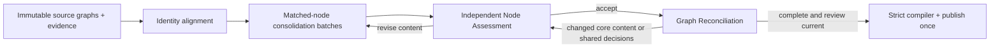

> Incremental execution update: see [Incremental two-stage ontology integration](ontology-merge-incremental.md) for current-relative local submissions, workspace acceptance and one final publication. The descriptions of cumulative source-relative buffering below document the v67 baseline.

# Two-stage ontology graph merge

Date: 2026-11-12. Design and implementation description; live results are recorded separately.

四个管理员案例的真实结果、失败记录与完整成本见 [实现验证记录](ontology-merge-two-stage-validation.md)。该记录区分完整重跑、复用阶段的局部修复与全部开发成本。

## Responsibilities

The production path uses three roles, sharing the existing node/edge schema and read tools:

1. **Node Consolidation** confirms the existing Identity decision and integrates complete matched source versions. Synonyms, complements, supported generalization, corrections and complete competing alternatives remain explicit. Simple groups are packed by source-content size; groups are not mandatory individual model calls.
2. **Node Assessment** independently compares actual merged node content and necessary dependencies with sources. It checks identity, node admission/minimality, complete formulas/actions/alternatives, reasons and preservation. Acceptance applies only to the reviewed version/context.
3. **Graph Reconciliation** inspects and repairs the graph itself. It owns business relation roles, hierarchy, groups, predicate vocabulary, related decisions and preservation. It has no duplicate mandatory Graph Assessment role. Core node/dependency changes return to Node Assessment. Graph-level completion is this role's self-check, not independent proof.

Identity is a prerequisite decision, not an additional new planner. A concrete identity counterexample fails this transaction with its explanation; a changed identity requires source-based reconstruction, never an automatic reverse split of fused text. This first implementation does not provide arbitrary historical rollback.

## Workflow and interfaces

The return destination after a node review is retained: feedback about graph-stage changes returns to Reconciliation rather than replaying all node batches. Exceeding the attempt/call budget produces an incomplete run with saved traces, not a published success.

| Module | Main input | Output | Responsibility |
| --- | --- | --- | --- |
| Identity | Semantic node summaries, retrieval signals, complete members available through tools | `groups`, distinctions, canonical handles | Agent decides same business identity; code checks membership and builds a single-target ID map. Physical overlap is a signal, not identity proof. |
| Node Consolidation | Complete `matched_groups`, source `nodes`, current `candidate_nodes`, incident edges/neighbor directory, relevant physical facts and evidence | Buffered node/necessary dependency edits and source `changes`; `StageCompletion` | Agent classifies compatible descriptions/implementations, generalization and real conflicts. Code packs groups and validates each proposal. |
| Node Assessment | `reviewed_node_ids`, actual current contents/alternatives, original source members, necessary dependencies; `shared_decision_checks` when applicable | `IntegrationReview`: verdict, concrete issue references, preservation/quality/decision checks and per-Rule rationale checks | Independent Agent decides validity; code routes a concrete revision to its owning stage. |
| Graph Reconciliation | Current graph, original evidence, `graph_issues`, `inspection_signals`, prior review feedback | Small cumulative edits, relation contracts, explicit source rewrites; signal dispositions and per-Rule rationale checks | Agent checks role ownership, hierarchy, vocabulary, related policies and supported redundancy, and repairs them. Code supplies signals without prescribing business edits. |
| Compiler/commit | Immutable sources, identity map, accepted cumulative proposal | Final graph, original-node/edge mappings and explicit many-to-many rewrite records | Code checks references, nested content, complete alternatives, source dispositions, and strict graph contracts; publishes once. |

All Agents share the same read vocabulary (`inspect_graph`, `read_evidence`, `read_guidance`). Only the two writer roles receive mutation tools. Neither model output nor a local edit deletes its immutable incoming source graph. A relation reorganization is represented by `changes.before` / `changes.after` with an explanation; it is not forced into a one-to-one edge map.

## State and tools

Sources are immutable. One current graph, a single-target identity map, explicit source-relative changes and one pending proposal are retained. Internal handles are stable for the batch; public IDs and repository state are produced only at final commit. Incoming source objects are not deleted.

Read tools remain `inspect_graph`, `read_evidence`, `read_guidance`. Input and candidate views are explicit; definitions absent from the current conversation are returned again. Physical directories remain searchable rather than repeated in every prompt. Registry guidance is on demand.

Both writers use `submit_edits`: small complete-object edits replace saved edits by object ID; changes replace overlapping source groups only when all previous before elements are covered. New relation contracts cannot overwrite old definitions. A revision number rejects stale repairs. The finish response is only `StageCompletion`, not another copy of the full proposal.

`inspect_pending` distinguishes saved, possibly invalid edits from the last validated graph. Explicit removal controls withdraw obsolete edits, contracts or whole change groups. `write_conflict` accepts complete alternative contents and their sources, and uses the existing lossless factoring API; it never selects a winning meaning or invents missing alternative content. The compiler still validates the resulting conflict and source dispositions.

A failed pending edit is saved for repair but does not replace the last validated candidate. The Agent replaces only faulty objects/changes. Invalid JSON requires resubmitting only that small call. No deterministic business repairs, topology-based semantic decisions or case-specific branches are permitted.

## Checks

All stages reuse three check layers:

- **Nodes/representations:** type, referent, minimality, targets/formula, atomic decisions, Event structure, complete alternatives.
- **Edges/groups:** registered concrete predicates, actual endpoint roles/direction, business descriptions and material evidenced scope, explicit group membership.
- **Cross-object consistency/preservation:** identity, competing decisions, hierarchy, dependencies, supported redundancy and source dispositions.

Evidence, scope and compatible alternatives govern every layer. A source assertion is not independent proof of its own database-distribution claim. Available evidence can be retrieved; no live DB scanning is added.

Shared direct Concept grounding, triangles, same-predicate neighbors and multiple Value Concepts are inspection signals, not prescribed edits. No mandatory Column Concept, Rule, sibling metadata, tree or minimum graph size is imposed. has_attribute is abstract, never a final authored edge.

Source projection differences are also inspection signals: SQL lineage uses the configured dialect and is compared with source Concept bindings even where no selection Rule was extracted. This recall mechanism is not a complete SQL-equivalence checker. Reconciliation records a disposition for each signal. Related policies require an explicit compatible/conditional/conflict/different-decision judgment; a declared conflict must refer to stored complete alternatives. Source case IDs alone cannot supply separating conditions.

When shared policy or necessary dependency context changes, Node Assessment receives the actual affected nodes, original source choices and shared-decision signals. It independently checks them, including every current Rule's reason and unsupported claims. Graph completion does not bypass this targeted review. A target list is available representation coverage, neither a SELECT-all policy nor evidence that an unbound field falls outside the business meaning.

After a revision, Node Assessment additionally receives only the immediately preceding issue list and object references. It verifies the repair against original evidence rather than accepting the previous review as authority. This bounded context avoids losing prior repair requirements without replaying full conversations. A corrected earlier judgment must explain its evidential error; changing Gold-selected subsets does not establish that other physical representations are invalid or require SELECT-all. Concept binding coverage and a positive subset-selection policy are separate judgments.

## Validation and publication

Per-submission content validation checks every edited node and resolved alternative against existing field contracts and nested semantic shapes, including Rule triggers and Metric expression. Errors name the object and content location. Compilation checks explicit source correspondence and references. Intermediate graph compilation permits pending graph-level reconciliation, e.g. duplicate binding owners or old abstract edges; malformed content/unknown references are not silently accepted.

The final compiler runs the original full GraphManager validator and concrete-predicate check, and final commit exports all source mappings/rewrites exactly once. A budget or representation failure never publishes an accepted graph. Code cannot prove business semantics; independent experimental audits remain useful.

Before publication, a source-coverage guard also compares exact SourceReferences: direct mappings preserve their input references, and each nonempty rewrite group preserves their union on its explicitly named results. Empty-after discards remain explicit decisions with immutable originals. The guard reports missing references and never automatically propagates support to unrelated facts. A replacement relation should name its surviving assertion edges rather than only an adjacent root node; reification may require a subgraph. Group coverage is neither pairwise equivalence nor proof that every source supports every result.

## Four-case review expectations (not runtime rules)

Use the unchanged source graphs/evidence for BIRD california_schools 35/36/63/87:

- Administrator name groups may represent the role, without person uniqueness or a primary-slot claim.
- Case 63 already has three name target groups but selects only the first; 36 selects all three pairs as six columns on one row. Targets do not resolve selection policies.
- Case 35 selects Email1 without a separate slot Rule; compare its source Concept/Gold with 87's Email1/2 and paired-column behavior. Split independent obligations only if supported; retain every obligation and repair consumers.
- Email belongs to the administrator role, not to School merely because stored in schools. This type-level organization does not prove Email2 belongs to the person identified by first-slot name.
- Charter number already has chartered-school ownership in the source. Use a concrete supported predicate without inventing totality, uniqueness or exclusivity.
- Preserve real conflicts as complete alternatives and their independent sources; do not preserve unsupported reasons such as primary.

## Observability and cost

Every model start/end/error is immediately written to model_calls.jsonl with episode/call IDs, messages, elapsed time and usage. Stage summaries remain in agent_traces.jsonl. Count usage from one source, not both. Failed stages retain their completed responses. SDK retries without response usage cannot be assigned invented token charges.

The batch has a bounded model-call budget in addition to per-episode limits. Infrastructure errors propagate; they do not restart semantic consolidation. Exact monetary costs require provider cache-token details and a dated price schedule; report measured calls/tokens when unavailable.

Read budgets are enforced at tool execution as well as tool advertisement. Large physical directories and operation guidance are read on demand. Consolidation sees complete matched members and required neighbors; Node Assessment sees reviewed nodes and their relevant sources rather than all incoming seeds. Final stage output contains concise checks, not another copy of the full graph.

For development, `--reviewed-node-stage` explicitly imports a source/schema-identical checkpoint with an actual accepted Node Assessment and recompiles it before use. `--pending-proposal` imports repairable pending work; it is not acceptance. `--feedback-file` records external experimental feedback. These are transparent recovery controls, not default production steps. A warm run's calls exclude its ancestors; report them separately from a fresh end-to-end run.

## Modules

- integration/two_stage.py: checkpointed role sequencing, matched-group packing, actual changes and targeted reassessment.
- integration/submission.py: stable proposal buffering, local replacement, early content checks.
- integration/compiler.py: shared source-relative compilation, final strict validation/publication.
- llm/integration.py and integration/tools.py: role prompts, read tools, buffered submissions.
- llm/trace.py: immediate per-call logging, whole-run budget.
- integration/recovery.py: explicit, source-checked reuse of an independently reviewed stage.
- integration/signals.py: generic recall signals and dialect-aware source projection comparison.
- integration/provenance.py: exact source coverage for mappings and explicit rewrite groups.

The legacy whole-proposal engine remains available to existing ablations/tests; the bootstrap production integration path selects the two-stage engine.

## Provider control correction

The official DeepSeek OpenAI-format endpoint uses `extra_body.thinking.type = enabled/disabled`, not `enable_thinking`. The shared provider now maps the existing enable_thinking configuration to that official parameter for api.deepseek.com; other compatible endpoints retain their previous parameter. This is transport configuration, not case-specific ontology logic. See https://api-docs.deepseek.com/guides/thinking_mode/ . The first v67 live attempt exposed reasoning tokens despite the false setting and was stopped after malformed untyped submissions; its usage remains part of experiment cost. The rerun uses typed GraphEdit/Change tool parameters and the corrected switch.

Thinking-enabled tool conversations retain the provider's `reasoning_content` on subsequent assistant messages. `reasoning_effort` is an optional shared/profile configuration. The v67 low-reasoning experiment overrides only its own config, leaving `.env` unchanged. These controls affect execution and cost; they are not evidence of ontology quality.
