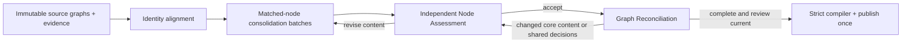

> Incremental execution update: see [Incremental two-stage ontology integration](ontology-merge-incremental.md) for current-relative local submissions, workspace acceptance and one final publication. The descriptions of cumulative source-relative buffering below document the v67 baseline.

> 当前字段、工具与评估执行接口见本文末尾“2026-11-15：真实字段与局部评估执行契约”。

> 2026-11-16：最新职责调整见 [节点整合与关系协调设计 Review 稿](ontology-merge-content-and-relations-review.md)。该稿将输入节点作为 merge 的知识基准，按类型检查保义整合，并将 Reconciliation 收敛到关系组织与必要节点重构。本文下方关于重审源事实、逐 Rule 理由检查及阶段回流的描述保留为历史实现记录，不应与新稿叠加使用；简化接口和职责 prompt 已接入运行时；本轮只做可控回归，尚未做新的真实模型对照。
# Two-stage ontology graph merge

Date: 2026-11-12. Design and implementation description; live results are recorded separately.

四个管理员案例的真实结果、失败记录与完整成本见 [实现验证记录](ontology-merge-two-stage-validation.md)。该记录区分完整重跑、复用阶段的局部修复与全部开发成本。

## Responsibilities

The production path uses three roles, sharing the existing node/edge schema and read tools:

1. **Node Consolidation** confirms the existing Identity decision and integrates complete matched source versions. Synonyms, complements, supported generalization, corrections and complete competing alternatives remain explicit. Simple groups are packed by source-content size; groups are not mandatory individual model calls.
2. **Node Assessment** independently compares actual merged node content and necessary dependencies with sources. It checks identity, node admission/minimality, complete formulas/actions/alternatives, reasons and preservation. Acceptance applies only to the reviewed version/context. Correct Concept targets may overlap: pure direct-edge ownership, parallel assertions, hierarchy and attribute attachment are deferred to Graph Reconciliation, rather than repeatedly rejecting sound node content for an intermediate layout. Incorrect meanings/bindings/formulas, including intrinsic casts or NULL policy, still block node acceptance.
3. **Graph Reconciliation** inspects and repairs the graph itself. It owns business relation roles, hierarchy, groups, predicate vocabulary, related decisions and preservation. It has no duplicate mandatory Graph Assessment role. Core node/dependency changes return to Node Assessment. Graph-level completion is this role's self-check, not independent proof.

Identity is a prerequisite decision, not an additional new planner. A concrete identity counterexample fails this transaction with its explanation; a changed identity requires source-based reconstruction, never an automatic reverse split of fused text. This first implementation does not provide arbitrary historical rollback.

## Workflow and interfaces

The return destination after a node review is retained: feedback about graph-stage changes returns to Reconciliation rather than replaying all node batches. Exceeding the semantic repair rounds or safe request-input budget produces an incomplete run with saved traces, not a published success. Current training jobs do not impose a model-call limit.

| Module | Main input | Output | Responsibility |
| --- | --- | --- | --- |
| Identity | Semantic node summaries, retrieval signals, complete members available through tools | `groups`, distinctions, canonical handles | Agent decides same business identity; code checks membership and builds a single-target ID map. Physical overlap is a signal, not identity proof. |
| Node Consolidation | Complete `matched_groups`, source `nodes`, current `candidate_nodes`, incident edges/neighbor directory, relevant physical facts and evidence | Buffered node/necessary dependency edits and source `changes`; `StageCompletion` | Agent classifies compatible descriptions/implementations, generalization and real conflicts. Code packs groups and validates each proposal. |
| Node Assessment | `reviewed_node_ids`, actual current contents/alternatives, original source members, necessary dependencies; `shared_decision_checks` when applicable | `IntegrationReview`: verdict, concrete issue references, preservation/quality/decision checks and per-Rule rationale checks | Independent Agent decides validity; code routes a concrete revision to its owning stage. |
| Graph Reconciliation | Current graph, original evidence, `graph_issues`, `inspection_signals`, prior review feedback | Small cumulative edits, relation contracts, explicit source rewrites; signal dispositions and per-Rule rationale checks | Agent checks role ownership, hierarchy, vocabulary, related policies and supported redundancy, and repairs them. Code supplies signals without prescribing business edits. |
| Compiler/commit | Immutable sources, identity map, accepted cumulative proposal | Final graph, original-node/edge mappings and explicit many-to-many rewrite records | Code checks references, nested content, complete alternatives, source dispositions, and strict graph contracts; publishes once. |

All Agents share the same read vocabulary (`inspect_graph`, `read_evidence`, `read_guidance`). Only the two writer roles receive mutation tools. Neither model output nor a local edit deletes its immutable incoming source graph. A relation reorganization is represented by `changes.before` / `changes.after` with an explanation; it is not forced into a one-to-one edge map.

## State and tools

Sources are immutable. One current graph, a single-target identity map, explicit source-relative changes and one pending proposal are retained. Internal handles are stable for the batch; public IDs and repository state are produced only at final commit. Incoming source objects are not deleted.

Read tools remain `inspect_graph`, `read_evidence`, `read_guidance`. Input and candidate views are explicit; definitions absent from the current conversation are returned again. Physical directories remain searchable rather than repeated in every prompt. Registry guidance is on demand.

Both writers use `submit_edits`: small complete-object edits replace saved edits by object ID; changes replace overlapping source groups only when all previous before elements are covered. New relation contracts cannot overwrite old definitions. A revision number rejects stale repairs. The finish response is only `StageCompletion`, not another copy of the full proposal.

`inspect_pending` distinguishes saved, possibly invalid edits from the last validated graph. Explicit removal controls withdraw obsolete edits, contracts or whole change groups. `write_conflict` accepts complete alternative contents and their sources, and uses the existing lossless factoring API; it never selects a winning meaning or invents missing alternative content. The compiler still validates the resulting conflict and source dispositions.

A failed pending edit is saved for repair but does not replace the last validated candidate. The Agent replaces only faulty objects/changes. Invalid JSON requires resubmitting only that small call. No deterministic business repairs, topology-based semantic decisions or case-specific branches are permitted.

## Checks

All stages reuse three check layers:

- **Nodes/representations:** type, referent, minimality, targets/formula, atomic decisions, Event structure, complete alternatives.
- **Edges/groups:** registered concrete predicates, actual endpoint roles/direction, business descriptions and material evidenced scope, explicit group membership.
- **Cross-object consistency/preservation:** identity, competing decisions, hierarchy, dependencies, supported redundancy and source dispositions.

Evidence, scope and compatible alternatives govern every layer. A source assertion is not independent proof of its own database-distribution claim. Available evidence can be retrieved; no live DB scanning is added.

Shared direct Concept grounding, triangles, same-predicate neighbors and multiple Value Concepts are inspection signals, not prescribed edits. No mandatory Column Concept, Rule, sibling metadata, tree or minimum graph size is imposed. has_attribute is abstract, never a final authored edge.

Source projection differences are also inspection signals: SQL lineage uses the configured dialect and is compared with source Concept bindings even where no selection Rule was extracted. This recall mechanism is not a complete SQL-equivalence checker. Reconciliation records a disposition for each signal. Related policies require an explicit compatible/conditional/conflict/different-decision judgment; a declared conflict must refer to stored complete alternatives. Source case IDs alone cannot supply separating conditions.

When shared policy or necessary dependency context changes, Node Assessment receives the actual affected nodes, original source choices and shared-decision signals. It independently checks them, including every current Rule's reason and unsupported claims. Graph completion does not bypass this targeted review. A target list is available representation coverage, neither a SELECT-all policy nor evidence that an unbound field falls outside the business meaning.

After a revision, Node Assessment additionally receives only the immediately preceding issue list and object references. It verifies the repair against original evidence rather than accepting the previous review as authority. This bounded context avoids losing prior repair requirements without replaying full conversations. A corrected earlier judgment must explain its evidential error; changing Gold-selected subsets does not establish that other physical representations are invalid or require SELECT-all. Concept binding coverage and a positive subset-selection policy are separate judgments.

## Validation and publication

Per-submission content validation checks every edited node and resolved alternative against existing field contracts and nested semantic shapes, including Rule triggers and Metric expression. Errors name the object and content location. Compilation checks explicit source correspondence and references. Intermediate graph compilation permits pending graph-level reconciliation, e.g. duplicate binding owners or old abstract edges; malformed content/unknown references are not silently accepted.

The final compiler runs the original full GraphManager validator and concrete-predicate check, and final commit exports all source mappings/rewrites exactly once. A budget or representation failure never publishes an accepted graph. Code cannot prove business semantics; independent experimental audits remain useful.

Before publication, a source-coverage guard also compares exact SourceReferences: direct mappings preserve their input references, and each nonempty rewrite group preserves their union on its explicitly named results. Empty-after discards remain explicit decisions with immutable originals. The guard reports missing references and never automatically propagates support to unrelated facts. A replacement relation should name its surviving assertion edges rather than only an adjacent root node; reification may require a subgraph. Group coverage is neither pairwise equivalence nor proof that every source supports every result.

## Four-case review expectations (not runtime rules)

Use the unchanged source graphs/evidence for BIRD california_schools 35/36/63/87:

- Administrator name groups may represent the role, without person uniqueness or a primary-slot claim.
- Case 63 already has three name target groups but selects only the first; 36 selects all three pairs as six columns on one row. Targets do not resolve selection policies.
- Case 35 selects Email1 without a separate slot Rule; compare its source Concept/Gold with 87's Email1/2 and paired-column behavior. Split independent obligations only if supported; retain every obligation and repair consumers.
- Email belongs to the administrator role, not to School merely because stored in schools. This type-level organization does not prove Email2 belongs to the person identified by first-slot name.
- Charter number already has chartered-school ownership in the source. Use a concrete supported predicate without inventing totality, uniqueness or exclusivity.
- Preserve real conflicts as complete alternatives and their independent sources; do not preserve unsupported reasons such as primary.

## Observability and cost

Every model start/end/error is immediately written to model_calls.jsonl with episode/call IDs, messages, elapsed time and usage. Stage summaries remain in agent_traces.jsonl. Count usage from one source, not both. Failed stages retain their completed responses. SDK retries without response usage cannot be assigned invented token charges.

Current training jobs leave model calls unlimited and retain five semantic repair rounds. Temporary transport recovery preserves the dialogue; terminal failures keep the workspace without publishing. Exact monetary costs require provider cache-token details and a dated price schedule; report measured calls/tokens when unavailable.

Identical reads at the same draft revision reuse earlier results; different necessary reads remain available. Large physical directories and operation guidance are read on demand. Consolidation sees complete matched members and required neighbors; Node Assessment sees reviewed nodes and their relevant sources rather than all incoming seeds. Final stage output contains concise checks, not another copy of the full graph.

For development, `--reviewed-node-stage` explicitly imports a source/schema-identical checkpoint with an actual accepted Node Assessment and recompiles it before use. `--pending-proposal` imports repairable pending work; it is not acceptance. `--feedback-file` records external experimental feedback. These are transparent recovery controls, not default production steps. A warm run's calls exclude its ancestors; report them separately from a fresh end-to-end run.

## Modules

- integration/two_stage.py: checkpointed role sequencing, matched-group packing, actual changes and targeted reassessment.
- integration/submission.py: stable proposal buffering, local replacement, early content checks.
- integration/compiler.py: shared source-relative compilation, final strict validation/publication.
- llm/integration.py and integration/tools.py: role prompts, read tools, buffered submissions.
- llm/trace.py: immediate per-call logging, whole-run budget.
- integration/recovery.py: explicit, source-checked reuse of an independently reviewed stage.
- integration/signals.py: generic recall signals and dialect-aware source projection comparison.
- integration/provenance.py: exact source coverage for mappings and explicit rewrite groups.

The legacy whole-proposal engine remains available to existing ablations/tests; the bootstrap production integration path selects the two-stage engine.

## Provider control correction

The official DeepSeek OpenAI-format endpoint uses `extra_body.thinking.type = enabled/disabled`, not `enable_thinking`. The shared provider now maps the existing enable_thinking configuration to that official parameter for api.deepseek.com; other compatible endpoints retain their previous parameter. This is transport configuration, not case-specific ontology logic. See https://api-docs.deepseek.com/guides/thinking_mode/ . The first v67 live attempt exposed reasoning tokens despite the false setting and was stopped after malformed untyped submissions; its usage remains part of experiment cost. The rerun uses typed GraphEdit/Change tool parameters and the corrected switch.

Thinking-enabled tool conversations retain the provider's `reasoning_content` on subsequent assistant messages. `reasoning_effort` is an optional shared/profile configuration. The v67 low-reasoning experiment overrides only its own config, leaving `.env` unchanged. These controls affect execution and cost; they are not evidence of ontology quality.

## 2026-11-15：真实字段与局部评估执行契约

本节规定当前运行时的展示、读取、编辑和评估接口。轻量化通过省略不必要内容实现，不重命名已保存字段。

- 节点使用 `node_type`、`name`、`description`、`properties.definition/action/condition` 等真实路径；关系使用 `edge_type`、`from_node_id`、`to_node_id`、`properties.description/alternative_ids`。不生成派生 `meaning`。未展示的字段不意味着不存在。
- `inspect_items(ids, fields)` 按真实点路径返回嵌套内容；`content` 按需提供完整业务内容，`alternatives` 提供完整展开分支，`evidence_ids` 提供可引用证据。不存在的可选字段通过 absent_fields 标明，不以空值猜测其业务含义。完整物理 metadata 不进入首屏。
- 普通更新只提交实际改变字段。properties 按属性键替换，未提交键保留；expression、targets 和 relation_metadata 等结构属性提交完整新值，不进行隐式深层合并。改变 description 不会替代 definition。
- 工具返回 `validated, committed=false` 和实际字段差异；这只是机械校验，不代表独立语义评估接受。每个完整 conflict alternative 具有完整 NodeContent 与 evidence_ids，代码转换为已有精确 SourceReference；模型不重建内部来源。各分支来源、条件和关系作用域仍必须接受检查。
- Writer 明确 failure 是终止结果，保存已有工作而不重试格式修复。相同候选、证据、范围及契约的已拒绝评估输入不重复调用 Assessment；当前任务标记为未完成，不发布旧候选。真正无修改且没有待拒绝修改时跳过 Assessment。
- Assessment 的 issue_refs 可以用 fields 精确定位实际路径。反馈明确错误或丢失内容、证据与需要修复的关系；不要求评估器写完整 patch，不改变既有冲突判定权限。

Node Assessment 的 matched group 保持完整；消费者按实际受影响对象分片，同一候选保持不可变，所有分片通过后才接受事务。保留目标及其完整来源版本、公式依赖和分支；其他节点是可按需读取的语义背景，不因共享 operand 递归成为新的正式检查目标。背景节点首屏可以省略绑定，物理端点不携带整份 source_metadata；内部图与精确来源仍完整保存。

当前分片目标为每包压缩后不超过 110,000 字符；发送前对系统指令、消息与工具定义统一做 210,000 字符保守检查，包括工具往返新增内容。字符预算是部署保护，不是精确 token 估计或模型调用次数上限。超大不可分单元在发送前明确报错，不截断 evidence、冲突分支或反复提交超限输入。部分分片不通过时整个内容事务仍不发布；已完成局部事务的 checkpoint 保留。

Node Assessment 的额外关系读取按完整对象分页，当前每页约 8,000 字符，保留 next_offset；不要求因存在分页而清点整个 hub。该阶段不重新执行 fuzzy identity candidate 检索；发现具体反例时使用已有 revisit_identity 返回路径。当前工具 schema 仅暴露真实边属性路径，旧扁平调用通过读取兼容层规范化，不在新提示中推荐。

Assessment 的完成条件与图编辑不同：接受需要完整覆盖本片的 decision/reason 检查；已有具体错误且可定位到对象时可以直接 revise，附已完成的检查即可。不能因为拒绝反馈没有填完其他 Rule 清单而把它反复退回。格式修复提示要求修正 review，不使用 Writer 的 remove_edits 等指令。修复后的最终接受仍要求全部必要分片及检查通过。反馈将 issues 与带真实字段路径的 issue_refs 一起传递给 Writer，不丢弃定位信息。

节点写入与评估复用 complete-focus/light-neighbour 输入构造。修复时按原评估 issue_refs 选择直接修复对象及必要 matched groups，代码保留其他组的 aliases、未改内容和 pending edits；不重新提交整批节点内容。共享节点规范在每个包内只渲染一次，写入时保留所需类型字段 schema。额外读取按完整对象分页并限制页大小。

节点整合也使用 evidence_ids 为新的完整 alternative 指定来源；保留已有 alternative_id 时默认继承其精确来源。普通更新在代码中保留已有 SourceReferences，新模型 schema 不要求重建内部来源对象。为避免把只剩一个分支错误写成 conflict，提供 resolutions：Agent 指定已有保留分支并逐个说明其他分支为何错误/冗余；代码展开完整内容、按既有分支语义投影出边并生成来源处置。此操作不得用于消除有证据的竞争实现，独立评估仍检查原始所有分支。被拒绝的新提交原子回滚到上一个有效草稿，已保留的其他局部工作不丢失。

初始 Node Consolidation 的分批同样测量完整输入（节点、关联边、契约与证据），不再只累计节点序列化大小；以 110,000 字符目标为消息、工具和后续交互保留空间，不拆开同一 identity group。分批计划写入 workspace，恢复时复用相同任务编号，避免已完成任务与新分组错位。旧 checkpoint 已有内容任务时保留原分组，不静默重排。当前后台配置不限制模型调用次数；仍限制语义修复轮次为初始一次加五轮，传输重试不充当新的语义轮次。

必要读取不按固定三/四轮禁用：同一草稿 revision 下的相同工具及参数去重，返回 earlier-result 提示；新对象、不同字段、不同分页或修改后的版本仍可按需读取。这样避免在公式修复尚缺字段 ID 时把“读取次数用完”错误表述为“无法表达”。调用次数不设上限，完整请求的输入保护及语义修复轮次限制仍有效；明确 failure 仍退出而不伪装成接受。

共享 node_guidance 显式携带已提供的类型列表，read_guidance 能识别已渲染的共享契约并返回引用，避免合并为单份指导后反而因按类型键查找失败而再次渲染。物理目录工具的 schema 明确 table/column_names 只用于 SQL 表/列；可以从物理列的 grounded_on 邻接查找既有语义绑定，不把 Concept 类型误当表名。

批处理的 SDK 仅作一次内部重试；保持原对话的恢复层处理后续临时错误、Key 轮换及必要的 HTTP 模式切换，调用次数不设额外上限。实验进度页保留所有 HTTP 尝试。长响应可使用流式传输；没有返回 usage 的中断不能推断为零费用。

对象类型与操作的错配在工具边界报错：边内容误放在 create_node/node 时，反馈指明 edits[i]、create_edge/edge 的正确外壳，不提示为边补 node_type/name。反向错配同样定位；代码不静默转换操作或改变业务含义。

节点整合与关系编辑统一支持已有对象的部分更新：只提交 ID 与实际修改字段，代码在当前有效草稿上重建完整对象后校验。properties 按键合并，expression/targets/relation_metadata 等每个给定值整体替换；null 显式移除属性键，未给定则保留。新建仍要求完整对象。机械校验错误明确对象种类、ID 与操作；SourceReference 不由模型重建，edit.evidence_ids 为来源声明，首屏和工具读取使用相同编码以支持去重。

修复反馈与当前值分开：旧反馈只描述旧候选。Writer/Assessment 共享 current_repair_fields，按 issue_refs 的实际路径读取当前对象；冲突属性同时显示各完整分支中的当前值，避免把档案或旧反馈当作当前断言。重复的上一轮反馈不再另放一份。旧 journal 继续按完整属性替换重放，新 journal 标明部分更新语义；恢复不改变历史草稿含义。冲突公共 sources 必须由完整 alternatives 的精确 sources 规范化求并集，不能按普通节点的来源拼接顺序重建。
