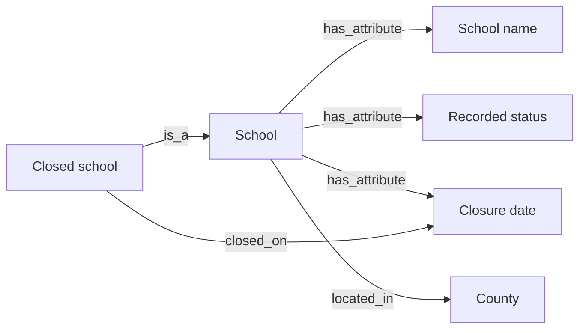

# 两个案例的抽取收敛与用户 review

> 历史实验记录：对应旧测试产物已于 2026-11-04 按用户要求删除；保留本文作为设计与实验历史。当前结果见 [v50 匹配与关系要求](ontology-matching-and-relations-v50.md)及新版 review。

最新规范：v43 统一 Direct/Repair registry，采用有证据的实现决策准入；允许在 condition/action 中提及关联业务对象。case47 新实跑及额外质量复核已完成，最终候选通过 SQL、全图 Assessment 与独立 subagent 复核，详见 [case47 v43 review](ontology-case47-v43-review.md)。下述 v42 及更早结果保留为历史，不代表用户已认可。

日期：2026-11-03。实验仅使用 BIRD california_schools 的 47、49；用户确认通过前不扩大案例范围。单元回归不属于扩大数据集实验。

## 本轮纠正

上一轮把 `closed school count` 视为一个原子 COUNT 指标，标准不够严格。这只是对已定义学校/关闭群体执行计数，不是一个独立定义的业务量；不应作为 Metric。旧评审记录保留为历史，不再代表当前认可的标准。

Metric 的必要条件现在是两项同时成立：独立定义的业务量，以及该量的实际计算。仅有 SQL 表达式、常见聚合函数或业务化名称都不充分。对完整 Concept/Event 做 COUNT、SUM、AVG、MIN、MAX 属于请求操作；增加筛选、grouping 或周期平均不改变这一点。真正业务公式内部可以包含聚合、归一化和必要时间基，不能按函数名硬性禁止，也不能按算术符号数量拆分。

业务群体放在 Concept/Event，生成行为放在 GenerationRule。没有 Metric 是合法结果，不能为了填满类型创建节点。

## GenerationRule 如何抓重点

v43 修订：偶然过滤值、年份、阈值或 K 应参数化；关联业务对象和维度的名称可以帮助明确 condition/action。更换业务绑定需重新检查适用性，不以删除业务名词作为抽象要求。必须有证据支持的、影响语义或结果的实现选择；等价 SQL 写法或普通操作出现并不足以创建规则。

| 可复用决策 | 应保留的核心 | 不应写死的场景 |
| --- | --- | --- |
| 按分组聚合选择领先组 | 先在所需粒度上取得所需聚合，按指定方向及 K 选组，保留组键；区分数量与已有数值 | 特定县、特定状态、固定 K=1 |
| 返回所选组的成员 | 明细来自原受限群体，并受所选组键约束 | 关闭学校、县名、具体输出字段清单 |
| 计数特定非空操作数 | 请求/evidence 确定计数操作数时，保留 COUNT(value) 的 NULL 语义；不自行加 DISTINCT | 把某一个学校名字字段推广成所有学校计数的唯一标准 |
| 投影去重 | 对请求指定的输出元组去重，不假装证明相同标签即同一业务实体 | 固定县、学校名、日期三列 |
| 固定周期平均 | 使用请求/evidence 定义的完整周期数；不换成已观察非空周期数 | 偶然年份、地区参数 |

这张表用于解释通用设计，不作为按案例匹配的生产规则。不得把“最大值”泛化成“必须 COUNT”；已有数值的极值、按组数量比较、返回承载极值的行有不同契约。类似地，请求一个 nullable 字段不自动授权排除 NULL。

具体 case 的 applies_to 边及 description 可以说明实际适用的业务节点、计数操作数等；triggers 可以保留原问题的连续短语。它们不替代通用条件，也不能默默补齐 condition 没有写出的前提。

Direct 与 Repair 使用同一最小性及复用标准。Repair 不等于 error-driven：有的 Repair 由 Assessment 质量反馈触发，没有错误 SQL。旧 `case49_r6` 的 `school details restricted to the closed population` 首次创建在 Direct 阶段，之后的修复没有改变其创建来源。

## 日期、状态和类别关系

旧图的 related_to 是避开错误 is_a 后留下的模糊替代，不能当作理想业务建模。若已知是类别归属，使用 category_of；若没有明确且受证据支持的联系，不能用 related_to 填满图。

新增可复用关系定义 `category_of: Concept → Concept`，源表示类别/取值的业务含义，目标表示所属属性/维度的业务含义。它不同于 is_a，也不同于物理 `DimensionValue → Column` 的 value_of。没有引入新节点基类。

School 的状态、日期、名称等可以作为相互独立的属性挂到受证据支持的业务对象上。不能把 closure date → Closed value → status 强行当作层级链。若起点定义为一个状态取值，边上不能将其悄悄当成携带日期的学校记录。日期与当前状态之间只声明实际证据支持的同记录范围、缺失性和推断限制；不能断言有关闭日期就必然当前 Closed，也不能断言 Closed 必有日期。

## Quality 与 format 的实际验收

格式/字段校验在图写入时由代码执行：节点字段、非空匹配组、合法引用、固定关系端点、description、公式引用和直接绑定唯一性。未通过的编辑原子拒绝。

Assessment 另外逐节点、逐边返回 `quality_checks`，检查清单由节点/边类型确定，与数据库、case ID 和业务字面值无关：

| 对象 | 必查项 |
| --- | --- |
| Concept | type_fit、minimality、grounding、support |
| Metric | type_fit、minimality、formula_scope、support |
| GenerationRule | type_fit、decision_value、atomicity、abstraction、condition_action、support |
| Event | type_fit、structure、support |
| Relation | endpoint_meaning、predicate_precision、scope、support |
| 删除 | removal_safety |

任何一项 invalid，quality 必须 invalid；没有 invalid 但有 inconclusive，quality 必须 inconclusive。清单遗漏、额外项目、子项与总判断矛盾均拒绝。SQL 应用与执行正确性仍独立评价，不能覆盖质量失败。这不是必要知识覆盖率评分，也没有新增探索证据系统。

## 实跑产物

实验输出在 `output/ontology_two_case_review/`。每个 case 的实际节点、显式边、Direct/Repair 记录、Assessment 分项检查及失败历史均保留。这里的自动验收不等于用户已认可；最终候选需展示给用户 review。

## 额度恢复前的运行结论（当时未通过）

仅两例，各 3 轮。轮 1 为 v40；轮 2、3 为 v41 的反事实复用规则。前两轮统一 64k 字符预算，出现 Assessment 上下文不足；去除候选边重复副本后，轮 3 对两例统一使用 96k 预算，没有绕过格式、质量或 SQL 门禁。

轮 3 的真实候选：

| 案例 | 展示快照 | Concept | Event | Metric | GenerationRule | 状态 |
| --- | --- | --- | --- | --- | --- | --- |
| 学校开办 47 | c721a08fb92e4fd89658f220f48a8ec9 | 5 | 1 | 0 | 4 | 未接受候选 |
| 学校关闭 49 | 6ce0f6ad698f4019a900e16fe5e022a1 | 6 | 1 | 0 | 4 | 未接受候选 |

两个候选都通过本地 schema 检查，33 条语义出边均有 description；这不证明语义质量。两张图都没有把简单计数或请求月均包装成 Metric。新增 Assessment 曾实际把轮 1 的月均节点判为 type_fit/minimality/formula_scope invalid，并驱动删除；不是靠代码识别案例后删节点。

但最新模型调用返回 HTTP 402 / Insufficient Balance。开办案例在 Assessment 调用处中断，关闭案例在验证基础设施调用处中断，均没有获得完整最终验收。没有将其记为通过，没有人工改图代替真实模型，也未扩大测试案例。

对保存候选的本地只读复核仍发现问题，详见 `output/ontology_two_case_review/semantic_review.json`：

- 开办图的 has_participant 指向“school name”属性，说明却切换为学校对象身份；应准确表达参与者对象或参与者名称记录。
- 年度筛选 Rule 增加了未经支持的部分日期精度处理承诺。
- 关闭图的 DISTINCT Rule 错误承诺不合并同名同日的不同实体；按输出元组去重无法保证这一点。
- 关闭事件将当前 Closed 状态写成历史关闭事件的必要条件，需要分离当前状态筛选与历史发生含义。
- 非空名称 Rule 与 Concept 自身的非空匹配重复；不能同时当作独立动作，又把同一条件固化为业务对象定义。

关闭图已把状态、名称、县挂在 School，把关闭日期挂在 Event，不再使用旧的 closure date → closed status → school status 弱关联链。开办图实际使用 category_of 表达 Elementary School District 与 district ownership code 的类别归属。后续不应强制两个 case 都采用相同建模形状，而应检查谓词及端点含义。

这些候选需要用户 review，也尚需修复；不能凭“零 Metric”“名字泛化”或 SQL 局部成功判定满意。模型服务恢复前不能完成真实复验，恢复后仍只继续这两个案例，待用户认可后再扩展。

## 本地验证与代码边界

全量回归：845 passed，1 warning；日志 `output/ontology_two_case_review/tests_full.log`。本轮修改文件 Ruff 通过，见同目录 `ruff.log`。

生产路径仅按节点类型、边类型、输入契约及通用质量检查工作，没有按数据库、BIRD ID、表列值或 Gold SQL 字面值分支。SQL 聚合没有被确定性禁止；是否为业务 Metric 仍是语义判断。测试新增了质量子项失败阻止验收、清单遗漏拒绝、边证据无损去重及 category_of 物理端点拒绝。

Assessment policy 的指纹包含 quality_contract.py，避免改变检查清单后复用旧验收策略。格式/质量响应、代码本地测试和真实模型运行结果分别记录。

## 额度恢复后的继续迭代

用户恢复模型额度后，使用公开 resume_case API 恢复检查点，原始失败 workspace 先归档；不跳过源数据、配置、prompt 和策略指纹检查。开办案例恢复并完成 v41 内部验收。关闭案例早先已因 SQL 生成失败回滚到基线，恢复只能验证基线，因此对同一个 case 重新抽取，没有增加第三个案例。

进一步发现 Rule 修复反馈存在歧义：一个规则同时有“冗余字段映射”和“细节过于具体”两个缺陷时，不能仅把措辞泛化就认定通过。因此 v42 为 GenerationRule 单列 decision_value 检查，先判断是否存在独立生成决策，再判断原子性及抽象程度。普通同义词→字段映射不是新规则；列举其他字段也不自动构成有证据的纠错对比。

同样，related_to 不应仅充当两个属性“不同、不能互相推导”的注释容器。此类限制放在有依据的对象—属性联系中；没有正向业务联系时，不为保存注释强建边。真实弱业务关联仍需说明积极的关联含义。

v42 单元回归为 846 passed、2 warnings（54.30 秒）。代码与实验配置没有依据 case ID、表列值、县名或年份选择业务逻辑。新增 decision_value 不会按 COUNT 函数名硬删 Metric，也不会按 Rule 名称硬删节点。

开办图还进行了只读的 v42 复评：复用了精确保存快照及其 SQL 证据，不把新评估冒充旧案例已执行的正式验收。发现计数适用边混淆数值操作数和记录群体后，交给正常 LearningAgent Repair 修改，重新执行 SQL 与全图 Assessment。此流程输出 validated_proposal 供用户 review，不伪造正式 case acceptance。

review 页面展示每条 Rule 首次在 Direct 或 Repair 的保存结果中出现的阶段；Repair 也可能只由质量反馈触发，不自动等于 SQL error-driven。

## 最终交给用户 review 的两个版本

本轮最终状态为“SQL 与模型质量检查通过，等待用户 review”。不是用户已批准，也未进行批量实验或全局 merge。

| 案例 | 最新提案快照 | 节点 | SQL 重放 | 全图分项质量检查 |
| --- | --- | --- | --- | --- |
| 开办学校 47 / case47_r5 | e4f6f9bf271d46e18c4c8a37c7a83339 | 5 Concept、4 GenerationRule，0 Metric、0 Event | 通过 | 通过 |
| 关闭学校 49 / case49_r9 | 4daf9549927149b5a54f9d7fb648e330 | 6 Concept、4 GenerationRule，0 Metric、0 Event | 通过 | 通过 |

这两个版本均为 validated_proposal：正常 LearningAgent 根据具体质量反馈修改已保存的图，再通过实际 SQL replay 和全图 Assessment，不手工重写图，不伪造正式 CaseWorkflow acceptance。先前原生 case 验收与所有失败/中断记录另行保留。

### 关闭学校图的组织

这些边直接来自实际模型提案。Closed school 的匹配只要求记录状态 Closed，不把名称或关闭日期非空写进群体定义。closed_on 的 description 明确：名称及关闭日期可以缺失，仍属于已关闭群体；County/StatusType 本身的非空属性不被这一限制否定。日期属性存在也不意味着当前状态一定 Closed。

没有 closure date → closed status → status 的 related_to 兜底链，没有 closed-school-count Metric，没有重复 Concept 字段绑定的 Rule。

四条规则分别为：指定操作数的分组计数、按所需度量选择 K 个组键、请求输出元组去重、只在要求呈现名称标签的列表中排除缺失标签。前三条首次来自 Direct；名称缺失规则源于实际 SQL 错误诊断后的 Repair。它不排除其他可空输出属性，例如关闭日期，也不改变计数群体或排名。

K 由请求或已解析上下文提供，不由 most 自动发明默认 K=1；源案例需要一个组键的行为保留在实际 case 上。去重只保证输出元组唯一，不保证不同实体在投影值相同的情况下仍保持分离。

### 开办学校图的组织

记录名称、日期、县、ownership code 等为 Concept；Elementary School District 通过 category_of 指向 district ownership code。没有把 COUNT(School)/12 包成 Metric，也未保留无法充分锚定参与者的 Event。Event 的存在仍由结构证据决定，不是禁用 Event。

四条规则是计数汇总、指定属性操作数及 NULL 语义、年度时间范围、完整年度计数的月均归一化。计数边明确绑定非空学校名称值，不能称其为记录总数或唯一学校数；缺少标签不证明实体不存在。这里的 12 是完整日历年的固有月份数，具体县名、年份属于运行时输入。

建议用户重点 review：计数汇总与操作数/NULL 两条规则是否还应合并压缩，以及名称标签列表的适用条件是否足够明确。原始生成文本全部保留，不通过后处理美化成预定答案。

### 查看材料

本地页面：http://127.0.0.1:8768/index.html 。包含完整交互图、语义 JSON、匹配、全部边描述、规则首次出现阶段、逐节点/逐边 quality_checks、逐轮反馈及失败历史。主评审记录为 `output/ontology_two_case_review/semantic_review.json`，不是用户批准记录。

最终本地回归仍为 846 passed、2 warnings；本轮文件 Ruff 通过。后续仍只围绕这两个案例根据用户 review 迭代，获得用户认可后才扩大数据集测试。

## v43 最新展示

本次只重跑 case47。展示 case47_r8 revision `36397aef7b8e4174a2bfb3a1a226047f`，7 Concept、1 Event、2 Rule、0 Metric，28 个评估单元全 valid，连续两次 replay 正确，独立 subagent pass；为已验证、待用户 review 的提案，未执行 merge。case49_r9 是历史候选，本次未重跑。详见 [完整记录](ontology-case47-v43-review.md)。
