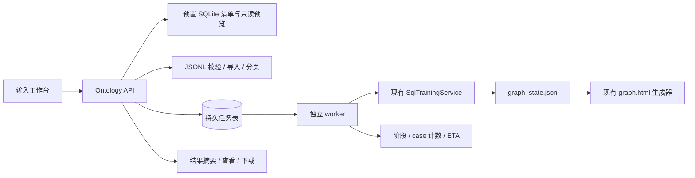

# Ontology 输入到结果的网页设计方案（待 Review）

> 此早期设计已被用户后续要求取代。当前实现为完整前端内的图谱视图，下载 PNG/SVG 图片并支持 Graph JSON 读入；sql-train 已接入真实 CLI，首批使用 1–2 case，持久化统一为 SQLite。请参阅 [实现与启动说明](ontology-web-implementation.md)，下文保留作设计历史。

更新日期：2026-10-25。本版按用户最新范围收敛，替代此前的 React 图谱组件迁移、增量合并 UI 和复杂版本发布方案。当前仅更新设计，尚未实施业务代码。

## 1. 本次重点与已有能力

本次实现一个完整流程：**选择预置数据库 → 查看数据库 → 上传并导入 NLQ–SQL pairs → 预览 pairs → 开始构建 → 查看进度和预计剩余时间 → 打开图谱 / 下载文件**。

图谱展示直接复用现有 `graph.html` 生成器，主要调整颜色与视觉风格。保留现有布局、搜索、筛选、平移缩放、关系子图和冲突详情，不迁移为 React 图谱组件，不更换图形库。第一版每次构建产出独立结果，不加入增量合并选择、手动改图或冲突裁决的产品流程。

已读到的代码：

| 部分 | 证据与结论 |
| --- | --- |
| 集成系统 | `/Users/yichendezaizai/CodeBase/DataMosaic` 实际为 DocSensaAI 集成仓库，门户是 React 18 + TypeScript + Vite + 自定义 CSS，已有侧栏与浅/深色主题 |
| DocPilot | 已获取 `module/DocPilot` 固定提交 `31fcabac18207a1711628b548bb0507cb4f07e9f`，参考 `demo/chat/frontend/src/App.tsx`、`styles.css`、`api.ts` 与后端 `main.py` 的工作区、上传状态、FastAPI 组织 |
| ontology 生成 | `src/cortex/application/sql_training.py` 提供同步 `SqlTrainingService.run()`，包含训练、Graph Merge、结构校验及保存 |
| 图谱展示 | `src/cortex/infrastructure/artifacts/graph_html.py` 提供 `render_graph_html()` / `write_graph_html_from_json()`，输出包含数据和 Canvas 脚本的离线 HTML |
| 数据库 | Cortex 已支持 SQLite / MySQL；本轮按用户的 database files 需求，优先支持预置 SQLite 文件 |

DataMosaic 引擎子模块的固定提交不可获取，数据库管理 API 尚未核实。**本轮通过服务端预置数据库文件独立完成闭环，无需等待该接口**；未来再将目录来源扩展为 DataMosaic 的数据库。DocPilot 已可通过本机 Git 访问，不需要额外登录操作。

## 2. 页面设计

### 2.1 主页面 `/ontology/`

沿用门户 Shell，侧栏新增 Ontology。主体采用输入工作台：左侧数据库区，右侧 pairs 与构建区，底部展示当前任务和最近结果。

```text
┌─────────────┬───────────────────────────────────────────────────────────┐
│ Overview    │ Workspace / Ontology                                     │
│ Analyze     │ Build ontology from question–SQL examples                 │
│ Extract     ├─────────────────────┬─────────────────────────────────────┤
│ Ontology ●  │ 1. Database         │ 2. Question–SQL pairs               │
│             │ [sales.sqlite ▾]    │ [上传 JSONL]  filename.jsonl        │
│             │ 简介 · 4 tables     │ 校验结果：128 条有效 / 0 条错误      │
│             │                     │ [导入 pairs]                        │
│             │ Tables              │                                     │
│             │ orders ●            │ #    Question           SQL         │
│             │ customers           │ 1    Total revenue?     SELECT ...  │
│             │                     │ 2    Top customers?     SELECT ...  │
│             │ [Schema | Data]     │ ... 分页 / 展开完整 SQL             │
│             │ 字段、类型、主外键   │                                     │
│             │ 或选中表的数据预览   │ 128 pairs imported  [开始构建]      │
│             ├─────────────────────┴─────────────────────────────────────┤
│             │ 3. Build                                                 │
│             │ 学习与验证 · 已处理 38/128 · 已用时 ... · 预计剩余 ...     │
│             │ 最近结果：sales · 完成 · [打开图谱] [下载 Graph JSON]      │
└─────────────┴───────────────────────────────────────────────────────────┘
```

左右分栏可按可用宽度调整，窄屏改为上下排列。默认浅色工作区，沿用 `#1e4863` 主色、浅灰背景、白色面板和现有字体；深色模式继承门户主题。

### 2.2 选择并展示数据库

由开发者/部署者提前放入若干 `.sqlite` / `.db` 文件并登记，用户进入页面即可选择。数据库清单包含稳定 ID、显示名称、简介与服务端路径；浏览器只使用 ID。具体预置哪些数据库可在实施时从已有数据中选取，不在设计阶段假定文件已经存在。

选择后展示：

- 数据库名称、简介、文件大小、表数量。
- 表列表；点击表后在 Schema / Data 两个 tab 间切换。
- Schema：字段名、数据类型、是否可空、主键、外键及指向关系。
- Data：只读数据表格，默认每页 20 行，支持分页；不增加任意 SQL 执行器。

数据库文件由后端只读打开；分页表名必须来自该数据库的真实 catalog，不能将客户端字符串直接拼进 SQL。大表不自动做昂贵的全表 COUNT，可用“下一页”模式。BLOB 显示占位，长文本截断后展开。

切换数据库时清空当前待导入/已导入 pairs 与当前构建配置；保留历史任务，并可按数据库查看。正在运行的任务继续绑定原数据库，不随下拉框切换而变化。

### 2.3 上传、导入并展示 pairs

文件沿用此前要求的 UTF-8 JSONL，每行一条记录：

```json
{"question":"What is total revenue?","sql":"SELECT SUM(revenue) FROM orders"}
```

`source_id` 和 `evidence` 可选；无 source_id 时按行生成稳定 ID。接受明确的 `NLQ` / `nlq` → question、`SQL` → sql 别名；多个别名同时出现且不一致则报错。

交互区分两个动作：

1. **上传并校验**：上传文件，服务端解析并暂存，返回文件名、有效/错误条数、样例与逐行错误。
2. **导入 pairs**：仅全量校验通过后可点击，将该文件绑定到当前选中数据库，展示已导入的分页记录列表，并启用“开始构建”。第一版每次导入使用一个文件，重新导入替换当前选择，不静默追加。

展示 question、格式化 SQL、可选 evidence；点击行展开全文。错误标注真实文件行号，支持修正后重传。校验包括 JSON 格式、对象类型、非空字段、重复 ID、字节/记录上限；带 db_id 时必须匹配选中数据库。不将“结构校验通过”表述成“SQL 正确”，SQL 验证仍属于构建流程。

上传/导入失败不触发模型调用。未选择数据库、无已导入 pairs、服务配置不可用或提交进行中时，开始按钮禁用并说明原因。

### 2.4 开始构建、进度与估时

点击“开始构建”后创建持久任务并立即返回 run_id；页面展示当前阶段、进度、已用时间与预计剩余时间，允许离开后重新打开。重复点击使用幂等键去重。

阶段设计：

| 阶段 | 页面显示 |
| --- | --- |
| 排队 | 排队中、等待时间；不把等待计入模型运行速度 |
| 准备数据库与结构 | 当前阶段、不定进度、已用时间 |
| 学习与验证 pairs | 已处理 X/N、处理中数量、SQL 验证通过/未通过数、已用时间、预计剩余时间 |
| 合并 ontology | 当前阶段；能取得真实组计数则显示 X/Y，否则不定进度 |
| 保存结果 | 写入并校验 Graph JSON、HTML、报告 |
| 完成 / 完成但需检查 | 完整结果摘要、打开与下载操作 |
| 失败 / 中断 | 原因、已完成数量、重试入口；不显示成功图谱链接 |

**进度以真实阶段和计数为主**：N 个 pairs 处理完不等于整个任务完成；合并与导出未结束时，不显示总体 100%。第一版不提供基于固定阶段权重的虚假精确百分比。

**预计时间实现**：

- 提交前：若有相同模型配置、相似数据库结构与 pairs 规模的历史运行，显示历史统计得到的时间区间，并标注“预计”；无可比数据时显示“首次构建，运行后估算”。
- 学习阶段：积累至少 3 个 case 完成事件且已有有效观察窗口后，基于最近窗口的实际完成吞吐（完成数 / 墙钟时间）估算剩余学习时间，正确考虑 case 并发；不直接累加单个 case 耗时。
- 总剩余时间还需计入合并/保存的历史时间区间；缺少数据时标注“学习阶段预计剩余 ...，合并时间待估算”，不将局部估计误写为总 ETA。
- 每 5–10 秒平滑更新范围与 estimate basis；模型重试、吞吐变化时允许上调。长时间无新完成事件时扩大不确定性或显示“正在重试/耗时较长，重新估算中”，不机械倒数到零。
- 页面每 2 秒轮询任务；ETA 在后端计算，刷新页面后保持一致。上述阈值是实现初值，可根据真实运行调整。

### 2.5 结果区与展示页面

任务完成后直接在主页面结果区展示：数据库名称、输入 pairs 数、SQL 验证结果、节点数、边数、冲突数、开始/完成时间与总耗时。SQL 验证失败数和图谱冲突数分开显示，不能将有效图谱等同于所有 case 均通过。

主要操作：

- **打开图谱**：当前标签页跳转到 `/ontology/runs/{runId}/graph`，直接展示该 run 生成的 graph.html。
- **下载 Graph JSON**：下载原生 `graph_state.json`，包含 graph 与 node_conflicts，不只下载可视化节点列表。
- **下载 HTML**：下载包含内嵌数据的独立 graph.html，可离线打开。

图谱页增加轻量“返回构建页”和下载入口即可；返回时恢复所选数据库和任务。最近结果列表按数据库展示历史构建，避免一次刷新丢失产物入口。若存在可用图谱但部分训练未通过，显示“已生成，部分样例需检查”，仍允许查看和下载该 run 的真实结果。

## 3. graph.html 的调整边界

直接修改现有 `src/cortex/infrastructure/artifacts/graph_html.py` 的模板样式，继续通过原有生成函数输出在线与下载文件。

1. 将 CSS 中的背景、面板、文字、边框、按钮、标签、冲突状态颜色收敛为主题变量，映射到门户的浅/深色视觉。
2. Canvas 内同样存在硬编码深色背景、标签描边、边和选中颜色；这些也要改为主题 palette，不能只改 CSS 导致浅色背景上的标签不可读。
3. 保留节点类型的稳定颜色，可针对浅色背景调对比度；冲突继续用醒目的颜色和文字标识。
4. 页面初始主题读取同源 `docsensaai-theme`，也支持显式 theme 参数；离线文件无存储或参数时使用内置默认主题，不能依赖在线 CSS/JS 才能打开。
5. 返回链接通过已校验 run_id 生成；在线增加少量导航操作不重做图谱布局。下载 HTML 的在线返回入口可隐藏，保留图谱本身全部离线功能。

**本轮不做**：React 图谱重写、新布局算法、服务端图谱分片/邻域 API、新的来源浏览器。现有核心视图节点限制与全量数据加载行为保留，并通过实际样例检查性能；超大图优化另行评估。

## 4. 后端结构与 API

前端在集成门户 `web` 新增输入工作台。后端使用独立 FastAPI + worker，直接调用 Cortex，不修改 Extract 引擎。浏览器使用同源 `/ontology/api/`。



以下都是建议新增契约，不是现有 API：

| 方法与路径（浏览器） | 用途 |
| --- | --- |
| `GET /ontology/api/databases` | 预置数据库清单 |
| `GET /ontology/api/databases/{id}/schema` | 表、列、主外键元数据 |
| `GET /ontology/api/databases/{id}/tables/{tableId}/rows?offset=0&limit=20` | 只读分页数据 |
| `POST /ontology/api/training-files` | multipart 上传与校验，返回 file_id、摘要与错误 |
| `POST /ontology/api/imports` | `{database_id, file_id}`，生成绑定后的 import_id |
| `GET /ontology/api/imports/{id}/pairs?offset=0&limit=20` | 展示导入 pairs 与总条数 |
| `POST /ontology/api/runs` | `{import_id}` + Idempotency-Key，返回 202 / run_id |
| `GET /ontology/api/runs/{id}` | 状态、阶段、计数、时间、ETA、结果链接 |
| `GET /ontology/api/runs?database_id=...` | 最近任务/历史结果 |
| `GET /ontology/api/runs/{id}/graph` | 返回主题适配后的 HTML |
| `GET /ontology/api/runs/{id}/download?format=json|html` | 带 Content-Disposition 的文件下载 |

`/ontology/runs/{runId}/graph` 是用户友好的展示 URL，可代理到对应 HTML 响应；不能让门户 SPA fallback 吞掉此路径。所有资源从 run_id 解析到服务端受控文件，不接受任意文件路径。文件名包含数据库显示名的安全版本和 run_id。

任务响应包含：`status, phase, pairs_total, pairs_completed, pairs_running, passed, failed, started_at, updated_at, elapsed_seconds, eta_seconds_low, eta_seconds_high, eta_scope, eta_basis, result, error`。ETA 未知时为 null；result 仅在产物完整时包含节点/边/冲突计数与链接。

## 5. 执行与存储

### 5.1 预置数据库

增加服务端 registry，例如 `configs/web_databases.yaml`，配置 ID、名称、简介、相对文件路径，可选同库 pairs 示例文件。路径相对于明确的数据根目录解析；开发者预导入后启动时检查文件有效性与 catalog。第一版不要求普通用户上传数据库文件。

预置数据库作为不可变输入，预览和训练均使用同一内容指纹；训练只读。若后续允许数据库文件被后台更新，使用 SQLite backup API 获取一致性快照，而非复制可能有 WAL 的活动文件。

### 5.2 复用训练流程

worker 为每个 run 创建独立工作目录与空 graph repository，再调用 `build_sql_training_service()` 和 `SqlTrainingService.run()`。选中数据库的路径、验证 dialect 和工作目录通过任务级配置传入，不能修改共享配置文件或混用其他数据库。

当前 pipeline 没有完整网页进度协议，需要在准备、case 完成、合并和产物写入边界新增可选 progress observer；CLI 不提供 observer 时维持原行为。observer 只上报事件，不改变训练逻辑。外层 runner 校验并保存报告，调用现有 HTML 导出函数。

预置 SQLite 与训练验证 dialect 必须一致；模型、embedding 和 Graph Merge SQLite checkpoint 配置在后端预检。缺少必要配置时，在开始构建前明确报错。

### 5.3 持久化任务与产物

任务元数据使用 SQLite；Graph Merge 使用官方 SqliteSaver。每次网页训练拥有独立的 checkpoint 文件。API 管理真实 CLI 子进程并记录心跳，服务重启将未完成任务标记 interrupted。

同一数据库第一版串行构建；全局任务并发与 pipeline case 并发共同限制。API 重启不停止独立 worker；worker 中断后通过租约过期标为 interrupted，前端提供新任务重试。第一版不承诺 checkpoint 级自动续跑。

每个 run 保存规范化输入、数据库指纹、脱敏配置指纹、训练报告、case/evidence、graph bundle、`graph_state.json` 与 `graph.html`。写入并校验产物完成后才标记结果可用；历史任务不覆盖。failed 不提供错误的成功链接，needs_review 有完整且通过结构校验的结果时可打开并下载。

## 6. 系统集成与代码位置

- 集成仓库 `web/src/features/ontology/`：DatabasePanel、PairsImportPanel、PairsTable、BuildProgress、BuildResult 与 api/types；公共导航复用门户。
- ontology 仓库增加 HTTP 接口、数据库 registry/只读预览、输入导入、任务 runner、进度/ETA 模块；训练能力不复制。
- 现有 `graph_html.py`：仅主题 palette、样式和必要导航改动。
- `web/nginx.conf` 与 `web/local-server.cjs`：新增 API、graph HTML 展示与门户页面路由，匹配优先级一致。
- Compose 与本地启动脚本：新增 ontology API、SQLite 持久化目录配置、只读数据库数据目录和持久产物目录；不依赖开发机绝对路径部署。

## 7. 实施顺序与验收

1. 接入预置数据库、schema/数据预览，完成选择数据库的页面。
2. 完成 JSONL 上传校验、显式导入和 pairs 分页展示。
3. 接入真实训练任务、阶段/case 进度、耗时统计与 ETA。
4. 结果摘要、跳转现有 HTML、JSON/HTML 下载与配色调整。
5. 门户代理、本地与 Docker 启动、实际小数据端到端验证。

验收重点：数据库与 pairs 绑定正确；错误输入不能启动构建；页面刷新后可找回任务；进度来自真实事件且 ETA 能说明估算范围；失败可见；图谱 JSON 与 HTML 内容一致；下载 JSON 保留冲突；HTML 在线/离线均可用且浅/深色文字清晰；原数据库无写入。

本版待 review 的核心是输入工作台布局与交互。预置库具体名单、默认 limits 与 ETA 展示文案可以在实施时依据实际数据配置，不阻塞该方案。
